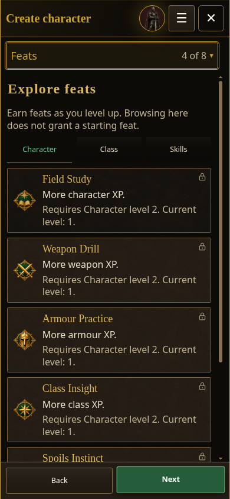
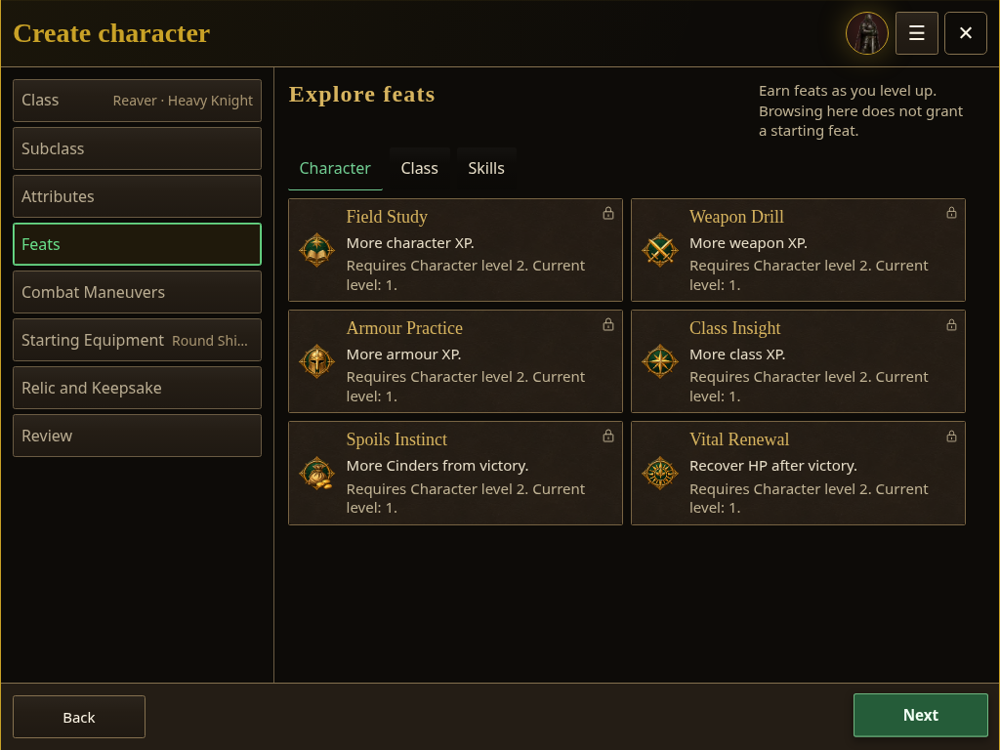
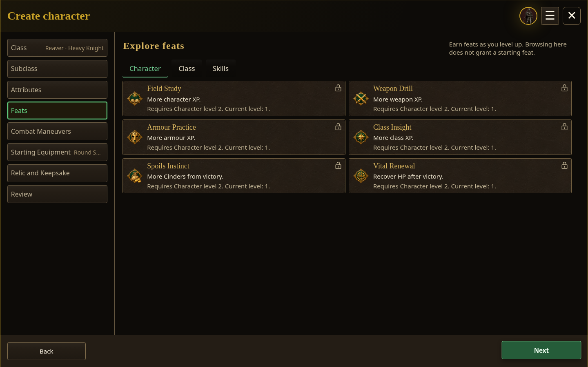
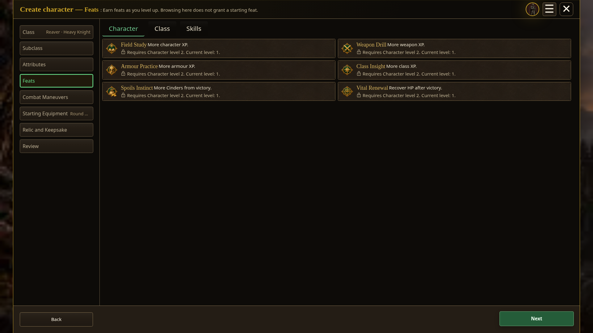
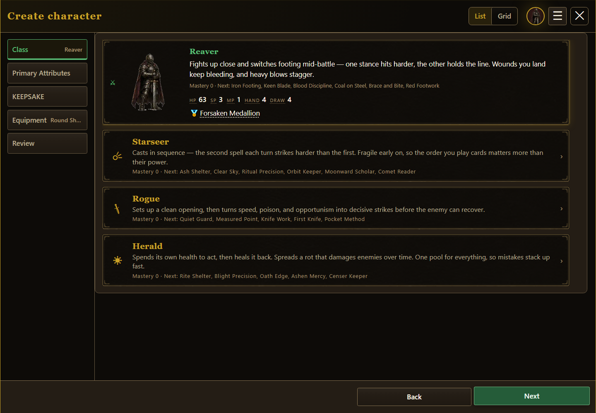
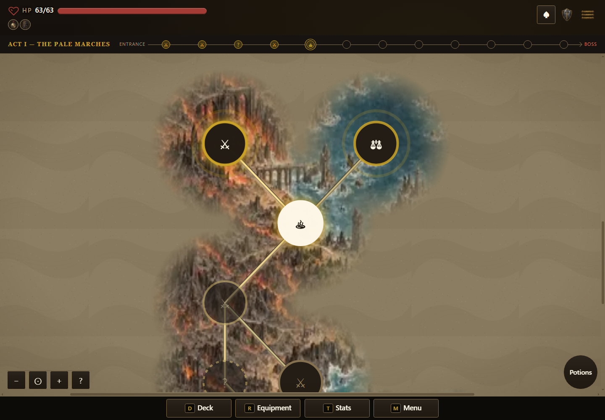
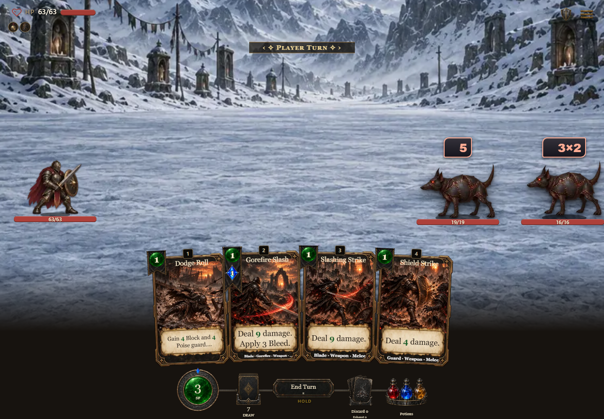
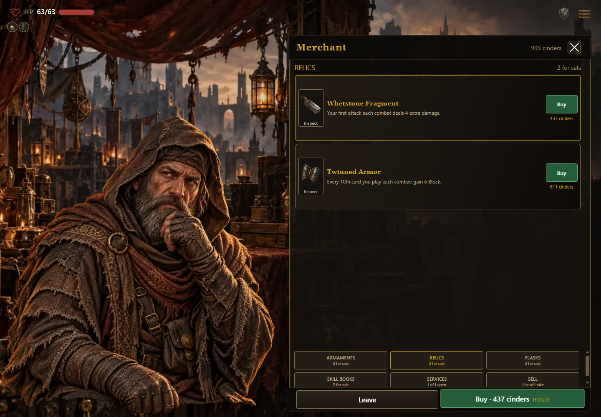
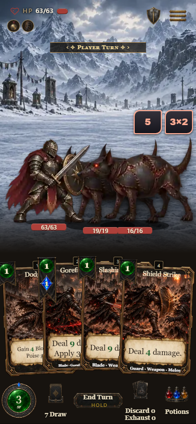

# AshenSpire

<!-- feature-preview:start -->
## Feature preview — compact character creation

**[Download and try this feature build](https://github.com/cehinds/AshenSpire/actions/runs/38654072847/artifacts/11935887981)** · [Build run](https://github.com/cehinds/AshenSpire/actions/runs/38654072847) · [All 36 screenshots and wireframes](docs/preview/features/update-character-creation/README.md)

Extract the build ZIP and open **AshenSpire.html**. GitHub sign-in is required for workflow artifact downloads; artifacts are kept for 14 days.

- Tighter spacing and fonts; repeated subtitles removed.
- Locked feats cannot be selected; spell choices recheck eligibility.
- Compact Review with all eleven starting cards available to inspect.

Captured **0.7.1.1520 / `1ad05d6483`**, source `eb5937f97c` — 2026-10-14.

| Mobile · 390 × 844 | Tablet · 1024 × 768 |
| --- | --- |
|  |  |
| Desktop · 1440 × 900 | Widescreen · 1920 × 1080 |
|  |  |

[Mobile gallery](docs/preview/features/update-character-creation/README.md#mobile) · [Desktop gallery](docs/preview/features/update-character-creation/README.md#desktop) · [Wide gallery](docs/preview/features/update-character-creation/README.md#wide) · [Tablet gallery](docs/preview/features/update-character-creation/README.md#tablet)

**Feature branch only:** remove this section and its feature gallery before merging to `dev`. See [the delivery protocol](CONTRIBUTING.md#feature-branch-previews).
<!-- feature-preview:end -->

A browser roguelike: build a character, explore a seeded world, and fight with cards.

> **AI-made game.** The original game code, design, writing, artwork and music
> are created by AI under human direction. Third-party fonts and software are
> exceptions; some asset records still need confirmation. [AI acknowledgement and credits](#legal-and-credits).

[Play](#play-and-download) · [Screenshots](#screenshots) · [Features](#features) · [Guides](#guides)

## Play and download

Choose **Test** for the latest promoted game. Badges show the full **published**
build number and link to its history. Play and HTML follow that channel's latest build.

<!-- readme-sync:channels -->
| Channel | Published build / history | Play | Download |
| --- | --- | --- | --- |
| **Test** — promoted |  | [Play Test](https://cehinds.github.io/AshenSpire/test/latest/) | [HTML](https://cehinds.github.io/AshenSpire/test/latest/download/AshenSpire.html) |
| Dev — integration |  | [Play Dev](https://cehinds.github.io/AshenSpire/dev/latest/) | [HTML](https://cehinds.github.io/AshenSpire/dev/latest/download/AshenSpire.html) |
| Release — candidate |  | [Play Release](https://cehinds.github.io/AshenSpire/release/latest/) | [HTML](https://cehinds.github.io/AshenSpire/release/latest/download/AshenSpire.html) |
| Main — earlier stable |  | [Play Main](https://cehinds.github.io/AshenSpire/main/latest/) | [HTML](https://cehinds.github.io/AshenSpire/main/latest/download/AshenSpire.html) |
<!-- /readme-sync:channels -->

**Windows:** [Release installer / build chooser](https://github.com/cehinds/AshenSpire/releases/download/installer-release/AshenSpire-Setup.exe)
· [Installer build number](https://github.com/cehinds/AshenSpire/releases/tag/installer-release)
· [Installation guide](desktop/windows/README.md).
The chooser identifies the selected game build; its installer can be newer than the hosted Test badge.

**Feature branches:** every `feature/*`, `fix/*` or `chore/*` branch with an open pull request into `dev`, named with ASCII letters, digits, `.`, `_`, `-` and `/` only, has a build at `https://cehinds.github.io/AshenSpire/branches/<branch>/latest/`, which plays in a sandbox and does not keep progress (open ones are listed on [All builds](https://cehinds.github.io/AshenSpire/)); the pull request links it.

[All builds](https://cehinds.github.io/AshenSpire/) · [Workbench](https://cehinds.github.io/AshenSpire/workbench/) · [ZIP artifacts](https://github.com/cehinds/AshenSpire/actions/workflows/dev-preview.yml) · [Changelog](CHANGELOG.md).
Publication can lag source changes. For ZIPs, open a successful run and download its named build artifact.

## Screenshots

Latest published Release candidate **0.7.1.1060**, captured 2026-10-08 UTC.
[Play this exact build](https://cehinds.github.io/AshenSpire/release/1060/) · [Capture details](docs/preview/releases/0.7.1.1060/README.md).
Dev/Test can contain newer features. Select an image to view its full size.

| Create a character | Explore a route |
| --- | --- |
|  |  |
| **Fight with cards** | **Visit shops and improve equipment** |
|  |  |

Phone combat — 390 × 844

## Features

Checked items are implemented; build channels and older saves can differ.

- [x] Four classes: Reaver, Rogue, Starseer, Herald
- [x] Seeded exploration, encounters, shops and bosses
- [x] Card combat with enemy intentions, equipment and statuses
- [x] Deck building, skill training, attributes and rewards
- [x] Saved runs, offline play and phone layouts
- [x] Optional LAN co-op
- [x] Alternative appearance by default; optional Classic appearance with the debug flag on
- [ ] Complete 1.0 release acceptance — [remaining work](docs/FINISH.md)

## Guides

[Getting started and project links](docs/PROJECT-GUIDE.md) · [Contributing](CONTRIBUTING.md)
· [Game rules](SPEC.md) · [Development](DEVELOPER.md) · [Credits](CREDITS.md).

## Legal and credits

**“Ashen Spire was built by AI under human direction.”** Anthropic Claude and
OpenAI ChatGPT/Codex created the original game work under the owner's direction.
The [full AI acknowledgement](src/content/aiDisclosure.js) describes code,
writing, generated art and synthesized music. No AI model runs while you play.

**Not AI-made by this project:** bundled fonts are third-party work under
[SIL OFL 1.1](asset-data/fonts/OFL.txt); system emoji come from your OS/browser;
Electron and its dependencies have their own licences. The project's
[MIT code licence](LICENSE) does not replace those licences.

**Rights review remains open:** [CREDITS.md](CREDITS.md#ai-authorship-and-third-party-exceptions)
identifies unrecorded flask/landmark sources and incomplete sprite/map rights.
AI authorship is not a guarantee that every asset's provenance or licence is cleared.
No FromSoftware assets or affiliation are claimed.
