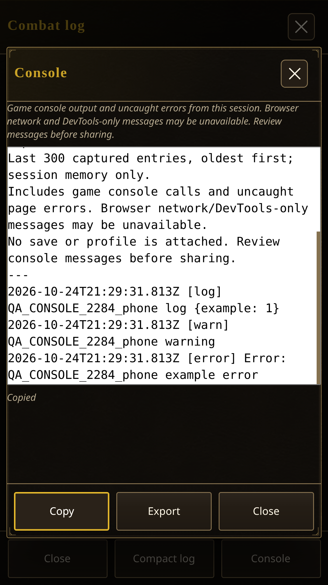
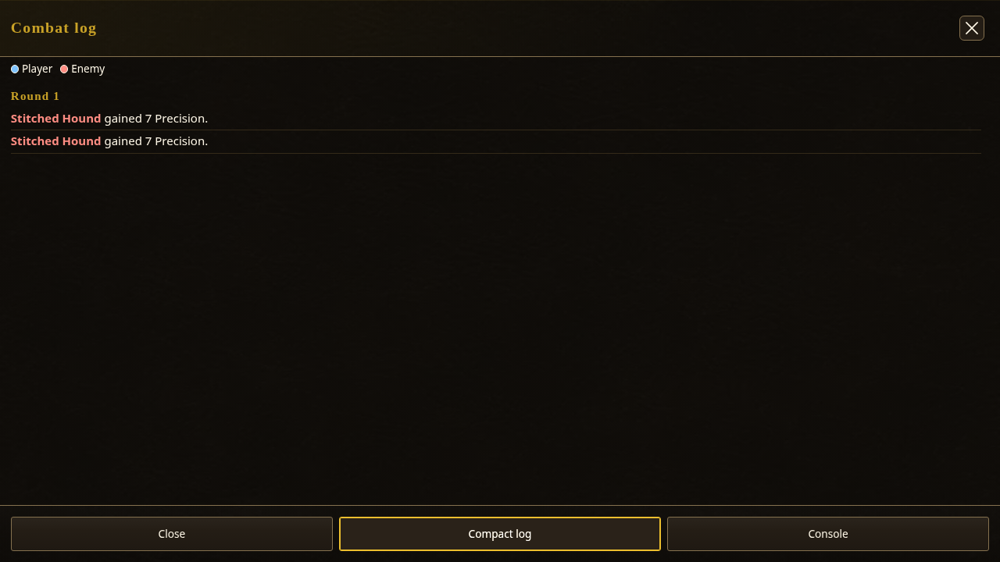
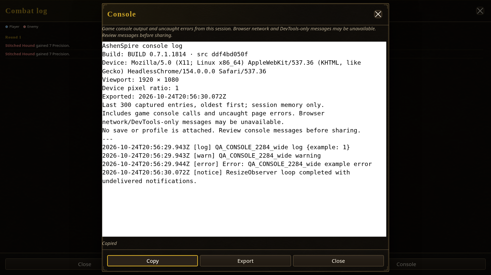
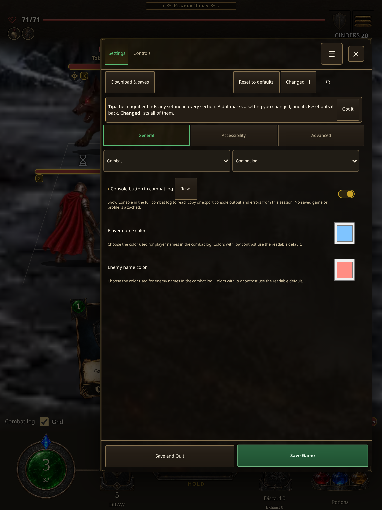
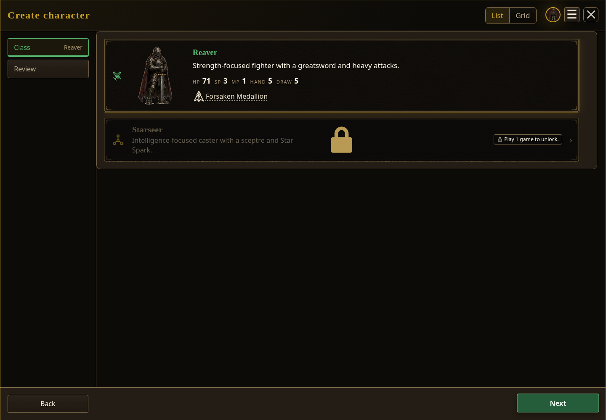
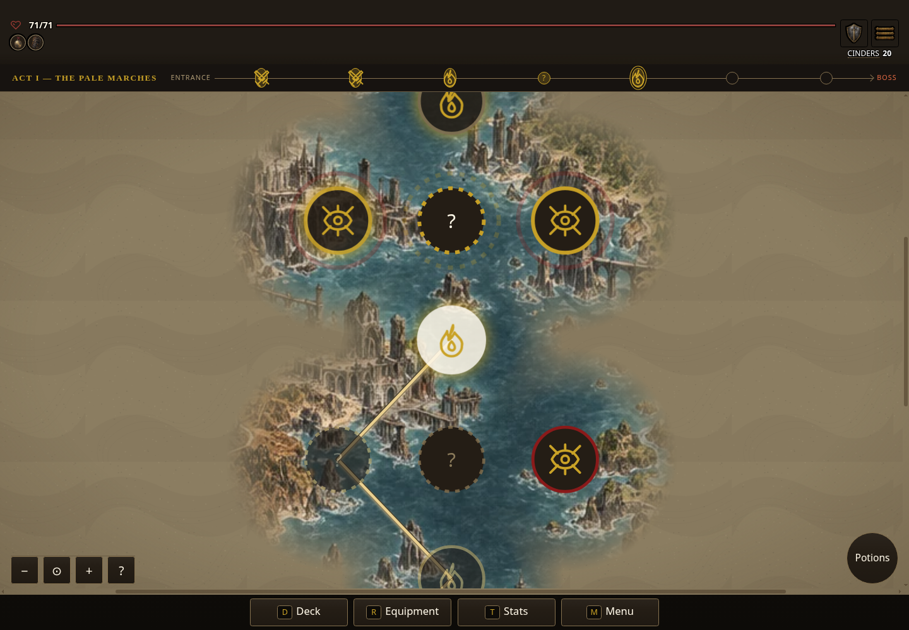
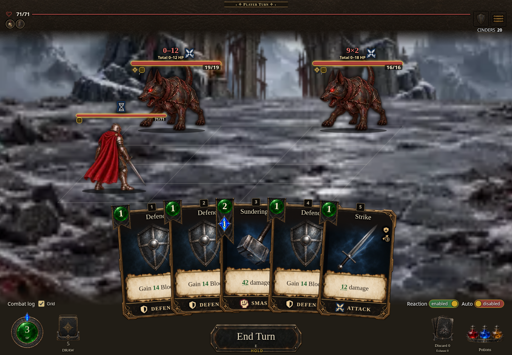
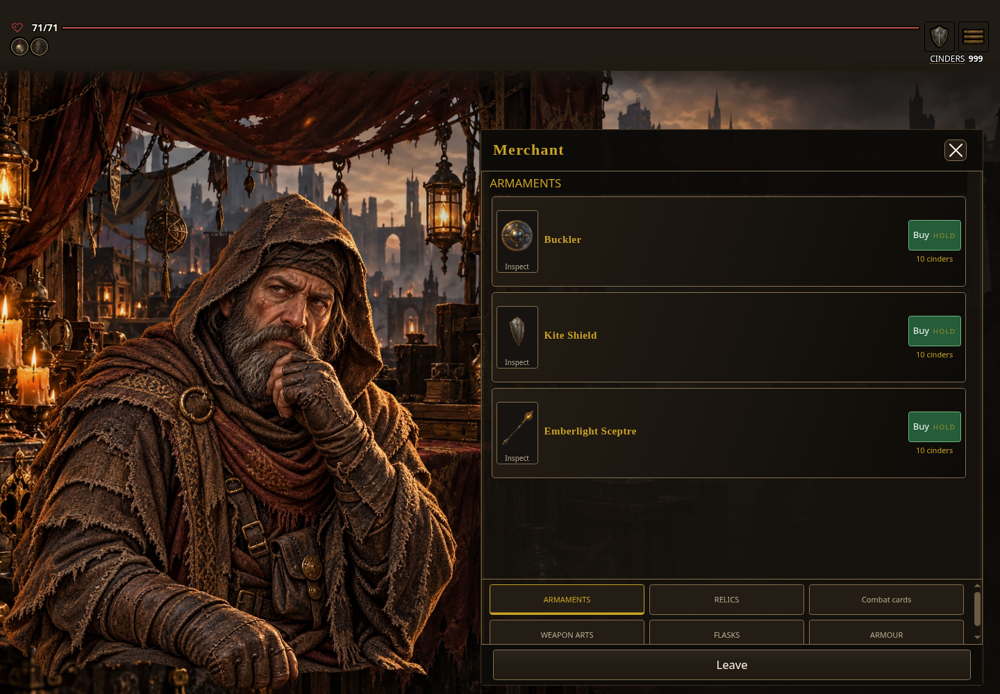
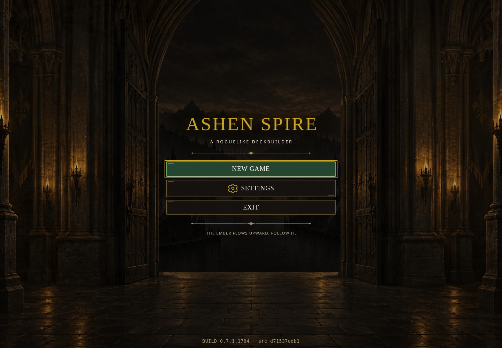
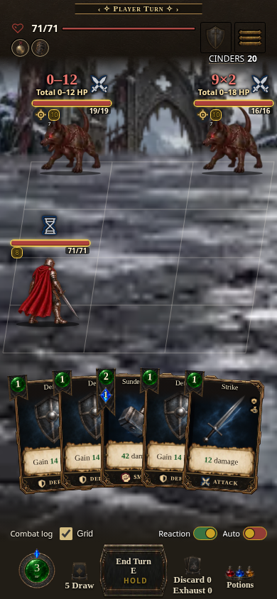

# AshenSpire

<!-- feature-preview:start -->
## Feature preview — Combat Console review snapshot

[Play this feature build](https://cehinds.github.io/AshenSpire/branches/fix/CombatLogConsoleReview/latest/)

Enable **Settings → General → Combat → Combat log → Console button in combat log**, then open **Combat log → Console** to read, copy or export session output. These captures show reviewed commit `fe7c6988e`: build **0.7.1.1814**, source digest **ddf4bd050f**. The canonical branch may contain later upstream data updates. [Capture record](docs/preview/features/combat-console/CAPTURE-RECORD.md) · [Component catalog](docs/component-catalog.html).

| Mobile | Desktop | Wide | Tablet |
| --- | --- | --- | --- |
|  |  |  |  |
<!-- feature-preview:end -->

A browser roguelike: build a character, explore a seeded world, and fight with cards.

> **AI-made game.** The original game code, design, writing, artwork and music
> are created by AI under human direction. Third-party fonts and software are
> exceptions; some asset records still need confirmation. [AI acknowledgement and credits](#legal-and-credits).

[Play](#play-and-download) · [Screenshots](#screenshots) · [Features](#features) · [Guides](#guides)

## Play and download

Choose **Test** for the latest promoted game. Badges show the full **published**
build number and link to its history. Play and HTML follow that channel's latest build.

<!-- readme-sync:channels -->
**Test** — promoted · [Play Test](https://cehinds.github.io/AshenSpire/test/latest/) · [HTML (offline, desktop, ~140 MB)](https://cehinds.github.io/AshenSpire/test/latest/download/AshenSpire.html)

Dev — integration · [Play Dev](https://cehinds.github.io/AshenSpire/dev/latest/) · [HTML (offline, desktop, ~140 MB)](https://cehinds.github.io/AshenSpire/dev/latest/download/AshenSpire.html)

Release — candidate · [Play Release](https://cehinds.github.io/AshenSpire/release/latest/) · [HTML (offline, desktop, ~140 MB)](https://cehinds.github.io/AshenSpire/release/latest/download/AshenSpire.html)

Main — earlier stable · [Play Main](https://cehinds.github.io/AshenSpire/main/latest/) · [HTML (offline, desktop, ~140 MB)](https://cehinds.github.io/AshenSpire/main/latest/download/AshenSpire.html)

<!-- /readme-sync:channels -->

**Windows:** [Release installer / build chooser](https://github.com/cehinds/AshenSpire/releases/download/installer-release/AshenSpire-Setup.exe)
· [Installer build number](https://github.com/cehinds/AshenSpire/releases/tag/installer-release)
· [Installation guide](desktop/windows/README.md).
The chooser identifies the selected game build; its installer can be newer than the hosted Test badge.

**Feature branches:** every `feature/*`, `fix/*` or `chore/*` branch with an open pull request into `dev`, named with ASCII letters, digits, `.`, `_`, `-` and `/` only, has a build at `https://cehinds.github.io/AshenSpire/branches/<branch>/latest/`, which plays in a sandbox and does not keep progress (open ones are listed on [All builds](https://cehinds.github.io/AshenSpire/)); the pull request links it.

[All builds](https://cehinds.github.io/AshenSpire/) · [Workbench](https://cehinds.github.io/AshenSpire/workbench/) · [ZIP artifacts](https://github.com/cehinds/AshenSpire/actions/workflows/dev-preview.yml) · [Changelog](CHANGELOG.md).
**How fresh:** the site is rebuilt from git history and republished after each `dev` build stamp
(about every 10 to 40 minutes while work lands) and after each push to `release`. A push to `test` or
`main` does not publish by itself; its newest build appears at the next publication, and the
owner can publish on demand. Each channel's `latest/` page shows the stamp it serves; if it
is behind, check the [pages-builds runs](https://github.com/cehinds/AshenSpire/actions/workflows/pages-builds.yml)
for a red `deploy` job. Publication can lag source changes. For ZIPs, open a successful run and download its named build artifact.

## Screenshots

Latest published Release candidate **0.7.1.1784**, captured 2026-10-24 UTC.
[Play this exact build](https://cehinds.github.io/AshenSpire/release/1784/) · [Capture details](docs/preview/releases/0.7.1.1784/README.md).
Captures use the byte-identical local Release and its native showcase states.
Dev/Test can contain newer features. Select an image to view its full size.

| Create a character | Explore a route |
| --- | --- |
|  |  |
| **Fight with cards** | **Visit shops and improve equipment** |
|  |  |

Title screen

Phone combat — 390 × 844

## Features

Checked items are implemented; build channels and older saves can differ.

- [x] Four classes: Reaver, Rogue, Starseer, Herald
- [x] Seeded exploration, encounters, shops and bosses
- [x] Card combat with enemy intentions, equipment and statuses
- [x] Deck building, skill training, attributes and rewards
- [x] Saved runs, offline play and phone layouts
- [x] Optional LAN co-op
- [x] Alternative appearance by default; optional Classic appearance with the debug flag on
- [ ] Complete 1.0 release acceptance — [remaining work](docs/FINISH.md)

## Guides

[Getting started and project links](docs/PROJECT-GUIDE.md) · [Contributing](CONTRIBUTING.md)
· [Game rules](SPEC.md) · [Development](DEVELOPER.md) · [Credits](CREDITS.md).

Draft environment art: [251 sources across eleven batches](https://github.com/cehinds/AshenSpire-art/blob/54a0a2374d138af7b51da985b6e1055d0d87bacb/art/map-battlefield-drafts/README.md), including [28 close-location scenes](https://github.com/cehinds/AshenSpire-art/blob/54a0a2374d138af7b51da985b6e1055d0d87bacb/art/map-battlefield-drafts/batch-10-location-streets/modules/index.json) and [12 Crownfall intro-map art candidates](https://github.com/cehinds/AshenSpire-art/blob/54a0a2374d138af7b51da985b6e1055d0d87bacb/art/map-battlefield-drafts/batch-10-location-streets/modules/intro-map.json).

## Legal and credits

**“Ashen Spire was built by AI under human direction.”** Anthropic Claude and
OpenAI ChatGPT/Codex created the original game work under the owner's direction.
The [full AI acknowledgement](src/content/aiDisclosure.js) describes code,
writing, generated art and synthesized music. No AI model runs while you play.

**Not AI-made by this project:** bundled fonts are third-party work under
[SIL OFL 1.1](asset-data/fonts/OFL.txt); system emoji come from your OS/browser;
Electron and its dependencies have their own licences. The project's
[MIT code licence](LICENSE) does not replace those licences.

**Rights review remains open:** [CREDITS.md](CREDITS.md#ai-authorship-and-third-party-exceptions)
identifies unrecorded flask/landmark sources and incomplete sprite/map rights.
AI authorship is not a guarantee that every asset's provenance or licence is cleared.
No FromSoftware assets or affiliation are claimed.
