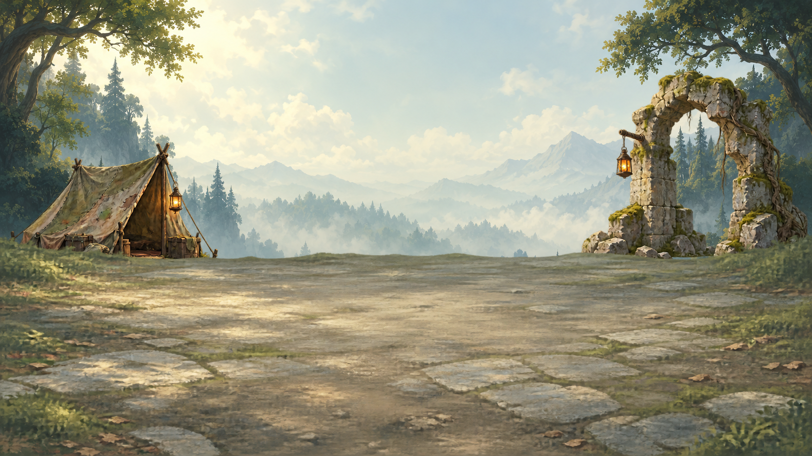

# Map and battlefield art — batch 01

The original daylight sky is now historical. Use the approved forest-day composition in [batch 08](../batch-08-style-alignment/README.md) and the [shared style module](../style-system/README.md).

**Eight painted drafts, retained on `feature/ImproveMapBattleFieldArt`.** These are source art for review, not runtime-bound assets.

## Included

| Component | File | Native size |
| --- | --- | --- |
| Stone bridge map prop | `map-bridge-stone.png` | 1254 × 1254 RGBA |
| Ruined arch map prop | `map-ruins-arch.png` | 1254 × 1254 RGBA |
| Village map prop | `map-village.png` | 1254 × 1254 RGBA |
| Rest camp map prop | `map-rest-camp.png` | 1254 × 1254 RGBA |
| Treasure chest map prop | `map-treasure-chest.png` | 1254 × 1254 RGBA |
| Forest daytime sky/background | `scene-forest-sky-day.png` | 1672 × 941 RGB |
| Forest rear props: tent and arch | `scene-forest-props-day.png` | 1672 × 940 RGBA |
| Forest clearing ground | `scene-forest-ground-day.png` | 1672 × 941 RGBA |

## Layer order

Back → front: **sky → rear props → ground → gameplay actors/UI**.

The preview is a native-size browser composition of the three unchanged source images. Images are drawn at native size and top-left aligned. Rear props are one pixel shorter than sky and ground, so common-canvas registration remains necessary. Ground transparency reveals the props and background above the floor. A 1280 × 720 viewport fits inside this draft canvas, but side objects can be cropped. Larger production canvases and camera-safe placement remain necessary for the intended camera movement.

## Editable metadata and provenance

- [manifest.json](manifest.json): readable dimensions, transparency measurements, hashes, draw order, unassigned registration family, and remaining review tasks.
- Each source has a matching `.provenance.json`: exact prompt, generation tool, original output path, and references where used.
- Paths in provenance describe the generation workspace. The source PNG beside each sidecar is the retained portable copy.
- Original AI-generated paintings under user direction; no third-party artwork or license is asserted.

## Review before production

- Darken the bright pastoral palette to better match the project art direction.
- Normalize the rear-prop canvas height (940px) to the sky/ground height (941px).
- Remove faint alpha dust and colored edge fringes, especially on the camp.
- Register map anchors and export crisp **512px and 256px** variants; current images are larger draft masters.
- Check small-map readability and biome color compatibility.
- Expand scene overscan and test camera crops; the side props currently approach the edges.
- Adapt these **1672 × 941** scene drafts to a production canvas. They are not registered to the handoff's **2048 × 1152** example contract.
- Move approved source art through the project's art repository intake, then bind production IDs. No art release pin or runtime code changes accompany this batch.

## Integration handoff

Other branches can start wiring with the proposal, JSON contracts, editable SVGs and 24 transparent technical PNG examples in [the shared handoff](../../../docs/design/improve-map-battlefield-art/HANDOFF.md). Painted drafts are separate from those placeholders.

## Suggested next batch

- Map props: dungeon entrance, cave, ferry, enemy camp, shrine, portal, trainer.
- Scene variants: cloudy, night and misty forest; road and bridge ground; snow, swamp and ruins.
- Separate foreground and rear-prop families where the scene needs objects in front of actors.
