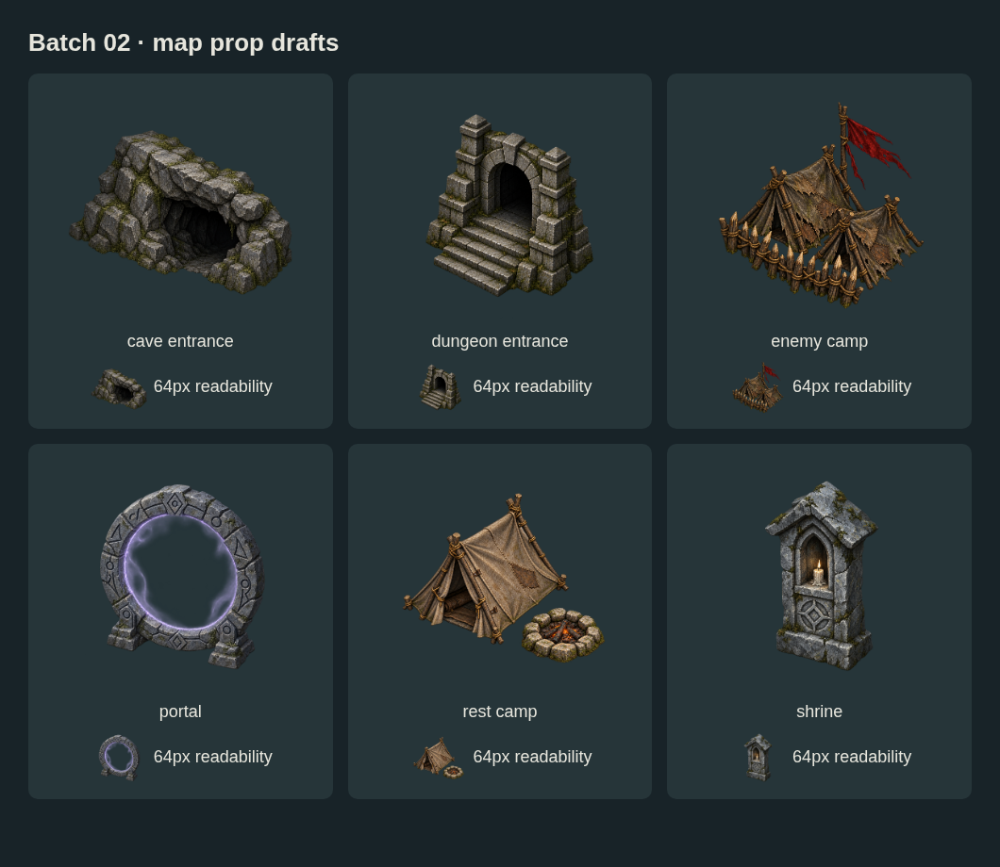
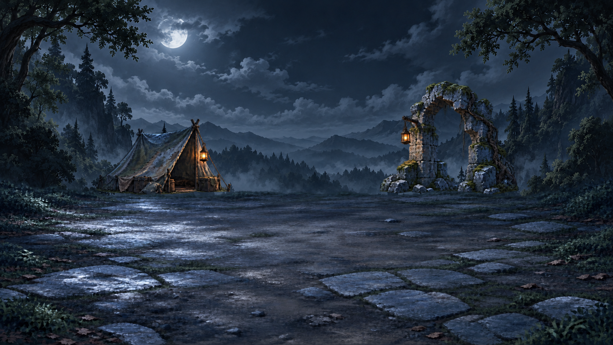

# Map and battlefield art — batch 02

**Ten more source drafts on `feature/ImproveMapBattleFieldArt`.** Six map props, a complete night scene stack, and one misty background. These are unregistered art sources for review.



## Map props

| File | Purpose | Current review note |
| --- | --- | --- |
| `map-dungeon-entrance.png` | Built stone doorway and stairs | Strong structural silhouette; similar to shrine when small |
| `map-cave-entrance.png` | Natural rocky entrance | Interior loses detail at 64px; narrow source margins |
| `map-rest-camp.png` | Revised tent and fire ring | Darker than batch 01; warm fringe still needs cleanup |
| `map-enemy-camp.png` | Ragged tents, stakes, red pennant | Dense palisade crowds small-map detail |
| `map-shrine.png` | Roadside votive stone and candle | Narrow silhouette; candle detail disappears when small |
| `map-portal.png` | Ancient stone ring with violet energy | Clearest small silhouette; faint energy/alpha noise remains |

All six are **1254 × 1254 RGBA** original PNGs. The generator did not honor the requested 1024px canvas. 512px/256px production exports remain a separate intake step. The contact sheet displays originals at 256px and 64px; it does not replace their source files.

## Forest scene layers



| File | Native size | Layer |
| --- | --- | --- |
| `scene-forest-sky-night.png` | 1672 × 941 RGB | Moonlit background |
| `scene-forest-props-night.png` | 1672 × 941 RGBA | Tent and arch, paired rear-prop layer |
| `scene-forest-ground-night.png` | 1671 × 941 RGBA | Moonlit ground, transparent above floor |
| `scene-forest-sky-misty.png` | 1672 × 941 RGB | Overcast fog background; matching foreground pending |

Back → front: **sky → rear props → ground → actors/UI**.

- [composition.example.json](composition.example.json) contains editable layer positions, display sizes and a camera example.
- The preview displays rear props at 70% size with an inset position, providing more useful side margins than batch 01. Visible rear-prop bounds at alpha≥16 fit within the 1280×720 camera example through a ±48px horizontal shift. Larger movement, vertical movement, actors and UI are not yet validated.
- Ground is displayed one pixel wider than its original. This is a disclosed browser preview transform, not a registered production export.
- Tent and arch are still a single paired layer. Separate individual rear props are a next step for independent combinations.
- The misty image is a background variant only; it must not be treated as a fully matched mist scene.

## Editable metadata

- [manifest.json](manifest.json): stable draft IDs, suggested tags, dimensions, alpha measurements, hashes and source sidecar paths. Null anchors and production IDs mean unregistered, not default coordinates.
- Each `.provenance.json` retains the exact prompt, generation tool, source paths and reference details. Where retries were made, the agent recorded retained/rejected attempts.
- Absolute source paths are generation-workspace provenance. The neighboring PNG is the portable retained master.

## Rebuild previews

From the repository root with its Playwright dependency installed:

```sh
node art/map-battlefield-drafts/batch-02/render-previews.mjs
```

Chromium defaults to `/usr/bin/chromium`; set `CHROMIUM_PATH` for another installed executable. The script serves only local preview HTML and PNGs on an ephemeral loopback port. It renders the editable JSON and contact sheet without modifying source art.

## Review and next work

- Independent visual review found the set coherent and the night center usable. The1280px crop initially crowded the landmarks; their displayed size was subsequently reduced from 80% to 70%, and horizontal bounds were checked.
- Remove residual alpha dust and colored fringes before production intake. Tiny alpha values are not evidence of a clean edge.
- Strengthen cave/shrine/camp identities at 64px; validate on actual terrain as well as the dark review background.
- Split rear props into independently reusable objects; add actor/contact-shadow references and test camera motion.
- Complete misty foreground layers, then expand toward road/bridge, swamp, snow and volcanic families.
- Finish shared-canvas registration and approved exports through the art repository. Runtime code and art release pins are unchanged.

Original AI-generated artwork under user direction; no third-party license is asserted. The [dev handoff](../../../docs/design/improve-map-battlefield-art/HANDOFF.md) remains the wiring reference for other branches.
