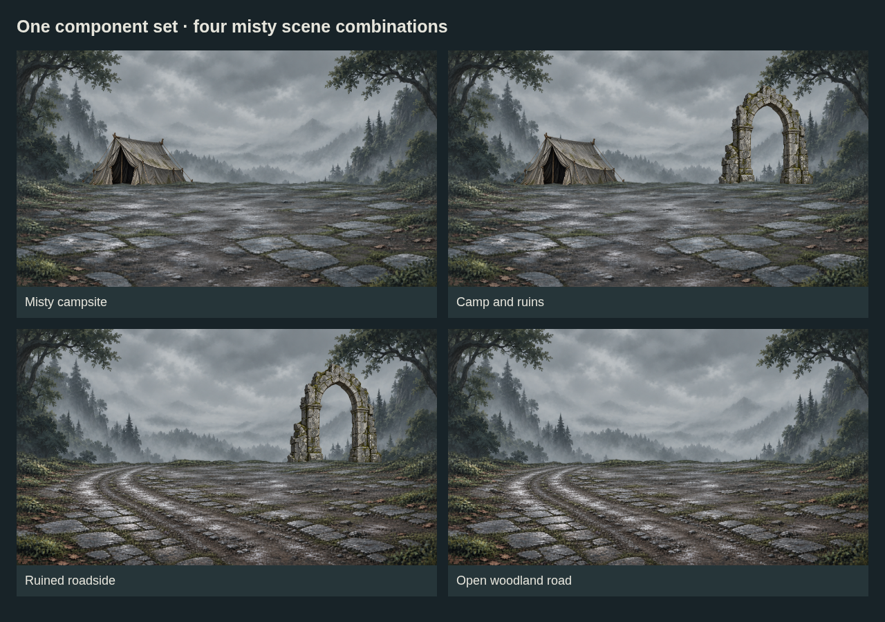
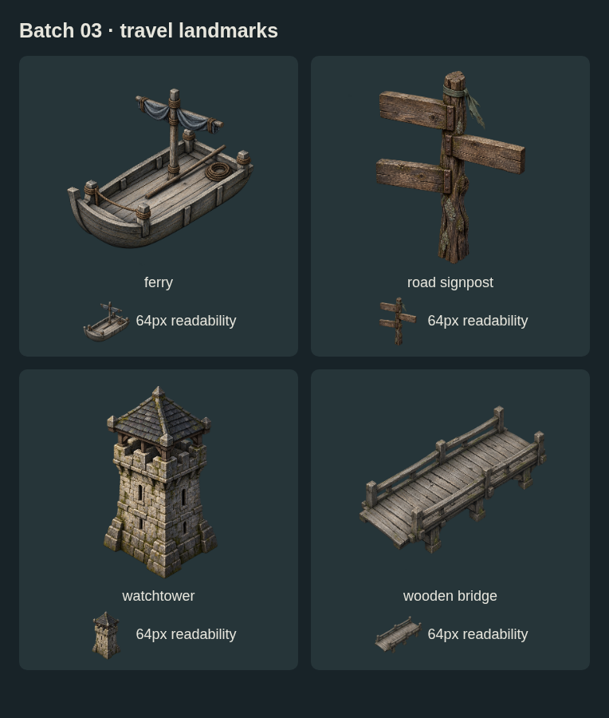

# Map and battlefield art — batch 03

**Eight source drafts:** four travel landmarks, two independently reusable rear props, and two interchangeable misty ground layers. Reuses batch 02's misty background.



## Independent scene components

| Source | Native size | Use |
| --- | --- | --- |
| `scene-prop-tent-misty.png` | 1254 × 1254 RGBA | Separate campsite tent |
| `scene-prop-ruined-arch-misty.png` | 1254 × 1254 RGBA | Separate ruin with transparent opening |
| `scene-forest-ground-misty.png` | 1672 × 941 RGBA | Damp clearing; transparent upper half |
| `scene-road-ground-misty.png` | 1672 × 941 RGBA | Worn road; transparent upper half |

The two ground layers share exact native dimensions. Tent and arch have their own positions and scales in [composition.example.json](composition.example.json), rather than sharing one painted layer. Four presets demonstrate campsite, camp with ruins, ruined roadside and open road.

Back → front: **misty sky → chosen rear props → chosen ground → actors/UI**.

These are browser composition examples, not runtime bindings. Source pixels remain unchanged. Ground masks the bases of the props. The tent was moved down after visual review to remove a floating gap. Actor feet, contact shadows and camera movement still need validation; the arch could use depth-dependent haze.

## Travel landmarks



- **Wooden bridge:** open span endpoints; no baked river or land tile.
- **Ferry:** independent boat with mast, furled cloth and curved bow; no water, dock or people. Revised after 64px review to distinguish its silhouette from the bridge.
- **Watchtower:** self-contained roofed tower; strongest small landmark in this batch.
- **Road signpost:** three blank planks; no baked text or labels.

All four map sources are 1254 × 1254 RGBA, larger than the intended 512px/256px exports. Bridge endpoints and ferry shoreline rules are not yet registered. Icon context remains important at 64px.

## Metadata and preview rebuilding

- [manifest.json](manifest.json) lists source files, editable tag groups, dimensions, hashes, transparency measurements and provenance sidecars. Tags are suggestions; they do not implement gameplay behavior.
- Each `.provenance.json` records exact generation prompts, references and source outputs. Absolute paths describe the generation workspace; the neighboring PNG is the retained portable copy.
- [composition.example.json](composition.example.json) controls independent props, positions, scale and ground selection in four presets.

From the repository root with Playwright installed:

```sh
node art/map-battlefield-drafts/batch-03/render-previews.mjs
```

Chromium defaults to `/usr/bin/chromium`; override with `CHROMIUM_PATH`. The script serves known local assets on an ephemeral loopback port and renders three PNG previews without changing the original source images.

## Remaining production work

- Check the revised ferry on contrasting terrain: much of its body is slightly below full opacity.
- Clean colored fringes and faint alpha dust. Transparency alone does not certify clean edges.
- Confirm shadows, depth, actor footing and safe camera motion.
- Add bridge connection anchors and valid ferry/water placement rules.
- The road bends toward the left rear; its painting is not a route-network definition or a seamless terrain tile.
- Register approved components and export through the art repository. No runtime code or release pins changed.

Original AI-generated artwork under user direction. No third-party license is asserted. [All batches](../README.md) · [Shared dev handoff](../../../docs/design/improve-map-battlefield-art/HANDOFF.md).
