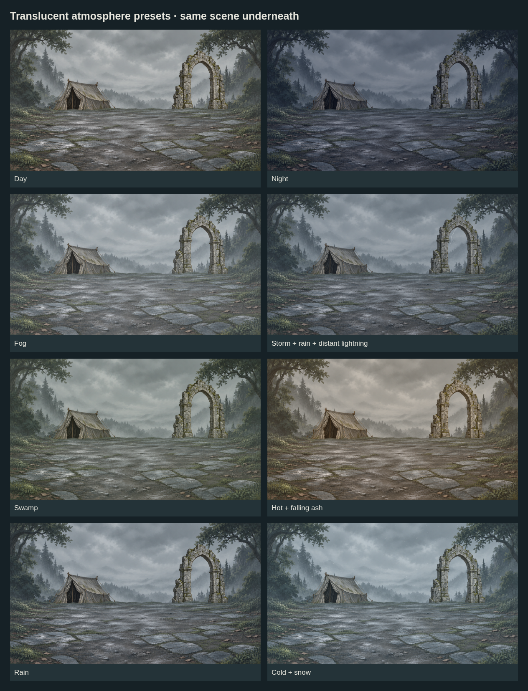
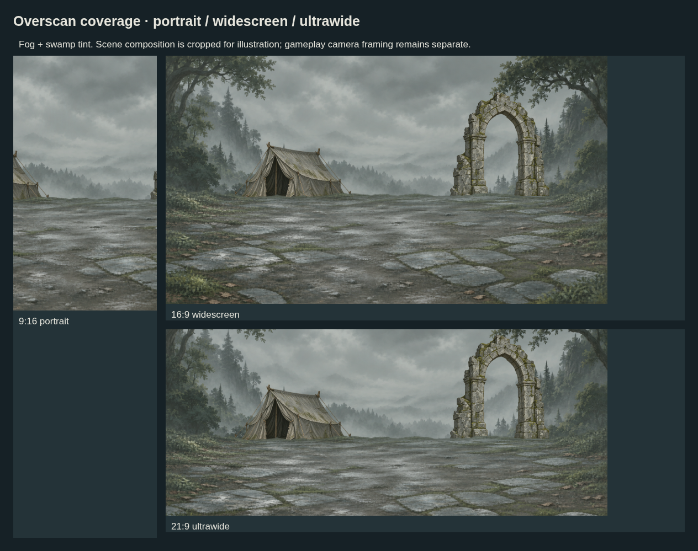

# Weather and time-of-day atmosphere layers

Active atmosphere/timing JSON now selects corrected batch-08 lightning frames. The original broad-halo frames remain historical; see [style corrections](../batch-08-style-alignment/README.md).

**Independent, translucent art layers with generous edge coverage.** This batch supplies 15 source PNGs plus editable vector sources where applicable. It remains on the art feature branch; no runtime weather system is wired yet.



## Included

| Family | Assets | Coverage |
| --- | --- | --- |
| Color filters | Day, night, fog, stormy, swamp, hot, rain, cold | Eight 4096 × 4096 RGBA PNGs plus editable SVGs |
| Particle textures | Rain, snow, ash | Three 1024 × 1024 transparent PNG/SVG tiles; exact 256px repeat |
| Main fog field | Soft neutral mist | 4096 × 4096 PNG/SVG with bounded drift |
| Distant lightning | Faint leader and stronger bolt | Two generated wide PNG frames; then hidden |
| Alternate fog draft | Cloudlike bottom/side mist | Generated1672 ×941 PNG; disabled in default presets |


The 16-second preview shows rain, snow, falling ash and fog. Lightning appears after 12 seconds: 80ms leader, 140ms main bolt, then hidden. The example contract permits 12–30-second pauses between strikes. The preview scheduler uses deterministic varied intervals for reproducibility; a runtime can use its saved weather seed. No rapid perpetual lightning loop or audio is included. The 25fps preview quantizes frame timing to 40ms; JSON retains exact requested durations.

## Extra room around the edges

[atmosphere.example.json](atmosphere.example.json) defines the coverage rule:

```text
field side = 2 × max(viewport width, viewport height)
field centered on viewport
allowed drift ≤ ±20% of viewport width/height
```

- Square filter and fog canvases support portrait, widescreen and ultrawide crops. The native 4096px PNGs retain the stated sampling density through a 2048px longest viewport edge.
- For a 2560px-wide view, export the SVG to 5120px; for 4K, export at least 7680px. Account for device-pixel ratio in the chosen raster target. Do not enlarge a small painted source to meet the number.
- Particle textures repeat across the entire field; motion by complete repeat periods wraps without an exposed edge.
- Fog is **not tileable**. It gently oscillates within the oversized field instead of wrapping at a seam.
- Lightning is a sparse independently positioned effect. Its original frames remain 1672 ×941 and 1671 ×941; they are not 4096px paintings. Place them on a larger transparent scene stage and keep the bolt's intended region inside the camera. Exact frame registration is still pending.
- [coverage-checks.json](coverage-checks.json) verifies 27 center/extreme-offset cases. The fog's own source QA additionally verifies alpha coverage and variation in 27 native crops.



These checks prove **overlay coverage**, not automatic framing of the painted scene. The portrait example crops the tent and arch. Earlier landscape sources still need expanded painted edges and camera composition work.

## Tags, combinations and layer order

The editable JSON groups tags by time of day, weather, biome tone and temperature tone. Presets combine these independently: storm adds rain and lightning; cold adds snow; swamp adds fog; hot demonstrates falling ash. Ash can also be selected independently for volcanic areas.

Suggested order: **sky → distant lightning → rear props → ground → actors → tint → fog → foreground particles → HUD**. Place effects behind actors instead if the scene requires it. Keep interface text out of the filter stack.

Choose one time-of-day filter and one main weather tint, then adjust opacity. A night tint changes color/value; it does not replace a correctly painted night sky or relight every material. These tags do not create buffs, weather damage, encounters or navigation behavior.

## Source and preview tools

- [manifest.json](manifest.json): 15 source files, dimensions, hashes, alpha ranges, editable sources and provenance.
- `filters/render.mjs`: export original vector color washes; metadata contains alpha/crop checks.
- `particles/render.mjs`: reproduce seeded SVG patterns, PNGs, exact periodicity/seam/translation checks and dark/light QA sheet.
- `fog-vector/render.mjs`: reproduce the oversized fog field and its crop checks.
- `render-previews.mjs`: render scene comparisons from the JSON; `--video` creates the motion preview with system FFmpeg.

```sh
node art/map-battlefield-drafts/batch-04-atmosphere/render-previews.mjs --video
```

Requires Node, Playwright, installed Chromium and FFmpeg. `CHROMIUM_PATH` selects the preview browser. The renderer uses a temporary loopback server and temporary JPEG video frames, removing its frame directory after encoding. Source PNGs remain unchanged. No separate HTML authoring tool is introduced.

## Review findings

- Filters preserve the scene's main shapes. Rain and ash are subtle at thumbnail size; tune against actual actors and phone displays.
- Fog is a soft veil rather than dense localized smoke; swamp is intentionally restrained.
- Generated lightning still has a broad blue halo, alpha-edge noise and a one-pixel width mismatch. It needs alignment and in-game review before binding.
- Reduced-motion recipes keep particles/fog static or hidden and disable lightning. The preview respects the browser's reduced-motion preference.

Original vector illustrations and original AI-generated fog/lightning under user direction; no third-party artwork or license asserted. [Library catalog](../README.md) · [Shared dev handoff](../../../docs/design/improve-map-battlefield-art/HANDOFF.md).
