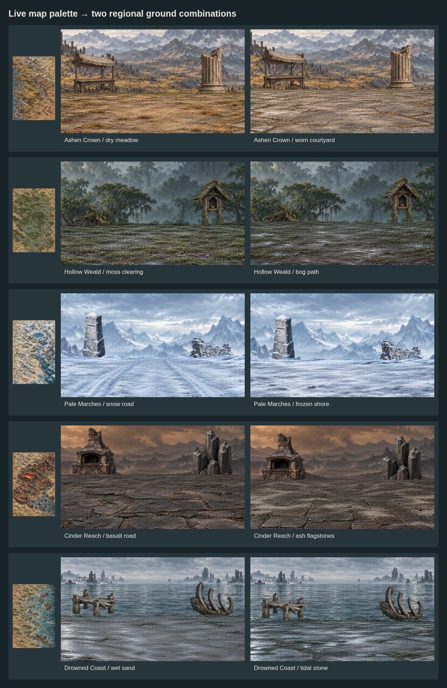
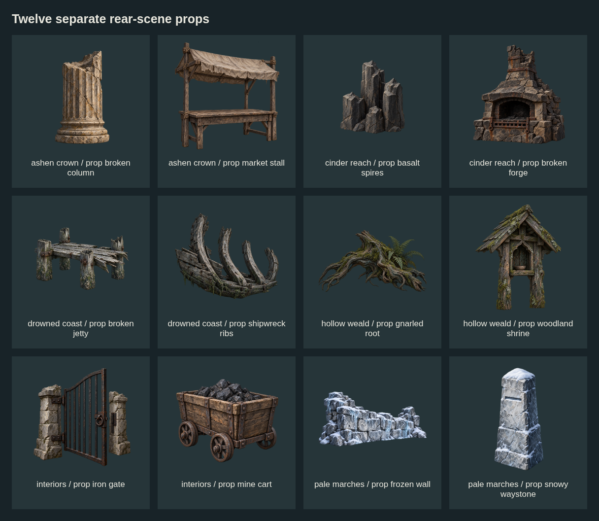
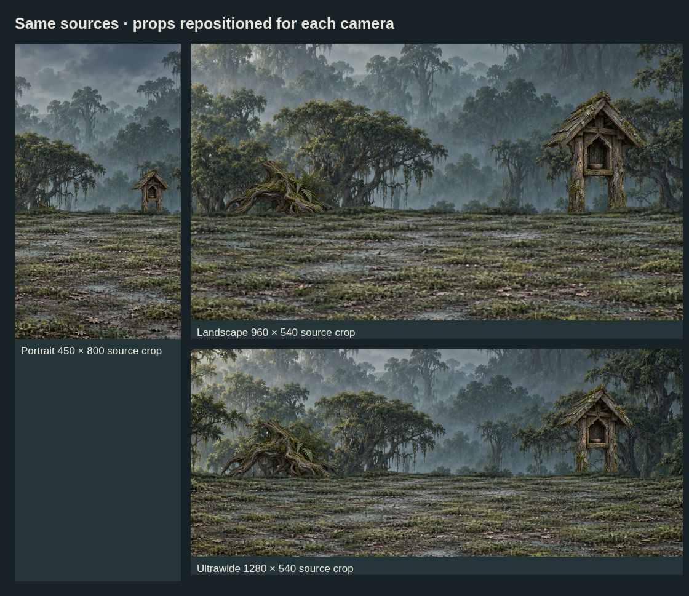

# Regional grounds and props — batch 05

**32 new source drafts: 12 grounds, 12 separate props and 8 backdrops.**

These sets follow the colors and materials of the five existing world maps. They stay on `feature/ImproveMapBattleFieldArt`, with no production bindings or runtime changes.



| Location family | Grounds | Separate props | Backdrop |
| --- | --- | --- | --- |
| Ashen Crown | Dry meadow, worn courtyard | Market stall, broken column | Dry castle highlands |
| Hollow Weald | Moss clearing, bog path | Gnarled root, woodland shrine | Deep wet forest |
| Pale Marches | Snow road, frozen shore | Snowy waystone, frozen wall | Snow mountains |
| Cinder Reach | Basalt road, ash flagstones | Broken forge, basalt spires | Volcanic landscape and volcanic shore |
| Drowned Coast | Wet sand, tidal stone | Broken jetty, shipwreck ribs | Tidal ruins and sea |
| Shared interiors | Dungeon flagstones, mine gravel | Iron gate, mine cart | Vaulted depths, mine depths |

## Edit and combine

- [Location coverage JSON](location-coverage.example.json): candidate pools for all **21 live location profiles and 200 node assignments**. These are reusable candidates, not bespoke finished paintings for every node. The atlas contains additional nodes outside this presentation mapping.
- [Coverage notes](COVERAGE.md): profile gaps, suggested tag aliases and remaining regional variants.
- [Composition JSON](composition.example.json): 13 examples with editable ground, backdrop, props, camera and placement values.
- [Manifest](manifest.json): source dimensions, hashes, tags, alpha bounds and provenance links.
- Layer order: backdrop → independent props → ground. Actors, contact shadows, atmosphere and UI need their own integration review.
- Earlier map icons and atmosphere assets remain reusable in batches 01–04. This batch adds rear-scene props; it does not replace the technical map-icon pack.



## Edge room and actual resolution

- Landscape sources are **1672 × 941**, except the courtyard at **1672 × 940**. Props are **1254 × 1254**. Requested larger canvases were not delivered; originals are retained unchanged.
- Landscape review crop: **960 × 540**, leaving 356px horizontally and about 200px vertically on each side.
- Ultrawide crop: **1280 × 540**, leaving 196px horizontally and about 200px vertically.
- Portrait crop: **450 × 800**, leaving 611px horizontally but only about 70px vertically. More painted vertical coverage is still needed for substantial portrait camera movement.
- Props reposition relative to each camera; this preserves side landmarks and central playable space. The 69 measured prop/camera bounds pass, and all three camera rectangles fit inside the source canvas.
- Snow and volcanic-shore backdrops use bottom-centered preview zoom to show mountains/water above the ground. This does not increase source detail. The courtyard is displayed one pixel taller to align the example canvas.



## Review status

These are **unregistered drafts**. Some generated floors remain slightly translucent and some cutouts have faint colored fringes. Tight prop margins, differing horizons and style variation need production cleanup. Snow's frozen-shore ground still reads closer to a snowfield than an obvious shoreline. Shared dungeon architecture needs region-specific variants; settlement profiles need more distinct buildings and paving.

Review adjusted root/cart contact, forge burial and backdrop framing. Contact shadows, actor scale, animation, full-resolution runtime appearance and dynamic camera travel remain unverified. The current checks cover geometry, source integrity and data references only.

## Reproduce previews

From the repository root, with Playwright and Chromium installed:

```sh
node art/map-battlefield-drafts/batch-05-regions/render-previews.mjs
```

Set `CHROMIUM_PATH` if Chromium is elsewhere. The script uses a temporary loopback server and writes five PNG review sheets plus [composition checks](composition-checks.json). PNG sources are never rewritten. See [all combinations](preview-all-combinations.png) for interiors and the volcanic shore.

Exact generation prompts and reference paths are in each asset's provenance sidecar; Hollow Weald uses its shared `generation-record.json` and `generation-prompts.json`. Map references are first-party images in `assets-mobile/environments/`.
