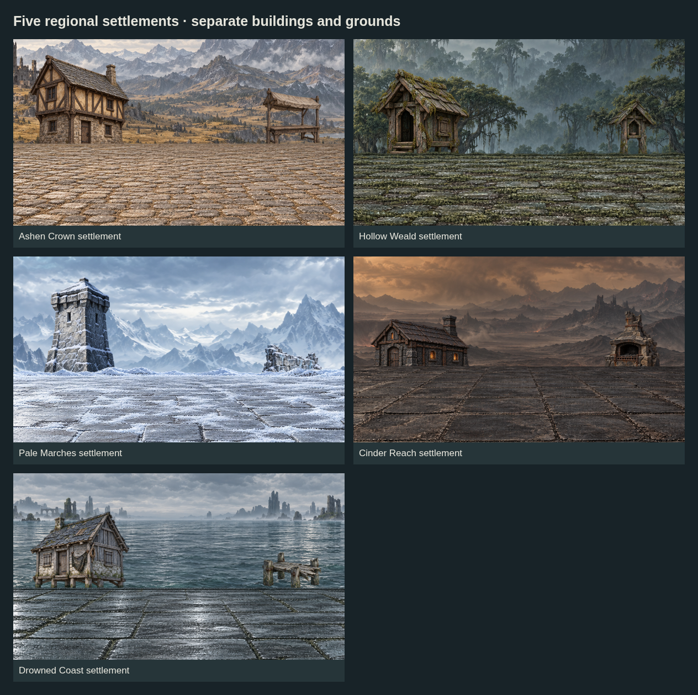
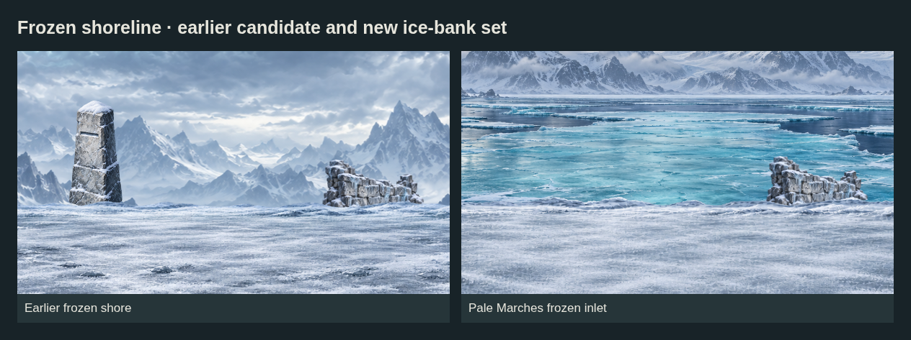
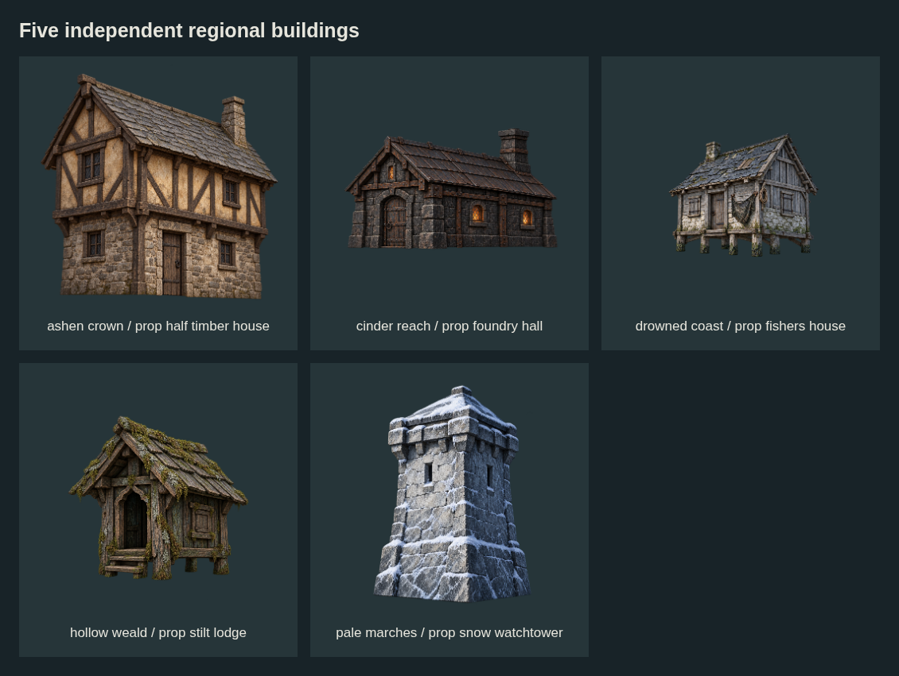
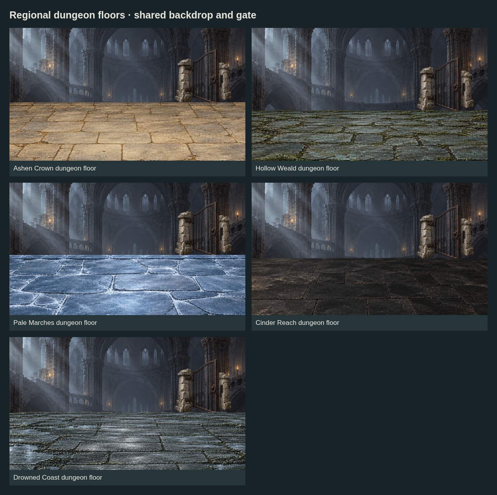

# Settlement buildings, regional floors and frozen shore — batch 06

Regional shore pools/scenes now select the corrected matte ice bank from [batch 08](../batch-08-style-alignment/README.md). The original glossy ice source remains historical.

**17 new sources: 11 grounds, 5 independent buildings and 1 frozen-inlet backdrop.** These are reusable draft layers matched to the five existing map regions.



| Region | Settlement pieces | Dungeon floor |
| --- | --- | --- |
| Ashen Crown | Half-timber house + market cobbles | Dusty keep stone |
| Hollow Weald | Mossy stilt lodge + village pavers | Root cellar |
| Pale Marches | Snow watchtower + snowy courtyard | Frost vault |
| Cinder Reach | Foundry hall + soot-dark court | Obsidian vault |
| Drowned Coast | Fisher's house + harbor paving | Flooded crypt |

Pale Marches also receives a separate **ice-bank ground and frozen-inlet backdrop**, giving shore encounters a recognizable water/ice setting.



## Editable choices

- **[JSON module index](modules/index.json)** is the authoring entry point. Each region has separate `pools.json` and `scenes.json` files; common rules/cameras live in `modules/shared/`. See the [editing guide](modules/README.md).
- Regional location pools contain 21 existing profiles and reference the existing 200 node assignments without duplicating the node list. [Single-file location export](location-pools.example.json) remains available for other tools.
- Each profile has ordered **primaryPools** and **fallbackPools**. Pick a complete candidate within the exact profile; props can be omitted. These arrays describe art proposals, not implemented random placement or runtime selection.
- Eleven profiles gain new primary candidates: five settlements, five dungeon floors and one frozen shore. Ten retain their previous candidates.
- Earlier batch 05 art remains available as fallbacks. All 49 referenced PNGs exist: 17 new and 32 earlier sources.
- Regional scene modules provide 11 editable examples with independent prop position, size and overlap values. The [single-file composition export](composition.example.json) is generated from those modules.
- [Manifest](manifest.json) records measured dimensions, hashes, tags, alpha bounds and provenance. [Coverage notes](COVERAGE.md) explain selection semantics and remaining gaps.
- Layer order is backdrop → props → ground. The building PNGs are rear-scene components; map icon exports and runtime placement are separate work.



## Review and edge coverage

- Native ground/backdrop canvases: **1672 × 941**. Building canvases: **1254 × 1254**. Requests for larger images did not produce larger files; originals are retained unchanged.
- Landscape crop **960 × 540** leaves 356px per horizontal side and about 200px vertically. Ultrawide **1280 × 540** leaves 196px per horizontal side. Portrait **450 × 800** has only about 70px vertical room. Larger camera travel still requires expanded painted masters.
- Each camera repositions the separate props. All **48 new-composition prop/camera checks**, plus two earlier comparison-prop checks, pass; all three camera rectangles fit the canvas. These bounds checks do not validate actor scale, lighting or pixel-level quality.
- The five dungeon floors intentionally reuse one earlier vaulted backdrop and gate. Ashen stone is warmer than that background; the Pale floor needs frost-matched architecture. Straight floor seams need blending/contact-shadow review.
- The coastal building needs a short dock or steps to connect it visibly to the quay. Portrait examples shrink buildings; landmark readability needs runtime review.
- Several native sources have faint colored fringes, low-alpha dust or slightly translucent material interiors despite opaque-material requests. The fisher's-house retry meets its requested 15% margins; other building margins vary. Per-source provenance records the deviations.
- The new frozen inlet improves shoreline identity. The water/ice in its opaque background is baked into that background; the playable ice-bank layer remains separate.



## Reproduce checks and preview sheets

From the repository root, with Python/Pillow, Node/Playwright and Chromium installed:

```sh
python art/map-battlefield-drafts/batch-06-settlements/build-metadata.py
node art/map-battlefield-drafts/batch-06-settlements/json-modules.mjs
node art/map-battlefield-drafts/batch-06-settlements/render-previews.mjs
```

The metadata script only measures PNGs and rebuilds the manifest. It never resets authored modules or scene recipes. The JSON export command rebuilds the two portable flat files; previews load modules directly. Set `CHROMIUM_PATH` if Chromium is elsewhere. The renderer starts a temporary loopback server and writes five PNG sheets and [composition checks](composition-checks.json). Neither script rewrites source images.

[Camera crop proof](preview-camera-crops.png) shows independent portrait/landscape/ultrawide compositions. Source prompts and provenance are adjacent to each PNG; Hollow Weald uses a shared generation record. All art remains unregistered on `feature/ImproveMapBattleFieldArt`, with no live content changes.
