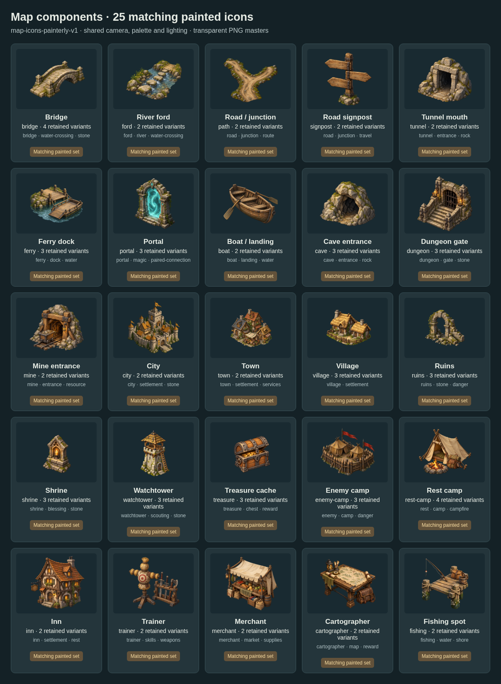

# Matching map-icon collection

**25 transparent painted map icons in one collection: `map-icons-painterly-v1`.**



- **Camera:** elevated three-quarter view, with front and right planes visible.
- **Materials:** weathered gray stone, ochre/tan timber, muted moss and dark iron.
- **Light:** soft upper-left daylight, restrained shadows and highlights.
- **Shape:** clear miniature silhouettes, subtle painted edges, no heavy cartoon outlines.
- **Canvas:** transparent square PNG masters. All delivered masters are 1254 × 1254px. The requested 1536px was not delivered. Alpha bounds are recorded per asset.

## Editable files

| File | Edit here for |
| --- | --- |
| [style-guide.json](style-guide.json) | Shared palette, camera, lighting and framing contract |
| [prompt-prefix.txt](prompt-prefix.txt) | Exact common generation brief; each provenance file adds its subject |
| [manifest.json](manifest.json) | Individual PNG IDs, component IDs, style IDs, hashes and alpha measurements |
| `map-*.provenance.json` | Exact prompt, original source output and measured delivery information |
| [../hex-world-module/art/map-props.json](../hex-world-module/art/map-props.json) | Component pools and historical variants |
| [../hex-world-module/map-components.json](../hex-world-module/map-components.json) | Required style and placeholder policy |

## Coverage

- **Travel:** bridge, ford, path, signpost, tunnel, ferry, boat, portal.
- **Adventure:** cave, dungeon, mine, ruins, shrine, watchtower, treasure, enemy camp.
- **Settlements:** city, town, village, inn.
- **Services:** rest camp, trainer, merchant, cartographer, fishing.

## Keep additions consistent

1. Start with the shared prompt and keep camera, lighting and materials fixed.
2. Give the source manifest and art mapping the same `styleSetId`.
3. Compare the result with the full collection, then at 64px and 128px on contrasting terrain colors.
4. Reject obvious changes in camera, saturation, outlines or rendering. A style ID alone does not establish visual consistency.
5. Vary biome details through snow, moss, roof wear or small accents while preserving the common rendering style.

The active proposal selector requires this collection. Older paintings and technical icons remain mapped for provenance; they cannot silently substitute for missing matching art. Existing component IDs, gameplay tags and placement rules remain the connection to tile data.

## Rebuild measurements and previews

From the repository root:

```sh
python art/map-battlefield-drafts/batch-07-map-icons/build-manifest.py
node art/map-battlefield-drafts/style-system/build-library.mjs
node art/map-battlefield-drafts/style-system/apply-metadata.mjs
node art/map-battlefield-drafts/hex-world-module/map-components.mjs --export
node art/map-battlefield-drafts/hex-world-module/render-map-components.mjs
node art/map-battlefield-drafts/hex-world-module/validate.mjs
```

The measurement script reads original generated output files and asserts byte-identical retained PNGs. It requires those originals to remain available; all recorded hashes and measurements are already retained in this batch. It never resizes, trims or paints an image. Browser previews compose unchanged sources at display size.

- [Previous mixed-style sheet](preview-before.png)
- [64px / 128px readability and contrast sheet](preview-readability.png)
- [Visual review and remaining limitations](REVIEW.md)

These are unregistered feature-branch drafts. Production map rendering and final 256/512px export are separate integration steps.
