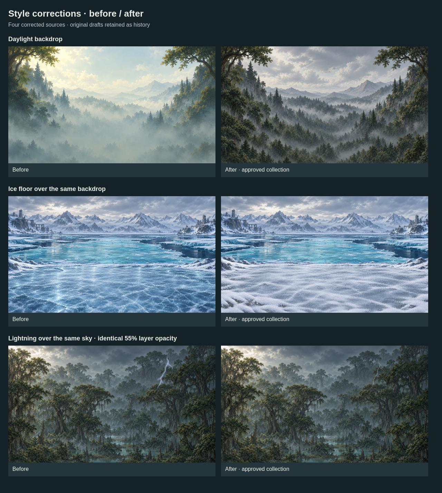

# Component style alignment

**Four original imagegen corrections** align the remaining style outliers with the shared painted world.

- **Ice bank:** matte frost-scuffed ice replaces glossy reflections and sharp central crack patterns.
- **Daylight forest backdrop:** muted gray-green foliage and neutral daylight replace the cream/mint color wash.
- **Lightning leader/main:** fine off-white branches replace the broad hard blue halo.

Every source is an unchanged generated PNG, **1672 × 941px**. Requested 3072 × 1728px was not delivered; no upscaling is claimed. Exact prompts, edit references, source paths, hashes and dimensions are retained in provenance sidecars and [manifest.json](manifest.json).

The corrected ice bank is selected by the regional shore pools/scenes. The weather catalog, atmosphere recipe and lightning timing contract select the corrected frames. The forest-day layered example is in [composition.example.json](composition.example.json). Original sources remain in their earlier batches as superseded history.

- [Shared editable style module](../style-system/README.md)
- [Approved layered scenes](preview-scenes.png)
- `build-manifest.py` measures unchanged original PNGs; it requires their recorded generated source paths.
- `render-previews.mjs` composes PNGs through Chromium using the editable JSON; comparison-only panels deliberately show historical sources.

Alpha fringes, wider camera overscan and precise lightning-frame registration remain production tasks. The new ground's measured center horizon is used for the shore prop placement. No game-runtime integration is introduced.
