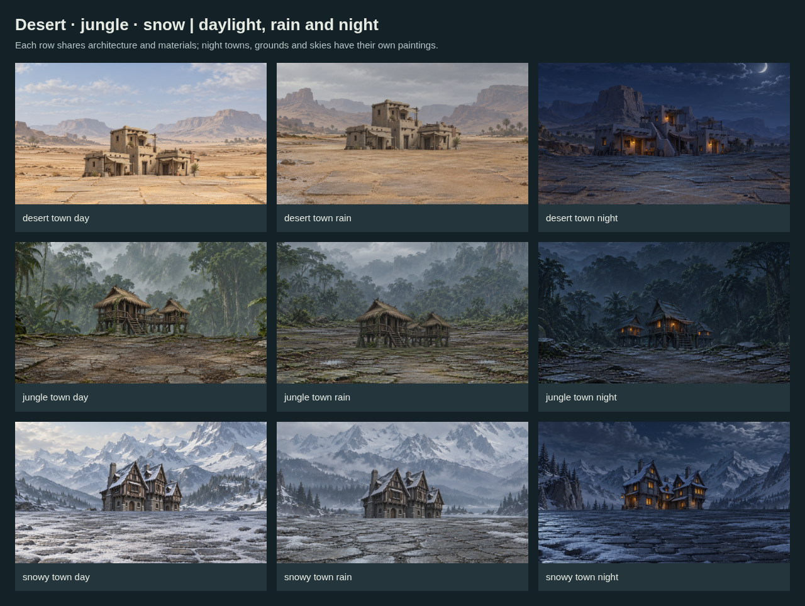

# Mountains, architecture and dungeon components

**45 original paintings** for desert, jungle and snowy settings, plus dry/volcanic/snowy mountains. Every PNG belongs to the shared `ashen-spire-painted-v1` direction.



## Included

| Family | Count | Contents |
| --- | --- | --- |
| Mountain props | 6 | Dry, volcanic and snowy ridges; separate near and faded distant paintings |
| Architecture props | 15 | City skyline, town cluster, castle, dungeon entrance and painted night town for each biome |
| Grounds | 12 | Daylight, rainy and night streets plus a dungeon floor per biome |
| Backdrops | 12 | Daylight, rain, night and dungeon interior per biome |

Cities and towns are independent rear architecture layers. Castles and dungeon entrances are complete transparent props. Mountains are transparent props with separate depth tags; distant versions simplify and fade their painted forms. Grounds and backdrops keep stronger peripheral detail and quiet playable centers.

Rain remains a separate existing particle/filter layer. Night towns, streets and skies have dedicated paintings. City/castle/entrance night previews reuse neutral unlit props with **explicit ambient grading** in JSON; these are not newly painted night relights of those buildings. Dungeon interiors use local ambient light and exclude outdoor weather.

## Editable modules

Start at [modules/index.json](modules/index.json).

- `modules/conditions.json`: daylight, rain and night conditions.
- `modules/mountains.json`: six mountain assets and depth/terrain tags.
- `modules/{desert,jungle,snowy}/pools.json`: 39 art pools and their tags.
- `modules/{desert,jungle,snowy}/scenes.json`: **39 scene combinations**—city, town, castle and dungeon entrance in all three conditions, plus one interior per biome.
- [composition.example.json](composition.example.json): portable export with `assetBase: "."` relative to this batch directory.
- [manifest.json](manifest.json): all source IDs, tags, native dimensions, SHA-256 hashes, measured alpha bounds and ground horizons.

Module paths resolve from the index. Asset paths resolve from the index's `assetBase` (the batch directory); the portable export uses the same files from its own directory. These are ordinary JSON files for editing in other tools. Biome names are art-authoring tags; no new live-world regions or gameplay assignments are created.

## More pictures

- [Cities, castles and entrances](preview-architecture.png)
- [Dungeon entrances and interiors](preview-dungeons.png)
- [Near and faded distant mountains](preview-mountains.png)
- [Portrait, landscape and ultrawide crops](preview-cameras.png)
- [All 39 scene combinations](preview-all-scenes.png)
- Source sheets: [desert](preview-assets-desert.png), [jungle](preview-assets-jungle.png), [snowy](preview-assets-snowy.png), [mountains](preview-assets-mountains.png).
- [Review and limitations](REVIEW.md)

## Rebuild and validate

```sh
python art/map-battlefield-drafts/batch-09-biome-architecture/build-manifest.py
node art/map-battlefield-drafts/style-system/build-library.mjs
node art/map-battlefield-drafts/style-system/apply-metadata.mjs
node art/map-battlefield-drafts/batch-09-biome-architecture/scenes.mjs --check
node art/map-battlefield-drafts/batch-09-biome-architecture/render-assets.mjs
node art/map-battlefield-drafts/batch-09-biome-architecture/render-previews.mjs
node art/map-battlefield-drafts/style-system/validate.mjs
```

The measurement script requires the recorded original generated files and the agents' hash-bound visual reviews. It checks byte-identical PNG copies; it never edits image pixels. Preview scripts compose unchanged paintings through Chromium. Prop placement uses measured bounds and ground horizons, adapting the requested size to each camera.

Requested canvas sizes are not treated as delivered resolution. Measured native dimensions remain authoritative. These are unregistered source drafts; alpha cleanup, exact actor scale and expanded edges for unrestricted camera movement remain production tasks.
