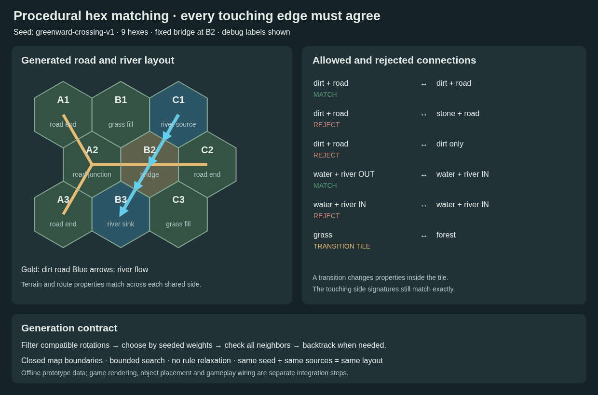

# Touching-edge compatibility and procedural generation

**Every touching edge must share the same profile and complete tag set.** Sharing only one property is insufficient: `dirt + road` matches another `dirt + road`, while `stone + road` and plain `dirt` both fail.



## JSON modules

| File | Edit |
| --- | --- |
| [generation/edge-profiles.json](generation/edge-profiles.json) | Ten edge signatures: surfaces, routes, river water and banks |
| [generation/tile-templates.json](generation/tile-templates.json) | Thirteen rotatable topology templates, weights and biome tags |
| [generation/rules.json](generation/rules.json) | Exact matching, closed boundaries, search limits, example seed and anchors |
| [generation/layout.example.json](generation/layout.example.json) | Generated nine-hex example; regenerate after source edits |
| [tiles/](tiles/) | Existing authored tiles, now using the same edge profiles |

## A dirt-road edge

```json
{
  "edgeProfileId": "dirt-road",
  "tags": ["dirt", "road"],
  "connector": {
    "kind": "road",
    "flow": null
  },
  "missingNeighbor": "boundary"
}
```

Its neighbor's opposite-facing side must use the same profile and tag set. Tag order is irrelevant. Missing or extra matching tags are errors. Edge tags are the hard matching signature; tile-level tags still describe biome, landmarks and gameplay.

| First edge | Touching edge | Result |
| --- | --- | --- |
| dirt + road | dirt + road | Allowed |
| dirt + road | stone + road | Rejected |
| dirt + road | dirt without road | Rejected |
| grass | forest | Rejected; use a transition tile |
| grass + bank | grass + bank | Allowed |
| water + river OUT | water + river IN | Allowed |
| water + river IN | water + river IN | Rejected |

Road/river tags must agree with the connector kind. River flow remains separate from the tag signature so matching water edges can have opposite directions.

## Transitions happen inside a tile

A grass-to-forest template can expose grass on three sides and forest on three other sides. Each shared boundary still matches exactly. Likewise, a dirt-to-stone road transition would expose a dirt-road profile at one end and stone-road at the other. Author that topology explicitly before allowing such a transition.

A tile's center biome can differ from its edges. For example, a bridge can have dirt approaches, a river below and stone architecture in its center. This preserves continuity without forcing every tile to be visually uniform.

The six authored examples now include matching `forest-bank` and `grass-bank` edges where forest/settlement land touches the riverbank. All seven existing shared boundaries validate.

## Rotation-aware candidate selection

The pointy-top odd-r geometry and clockwise side order remain **E, SE, SW, W, NW, NE**. Convert local sides into world directions before comparing a candidate with its neighbors.

The helper `rotationCandidates()` returns only compatible orientations. For the bridge:

- A dirt road on the west allows two bridge orientations.
- Adding a northeast river neighbor with outward flow narrows that to **rotation step 1**.
- A stone-road neighbor is rejected when the exposed bridge approach is dirt-road.

Map icons and combat layers remain upright according to their own art rules. Topology rotation does not rotate the battlefield scene.

## Offline generation prototype

The module includes a working, deterministic data generator:

1. Expand the topology templates into valid local edges.
2. Respect fixed tile/rotation anchors, such as the B2 bridge.
3. Pick the unfilled cell with the fewest currently legal candidates.
4. Order candidates using seeded template weights, distributing each template's weight across its allowed rotations.
5. Compare all filled neighbors and reject road/river exits outside the closed rectangle.
6. Backtrack if a later cell cannot be filled.
7. Stop with an explicit failure if constraints are impossible or the assignment budget is exhausted. Never emit a partial layout or loosen matching rules.

Default limits are 256 cells and 10,000 attempted assignments. The example is a 3×3 grid with a fixed bridge at B2, seed `greenward-crossing-v1`, connected roads, a river source and a sink. These limits are for a small authoring prototype; there is no claim of large-world generation performance.

Same seed, templates, rules and generator version reproduce the same layout. A source fingerprint detects stale generated examples. Save generated layouts and content versions when building persistence; a seed alone does not preserve a world after catalog changes.

## Commands

From the repository root:

```sh
# Edit rules.json to change the example seed, dimensions or fixed tiles.
node art/map-battlefield-drafts/hex-world-module/hex-generation.mjs --generate
node art/map-battlefield-drafts/hex-world-module/validate.mjs
node --test art/map-battlefield-drafts/hex-world-module/validate.test.mjs art/map-battlefield-drafts/hex-world-module/map-components.test.mjs art/map-battlefield-drafts/hex-world-module/hex-generation.test.mjs
node art/map-battlefield-drafts/hex-world-module/render-generation.mjs
```

The last command regenerates the editable SVG and PNG diagram from the generated JSON. The diagram deliberately shows debug labels and connections; the map's grid/label defaults remain off.

## Scope and next wiring

This generates and validates **topology data**. It does not install the generated cells into the live atlas, paint terrain, scatter props, roll encounters, grant rewards or save a run. Generated layouts do not replace the six authored examples.

Local edge continuity does not guarantee that every city shares a road network, every quest is reachable, or every river reaches a designated destination. Add those global checks and landmark constraints when connecting the generation module to the world builder. Existing component spacing, discovery, level and loot contracts remain the next stage after a valid layout is accepted.
