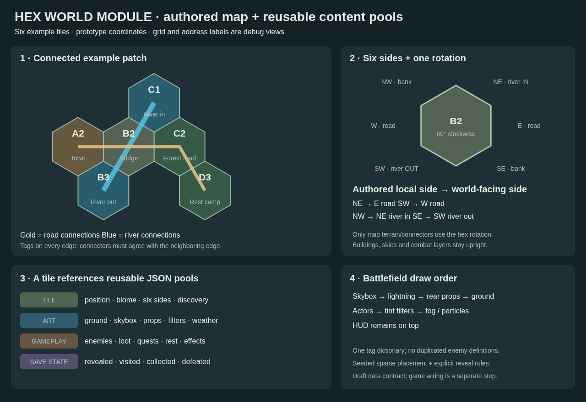

# Hex world module — editable proposal

**A tile describes a place. Separate JSON catalogs describe what can appear there.**

Start with [index.json](index.json). This standalone module contains six connected example hexes, six tagged sides per hex, reusable art pools, enemy definitions and gameplay references. IDs and positions are proposed examples; they do not assign the existing 200 world nodes to hex coordinates. Production bindings remain null.



## Open the part you want to edit

| Edit | JSON module |
| --- | --- |
| Module registry and selection rules | [index.json](index.json) |
| Edge compatibility and procedural templates | [GENERATION.md](GENERATION.md), [generation/rules.json](generation/rules.json) |
| Grid, map bounds and tile file list | [map.json](map.json) |
| Blank tile template | [templates/tile.template.json](templates/tile.template.json) |
| Tile position, biome, sides, rotation and content references | [tiles/bridge.json](tiles/bridge.json), or another file under `tiles/` |
| Shared tag vocabulary | [catalogs/tags.json](catalogs/tags.json) |
| Biome definitions | [catalogs/biomes.json](catalogs/biomes.json) |
| Map component definitions | [map-components.json](map-components.json) + category catalogs under `components/` |
| Object instances and discovery mappings | [map-objects.json](map-objects.json) |
| All map icon variants, separate from combat props | [art/map-props.json](art/map-props.json) |
| Battlefield grounds | [art/ground.json](art/ground.json) |
| Backgrounds / skyboxes | [art/skybox.json](art/skybox.json) |
| Battlefield props | [art/props.json](art/props.json) |
| Day/night filters | [art/filters.json](art/filters.json) |
| Fog, rain and distant lightning | [art/weather.json](art/weather.json) |
| Enemy definitions | [gameplay/enemy-types.json](gameplay/enemy-types.json) |
| Enemy combinations, weights and conditions | [gameplay/encounter-pools.json](gameplay/encounter-pools.json) |
| Level bands | [gameplay/level-bands.json](gameplay/level-bands.json) |
| Loot and rewards | [gameplay/loot-tables.json](gameplay/loot-tables.json), [rewards](gameplay/rewards.json) |
| Reveals, discoveries and rest | [reveal rules](gameplay/reveal.json), [discoveries](gameplay/discoveries.json), [rest spots](gameplay/rest-spots.json) |
| Trainers, quests and buffs/debuffs | [trainers](gameplay/trainers.json), [quests](gameplay/quests.json), [effects](gameplay/effects.json) |
| Example player progress, separate from authored content | [runtime/example-state.json](runtime/example-state.json) |

[GENERATION.md](GENERATION.md) defines strict touching-edge profiles and a seeded offline layout generator.

[MAP-COMPONENTS.md](MAP-COMPONENTS.md) connects all 25 object types to 25 active matching icons and 39 historical variants, tile instances and discovery rules.

[REWARDS-AND-LEVELS.md](REWARDS-AND-LEVELS.md) lists possible rewards and the four proposed level bands.

[EXAMPLES.md](EXAMPLES.md) shows short JSON excerpts. [VISION.md](VISION.md) explains suggested authoring and gameplay behavior.

## Six connected examples

| Address | Tile | Purpose |
| --- | --- | --- |
| A2 | Westwatch | Town and start of the road |
| B2 | Bridge | Road crosses a river; demonstrates a rotated tile |
| C2 | Forest road | Branches toward a rest camp; forest encounter pool |
| C1 | Upstream | River flows toward the bridge |
| B3 | Downstream | River flows away from the bridge |
| D3 | Rest camp | Rest rules and reusable camp art |

These six files form a small connected patch. Empty coordinates inside the example bounds are allowed; they are not implicitly generated tiles. Roads and rivers continuing beyond the authored patch need an explicit continuation policy.

## Coordinates and rotation

- Grid lines and tile labels each default to **false** in `map.display`. Turning on the grid never implies labels.
- Preserve the earlier proposal's **pointy-top, odd-r** hex grid. `column` and `row` are zero-based, with odd rows shifted right.
- A1 labels are derived from position: column 0/row 0 → A1; column 1/row 1 → B2. The stored label is checked against the coordinates.
- Local sides run clockwise: **E, SE, SW, W, NW, NE**.
- `orientationSteps` is an integer from 0 to 5. One step is 60° clockwise.
- `worldSideIndex = (localSideIndex + orientationSteps) % 6`.
- At B2, local NE/SW road exits become world E/W. Local NW river-in becomes world NE; local SE river-out becomes world SW.
- Rotation affects the authored edge layout. Map terrain can follow it; buildings and other upright icons do not. Battlefield layers are composed separately and never rotated as one hex sprite.
- Each side has an `edgeProfileId`, its exact matching tags, an optional connector and a missing-neighbor policy. Neighboring edges must share the profile and complete tag set. Transitions expose different profiles on different sides; river flows must be opposite.

## Pools and references

- A tile stores IDs, not copied enemy definitions or long asset lists. Changing an enemy type or shared pool updates every referring tile conceptually.
- `all`, `any` and `exclude` are explicit tag predicates. Empty `all`/`any` lists add no restriction. Weights are normalized only among eligible entries.
- Pool draw counts control how many items are selected. An empty, zero-draw prop/weather pool deliberately means no decoration/effect.
- Enemy encounter chance is separate from enemy selection weights. Map discovery rolls are separate from encounters and fog reveal.
- Map icons use a complete 25-piece painted collection with one required style ID. Fifteen earlier paintings and 24 technical placeholders remain mapped as inactive history. Dedicated 256/512px hex terrain exports remain pending with null references.
- Town uses a courtyard candidate. Bridge uses a borrowed wet-stone floor while a bridge-deck painting is pending. These references demonstrate the data contract, not approved location art.
- All file references resolve according to the index's path rules. Art files declare `assetBase`; this avoids repeating long PNG paths on every tile.

## Add a tile

1. Copy [the blank tile template](templates/tile.template.json) into `tiles/` with a unique file name and ID.
2. Set its position/label, biome, tags and six sides; choose art/gameplay pool IDs.
3. Add its file path to `map.json` → `tiles`. Update bounds if needed.
4. Validate. The template is schema-checked but is not a placed map tile until registered.

## Validate after editing

Requires Node.js and Python with `jsonschema` installed:

```sh
node art/map-battlefield-drafts/hex-world-module/validate.mjs
node --test art/map-battlefield-drafts/hex-world-module/validate.test.mjs art/map-battlefield-drafts/hex-world-module/map-components.test.mjs art/map-battlefield-drafts/hex-world-module/hex-generation.test.mjs
```

The [JSON Schema](schemas/module.schema.json) checks document structure. The validator checks cross-file IDs, tags, asset paths, tile positions, all six sides, rotation and reciprocal road/river connections. Use both: JSON syntax alone cannot detect a road that ends against an incompatible neighbor.

This is an authoring contract with a working offline topology generator. Rendering, procedural object placement, enemy spawning, loot, weather, reveal rules and persistence remain game integration work. [vision.svg](vision.svg) is the editable illustration source.
