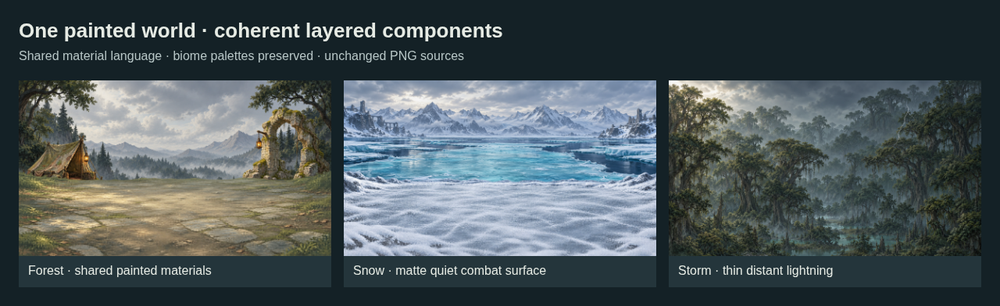

# One art direction for every component

**231 approved active sources:** 25 map icons, 58 grounds, 85 battlefield props, 49 backdrops and 14 atmosphere components.

All use `ashen-spire-painted-v1`: tactile painted materials, muted biome palettes, restrained highlights and consistent scene lighting. Map miniatures retain their elevated camera; battlefield layers use a low side view. Smooth translucent filters and sparse particles remain simple so they support the paintings.



## Editable JSON modules

| File | Purpose |
| --- | --- |
| [style-guide.json](style-guide.json) | Shared art direction and list of role profiles |
| [palettes.json](palettes.json) | Regional materials and day/night palette guidance |
| [profiles/](profiles/) | Eight small role-specific camera, material, light and framing contracts |
| [library.json](library.json) | Every retained source, exact path/hash, role, family and review verdict |
| `audit-*.json` | Asset-by-asset visual review, tied to the reviewed source hash |
| [replacements.json](replacements.json) | Four original outliers and their approved replacements |

The library indexes **275 retained sources**: 251 source-art drafts plus 24 earlier technical icons. Of these, 231 are approved, 40 are inactive history, and four are superseded by corrected sources. Historical assets remain available for comparison; active catalogs and regional scene pools reject them.

## Visual checks

- [Grounds · all 58](preview-grounds.png)
- [Battlefield props · all 85](preview-props.png)
- [Skies/backdrops · all 49](preview-backdrops.png)
- [Atmosphere · all 14](preview-atmosphere.png)
- [Map icons · all 25](../hex-world-module/map-components-preview.png)
- [New biome scenes and mountains](../batch-09-biome-architecture/README.md)
- [Close-location art: 86 sources and 28 scenes](../batch-10-location-streets/README.md) · [modules](../batch-10-location-streets/modules/index.json) · [12 intro-map mappings](../batch-10-location-streets/modules/intro-map.json)
- [Before/after corrections](../batch-08-style-alignment/preview-comparison.png)

Three Sol 6.1 reviewers inspected the grounds, props and sky/weather families. The earlier map collection also received an independent visual review. Review decisions distinguish intentional biome/time-of-day variations from camera, material or palette outliers. Style metadata alone does not establish visual consistency.

## Adding a component

1. Choose its role profile and biome palette before generating art.
2. Review it beside that family and inside a layered scene. Check small-size readability where applicable.
3. Add a verdict and the exact reviewed PNG SHA-256 to the appropriate audit module. Changing a source hash invalidates the earlier approval.
4. Rebuild the library, apply metadata and regenerate affected exports.
5. Validate before selecting the asset in a pool. A family match cannot place a map miniature into a battlefield-prop slot.

```sh
node art/map-battlefield-drafts/style-system/build-library.mjs
node art/map-battlefield-drafts/style-system/apply-metadata.mjs
node art/map-battlefield-drafts/hex-world-module/map-components.mjs --export
node art/map-battlefield-drafts/batch-06-settlements/json-modules.mjs
node art/map-battlefield-drafts/batch-10-location-streets/scenes.mjs --check
node art/map-battlefield-drafts/style-system/validate.mjs
node art/map-battlefield-drafts/style-system/render-previews.mjs
```

The regular hex-module validator and regional JSON loader also enforce family and role compatibility. Portable exports preserve the approved source choices.

## Remaining production work

- Existing alpha fringes and low-alpha dust need per-asset cleanup.
- Wide scene paintings still need expanded edges for unrestricted portrait/ultrawide camera travel. Oversized 4096px overlay fields keep their existing coverage rules.
- Corrected lightning has matching canvas dimensions but slightly different branch shapes; register the pair and tune opacity before runtime binding.
- Anchors, actor scale and final output sizes still need production calibration. These remain unregistered feature-branch drafts.
