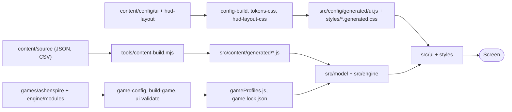
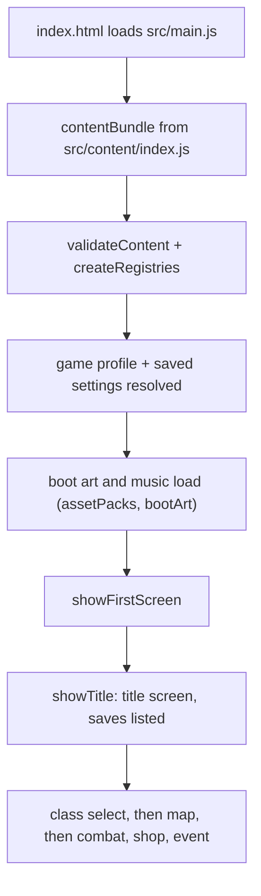

# Code map: where do I go to change X?

Task-first guide for editing in Visual Studio. Last checked against dev `7ad843ccc` on 2026-11-08.

- **Not** an architecture doc. For the why, see [ARCHITECTURE-MAP](ARCHITECTURE-MAP.md), [ARCHITECTURE-CURRENT-DEV](ARCHITECTURE-CURRENT-DEV.md), [PROJECT-GUIDE](PROJECT-GUIDE.md), [COMPONENT-MODEL-ARCHITECTURE](COMPONENT-MODEL-ARCHITECTURE.md).
- Build and test commands: [DEVELOPER.md](../DEVELOPER.md). Rules: [SPEC.md](../SPEC.md).

## The folders

- **[src/](../src)** runtime that runs in the browser
  - [src/main.js](../src/main.js) boot and run loop
  - [src/ui/](../src/ui) screens, components, display code
  - [src/engine/](../src/engine) combat, saves, rng, map generation
  - [src/model/](../src/model) run state, validation, game-profile glue
  - [src/content/](../src/content) content modules; [generated/](../src/content/generated) is build output
- **[engine/](../engine)** headless game-engine parts: [modules/](../engine/modules), [contracts/](../engine/contracts), [runtime/](../engine/runtime), [ui/](../engine/ui)
- **[games/ashenspire/](../games/ashenspire)** this game's profile: [game.json](../games/ashenspire/game.json), [maps/](../games/ashenspire/maps), [ui/screens/](../games/ashenspire/ui/screens), [bundles/](../games/ashenspire/bundles)
- **[content/](../content)** authored data
  - [source/](../content/source) cards, enemies, items, balance (JSON and CSV)
  - [config/ui/](../content/config/ui) tokens, screens, components
  - [hud-layout/](../content/hud-layout) per-device HUD layout
- **[styles/](../styles)** CSS; two files are generated
- **[tools/](../tools)** build, check and QA scripts (`node tools/<name>.mjs`)
- **[tests/](../tests)** `*.test.mjs` plus browser checks ([README](../tests/README.md))
- **[desktop/](../desktop)** Electron and Steam wrapper ([STEAM.md](../desktop/STEAM.md))
- **[docs/](.)** guides, specs, QA evidence

## How data flows

- **Why:** you edit data, a tool turns it into JS or CSS, the runtime only reads the output.

## What runs at start

- **Why:** [src/main.js](../src/main.js) is one big orchestrator; search it for `showTitle` to find the entry.

## I want to... | Go to | Then run

- **Using `npm run dev`?** On save it reruns `content-build`, `config-build`, `hud-layout-css`, `tokens-css`, `game-config build` and `framework-data-build` for the file you changed, then reloads the page ([tools/serve.mjs](../tools/serve.mjs) `buildToolsFor`).
  - Core enemy sheet edits still need `node tools/jev.mjs regen`: the watcher does not run `enemy-sheets` or `derived-tables`. Run other build and check commands below when the watcher does not cover them, and before committing.

| I want to... | Go to | Then run |
|---|---|---|
| Change a **card** stat | Core basic cards: [core/cards.json](../games/ashenspire/packs/core/cards.json); base reward cards: [base-cards/cards.json](../games/ashenspire/packs/base-cards/cards.json). Shared cards: [content/source/cards/](../content/source/cards), [basicCardProfiles.csv](../content/source/basicCardProfiles.csv) | `node tools/jev.mjs regen` |
| Change a **Core enemy** | [games/ashenspire/packs/core/enemies/](../games/ashenspire/packs/core/enemies) character sheets ([Editing enemies](../DEVELOPER.md#editing-enemies)) | `node tools/jev.mjs regen` (runs `enemy-sheets --write`, `derived-tables` and the content/profile builds) |
| Change an **item / weapon** | Core gear ratings and points: [core/gear.json](../games/ashenspire/packs/core/gear.json), [gear settings](../engine/modules/gear). Shared presentation and item data: [weapons.csv](../content/source/weapons.csv), [relics.json](../content/source/relics.json), [equipSlots.csv](../content/source/equipSlots.csv) | `node tools/jev.mjs regen` |
| Change **balance numbers** | Shared tables: [content/source/balance*.json](../content/source). Core module settings: [Core bundle](../games/ashenspire/bundles/core/bundle.json) overrides [engine/modules/](../engine/modules) defaults | `node tools/jev.mjs regen` |
| Change **combat rules** | [src/engine/combat.js](../src/engine/combat.js), [combatRules.js](../src/engine/combatRules.js), [src/content/combatRules.js](../src/content/combatRules.js) | `npm test` |
| Change a **screen layout** | [src/ui/screens/](../src/ui/screens), [content/config/ui/screens/](../content/config/ui/screens), [styles/](../styles) | `node tools/config-build.mjs`, `npm run validate:ui` |
| Change **HUD layout** | [content/hud-layout/](../content/hud-layout) ([guide](hud-layout-tokens.md)) | `node tools/hud-layout-css.mjs --write` |
| Change **font sizes, layers, motion** | [content/config/ui/tokens.json](../content/config/ui/tokens.json) | `npm run tokens:css` |
| Change **theme colours** | [styles/base.css](../styles/base.css) `:root`, `body.hi-contrast`, `body.cb-safe` (moving to tokens.json) | `npm run lint:style` |
| Add a **UI component** | [src/ui/components/](../src/ui/components), [content/config/ui/components/](../content/config/ui/components) | `npm run validate:ui`, `npm test` |
| Change **text / copy** | [content/source/uiStrings.csv](../content/source/uiStrings.csv), [src/ui/strings.js](../src/ui/strings.js) | `node tools/content-build.mjs` |
| Change a **game profile / module** | [games/ashenspire/game.json](../games/ashenspire/game.json), [engine/modules/](../engine/modules) | `node tools/game-config.mjs build`, `node tools/build-game.mjs` (`npm run build:game` only checks) |
| Change **saves** | [src/engine/save.js](../src/engine/save.js), [saveMeta.js](../src/engine/saveMeta.js) | `npm test` |
| Change **map / world** | [games/ashenspire/maps/](../games/ashenspire/maps), [src/engine/mapgen.js](../src/engine/mapgen.js) | `npm run validate:maps` |
| Change **art lookup** | [src/ui/assetmap.js](../src/ui/assetmap.js), [art-manifest.json](../art-manifest.json), [asset-data/](../asset-data) | `node tools/art-manifest.mjs --check` |
| Change **sound / music** | [music.json](../content/source/music.json), [sfxRecipes.json](../content/source/sfxRecipes.json), [src/ui/audio.js](../src/ui/audio.js) | `node tools/content-build.mjs` |
| Add a **test** | [tests/](../tests) as `name.test.mjs` | `node --test tests/name.test.mjs` |
| **Run the game** | [tools/launch.mjs](../tools/launch.mjs) | `npm start` |

- **Why "then run":** if you skip it, the game still reads the old generated file and your edit seems to do nothing.
- **Check only:** most tools take `--check` and change nothing.

## Generated files: never edit by hand

- **[src/content/generated/](../src/content/generated)** from `node tools/content-build.mjs`
  - except `gameProfiles.js`, `baseCards.js`, `fixCoreProtection.js`, owned by their own tools
- **[gameProfiles.js](../src/content/generated/gameProfiles.js)** and **[game.lock.json](../games/ashenspire/game.lock.json)** from `node tools/game-config.mjs build`
- **[src/config/generated/ui.js](../src/config/generated/ui.js)** from `node tools/config-build.mjs`
- **[styles/tokens.generated.css](../styles/tokens.generated.css)** from `npm run tokens:css`
- **[styles/hud-layout.generated.css](../styles/hud-layout.generated.css)** from `node tools/hud-layout-css.mjs --write`
- **[engine/ui/index.json](../engine/ui/index.json)** from `node tools/ui-validate.mjs`
- **[src/framework/data/*.js](../src/framework/data)** from `node tools/framework-data-build.mjs` (from [content/framework/](../content/framework))
- **[src/content/changelog.generated.js](../src/content/changelog.generated.js)** from `node tools/about-changelog.mjs --write` (after editing CHANGELOG.md)
- **Never commit** built HTML (`AshenSpire.html`, `dist/*.html`); CI builds it.
- **Why:** hand edits are overwritten on the next build and fail the `--check` tests.

## Checks you will use

- `npm test` fast suite; `npm run test:all` everything
- `npm run validate:config`, `validate:ui`, `validate:maps` data checks
- `node tools/linkcheck.mjs` every import resolves
- `npm run lint:style` CSS rules
