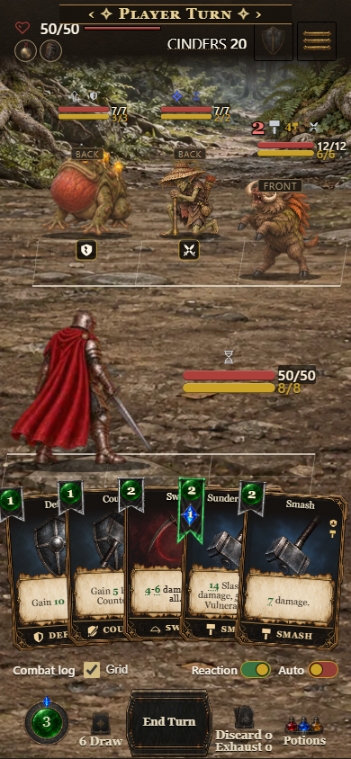
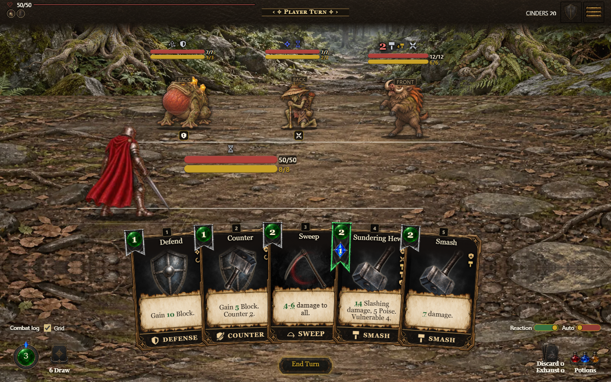
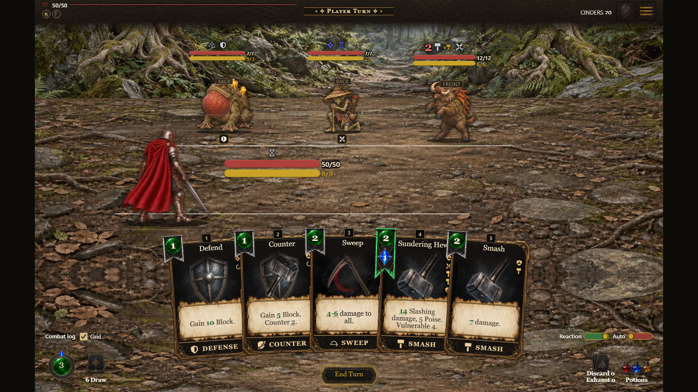
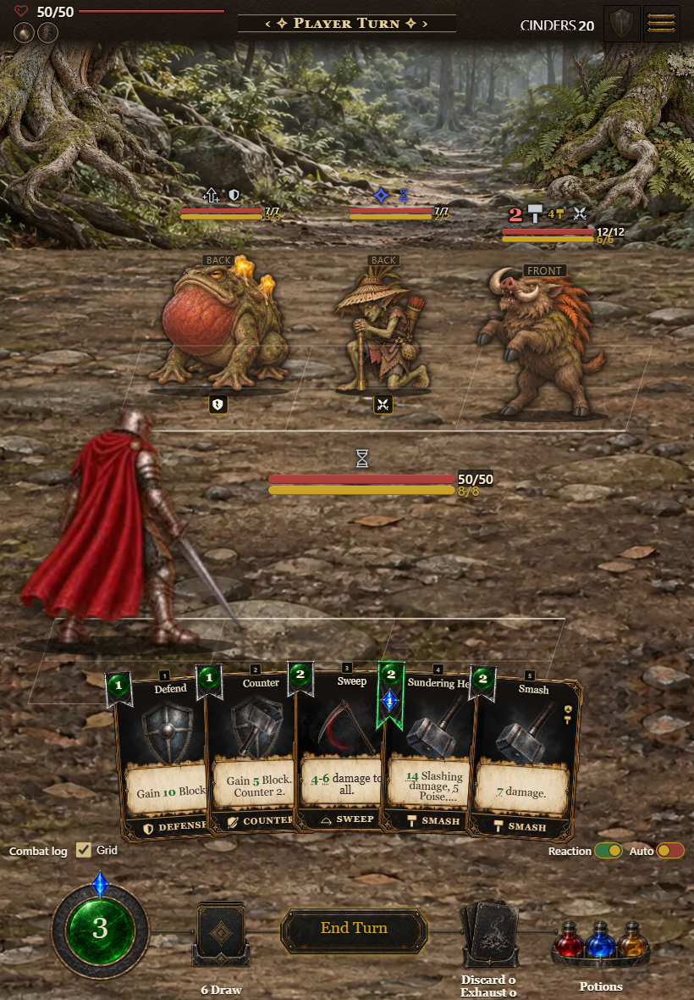
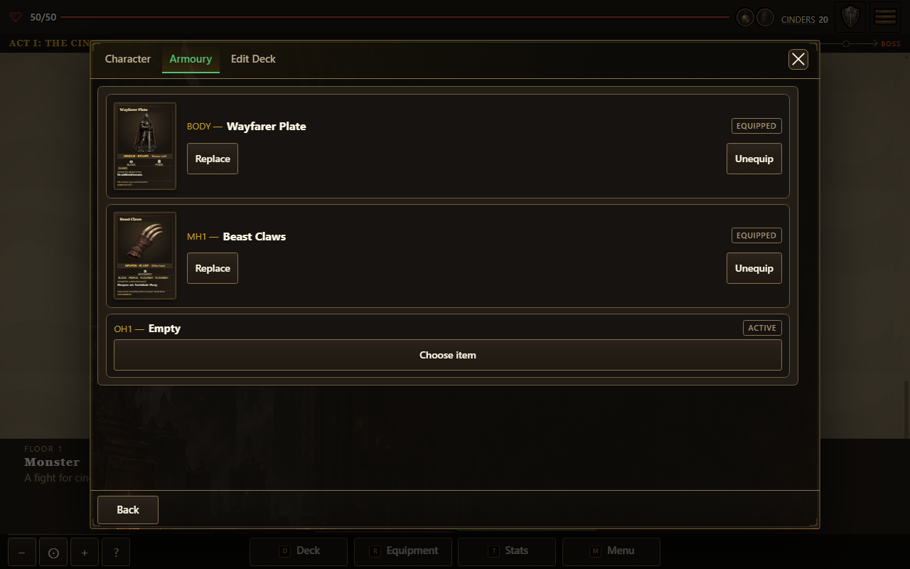
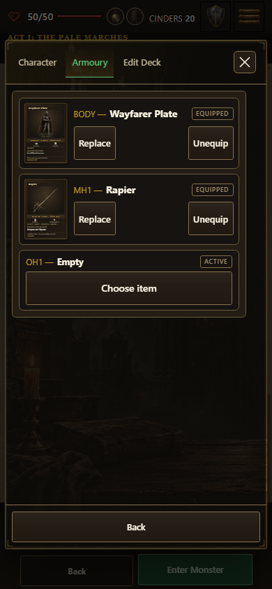
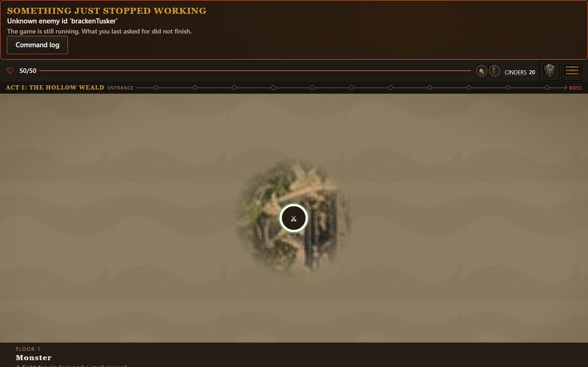
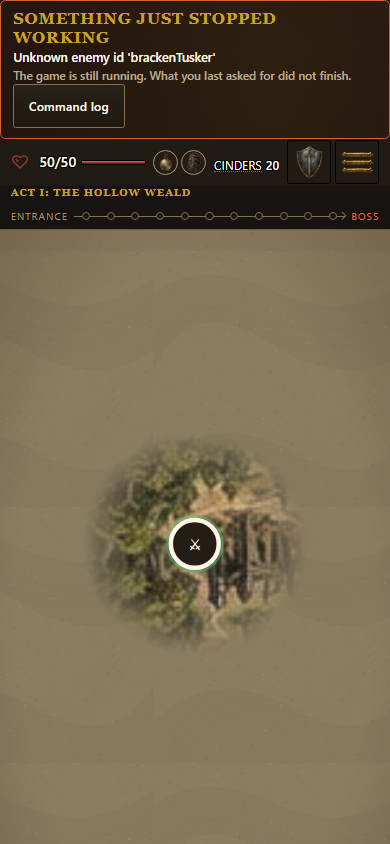

# Codex art buildout verification

Reviewed and tested runtime source: `6a7378b6a039cbe6bc2f7348fbfc8b049abfca35`, including dev `0327759be4`. Captured November 18, 2026, America/Anchorage. The served source's build box was `0.7.4.201`; the CI artifact's generated stamp is `0.7.4.202`. Art is pinned to v29.

[Download the successful exact-source feature build](https://github.com/cehinds/AshenSpire/actions/runs/44482212940/artifacts/14509066914). GitHub sign-in is required to download; extract the archive and open `AshenSpire.html`. The Pages feature endpoint returned HTTP 503 during verification; this published Actions artifact is the fallback.

## Final gates

| Gate | Result |
| --- | --- |
| Core (`npm test`, isolated serial run) | 151 PASS / 0 FAIL |
| `npm run code:check` | PASS |
| Discovered shard 0/4 | 302 files, 2,587 tests, 0 failures |
| Discovered shard 1/4 | 302 files, 2,231 tests, 0 failures |
| Discovered shard 2/4 | 302 files, 2,128 tests, 0 failures |
| Discovered shard 3/4 | 302 files, 2,492 tests, 0 failures |
| Discovered total | 1,208 files, 9,438 tests, 0 failures |
| Required image decoding | 22 scenes PASS / 0 FAIL |
| Sandbox desktop/phone with dev comparison | **164 PASS / 0 FAIL**, exit 0 |
| Actual downloaded standalone | All four visual flows complete; strict network check 2 PASS / 2 FAIL from inherited optional-sample fetch noise |

The exact unsharded discovered command exceeded Windows' command-line limit before executing tests (`ENAMETOOLONG`). Every official zero-based shard was run at the same immutable source in independent clean checkouts. Successful runner output does not expose separate per-test passed/skipped counts; none are invented here. Three discovered files run elsewhere, and four slow files remain outside the no-slow lane. Heavy release/test-branch suites are owned by their existing pipeline.

Clean baseline `66e473a77c` passed core, code check and all 1,205 discovered files / 9,424 tests. The first feature comparison found 15 real regressions. They were fixed through package/data corrections and explicit coverage. Existing pricing assertions were restored, not relaxed.

## Browser evidence

These are deterministic screenshot fixtures, not a full campaign playthrough. The acceptance file uses real production combat and reward/equipment paths. Before captures on dev reject the new enemy/item IDs because their content does not exist there.

The image probe replayed five combat and four claimed/equipped-icon scenes at 1280×800 and 390×844, then added combat and equipment captures at 1600×900 and 820×1180. Each required enemy/item image matched its identity and asset path, had `complete === true`, positive natural and rendered dimensions, and completed `decode()`. No page exceptions occurred.

The actual 187,552,038-byte CI standalone was also opened through `file://` at desktop and phone sizes. Combat and Rapier claim/equip completed at both sizes; every checked embedded image matched the named v29 asset's SHA-256. Its strict console/network probe remains **2 PASS / 2 FAIL**: an optional convention-based `assets/sfx/cardPlay.ogg` warm fetch is unavailable from local-file mode and emits CORS/network noise. The unchanged audio path immediately plays its synth and catches the optional sample failure; there were no JavaScript exceptions. Independent review confirmed this is inherited from clean dev and nonblocking for the art feature. A separate audio fix could avoid warming samples absent from the inlined asset map; no audio behavior was changed here.

| Mobile 390×844 | Desktop 1280×800 | Wide 1600×900 | Tablet 820×1180 |
| --- | --- | --- | --- |
|  |  |  |  |

| Equipped Beast Claws, desktop | Equipped Rapier, phone |
| --- | --- |
|  |  |

| Desktop before: missing content | Desktop after |
| --- | --- |
|  |  |

| Phone before: missing content | Phone after |
| --- | --- |
|  |  |

Raw browser reports, geometry and test logs stay in ignored QA output. Only this concise report and selected inspected screenshots are committed. The exact final command was `npm run qa:sandbox -- docs/qa/acceptance.codex-art-buildout.json --base origin/dev --out scratch/qa/codex-art-final`; its report states **PASS (164 passed, 0 failed)**. The base lacks the new content, so expected before-side failures do not change the final after-side verdict.

## Compatibility and review

- The original saved-profile bytes preserve their hash, 33-enemy roster, references and seeded map/RNG behavior. Removing the roster gate makes the regression fail; current Core still includes all 32 additions.
- All 28 original weapon packages and all 395 legacy cards' resolved base/upgraded prices and Mana categories match clean dev. New defaults reuse existing weapon-art identities; Beast Claws grants `twinbladeFlurry` and Rapier grants `riposte`.
- Every new enemy deck, opener and reserve fits SP/MP with optional modules disabled and across attribute variance.
- The original 35 outfit bindings / 32 paintings are preserved. Five explicitly declared borrowers add 45 selector bindings; all 40 current outfits select existing shipped animations. Unknown appearances still fail.
- Native and production-transform baseline captures agree. Final recapture changed 24 current-profile hash fields only; behavioral and historical capture fields stayed identical. All 24 baseline/determinism assertions pass.
- Independent read-only Codex review found no blocking source issues after the corrections. PR-level review is recorded in the PR once its number exists. Local Claude reviewer authentication was expired.

The [equipment document](codex-equipment-buildout-2026-11-19.md) records mechanics gaps, including the inherited Sceptre Retreat source mismatch. Alpha landmark sign-off, new held sprites, relic icons and the missing Shortbow inventory icon remain outside this delivery. No release or main promotion is authorized by this work.
