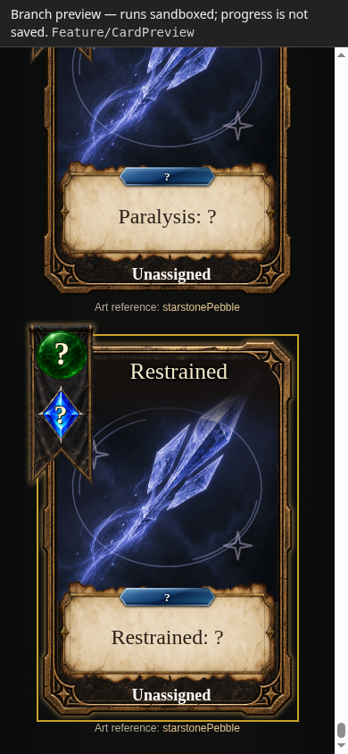
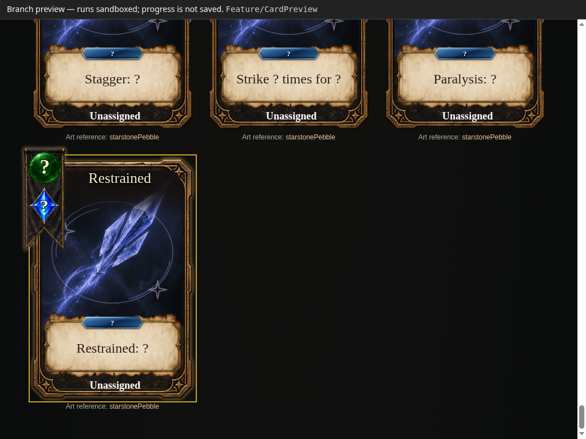
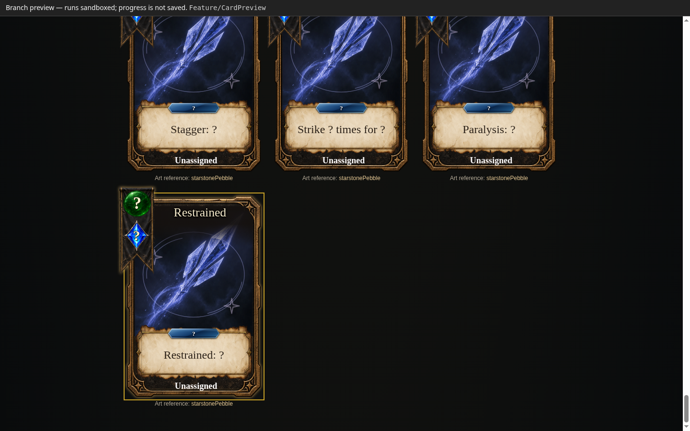
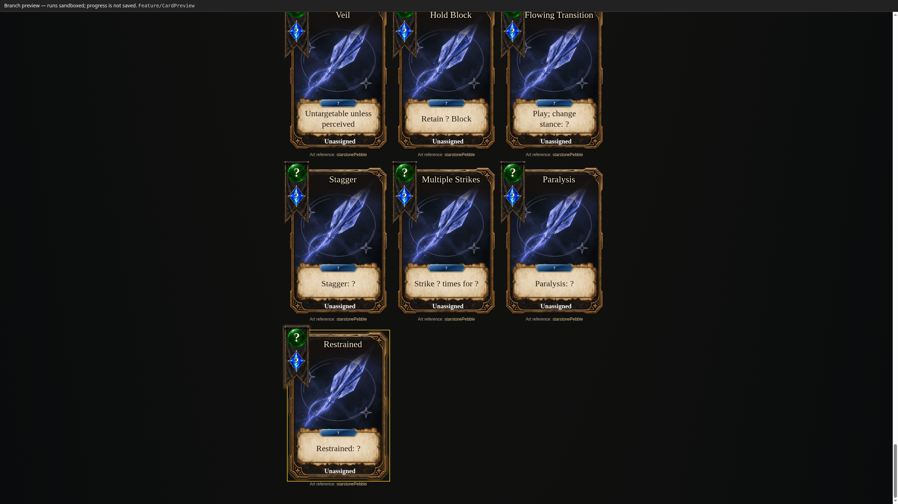

# Standalone proposed-card preview

`build.txt` is the complete HTML document for the public Pages wrapper to fetch into an `iframe sandbox="allow-scripts"` via `srcdoc`. For offline use, copy build.txt to a temporary .html file; no duplicate HTML is committed. It contains the six featured cards, all70 combat/status proposals, the complete inspection rules, current Simple artwork, production title fade and smaller centered effect boxes.

The exporter snapshots the actual current game renderer's DOM and embeds the unchanged production base, kit and illustrated-card styles. It embeds11 unique image assets once in an asset dictionary, plus fonts; no runtime fetch, module import, stylesheet link or external asset is required. The authored frame textures account for most of the11.14MB document. Rendered text sizes become equivalent container-relative values so card typography scales between280px gallery and330px inspection cards.

Regenerate by starting `../ingame-look-preview/server.mjs` against the source checkout, then running `export-standalone.mjs`. Optional environment variables: `ASHENSPIRE_REPO`, `CARD_PREVIEW_URL`, `CARD_PREVIEW_OUTPUT`. The generator requires Playwright via `CODEX_PRIMARY_RUNTIME_NODE_MODULES` and launches Chromium through the project's `tools/browser.mjs`.

`provenance.json` identifies the source game SHA, artifact SHA256, asset paths and asset hashes. `verification.json` records offline-document and opaque-sandbox verification (this environment blocks file:// navigation by administrator policy, so the exact standalone document is loaded into an offline blank page instead). The optional offline-hero.png capture remains in the execution outputs; reviewed screenshots are linked below.

These cards remain visual proposals with unknown costs, rank, school and stance; the preview adds no playable mechanics. Artwork references and full rules are retained from the approved development preview. No game engine, renderer, workflow or repository files were changed by packaging.

## Publishing and capture record

Public route (scroll-fix revision pending verification): https://cehinds.github.io/AshenSpire/branches/Feature/CardPreview/latest/.

**Historical verification of the prior payload; not evidence for the scroll correction.** Trusted runner [38855179710, job 116824927874](https://github.com/cehinds/AshenSpire/actions/runs/38855179710) passed on 2026-10-16 at 05:19:39 UTC. The public index identified artifact source `3094c9203fa8d07ba2fdda5c05d77162efbf83d8`. Wrapper, loader and plaintext payload returned HTTP 200; the downloaded 11,139,723 bytes matched SHA-256 `f402742bbdf84ba368020a0992ee063546c57881f48a6e3f91c791eb60250291`. This pins the approved visual payload, not the latest source HEAD. Compressed HEAD length was 7,529,673 bytes with gzip; the strict length and hash apply to the decompressed GET body. See public-verification-receipt.json.

The dedicated feature-preview workflow validates the committed plaintext build.txt and packages it as the artifact’s only HTML file. The trusted dev Pages publisher serves the payload as build.txt inside its existing opaque-origin sandbox wrapper. This branch does not deploy directly, change Pages settings, or merge game changes.

Renderer source: f7a24e0e39dd7823c15f89afd6023782526655d0. Reviewed visual source: fbee6162589ec2374664c19c4c78ee2795691d7e. Bundle provenance records its exact SHA-256 and export time. This is a visual proposal, not a numbered game build.

Captures are existing reviewed files in ../ingame-look-preview/: mobile.png (390×844), tablet.png (1024×768), desktop.png (1440×900), wide.png (2560×1440), captured 2026-10-16 UTC / 2026-10-15 Anchorage. hero.png and grease-inspection.png show the focused card layouts and full rules. No duplicate PNGs are added here.

Run `node validate-bundle.mjs` for static delivery checks. To regenerate, run the sibling ingame-look-preview server with ASHENSPIRE_REPO set, then use export-standalone.mjs with CARD_PREVIEW_URL, CARD_PREVIEW_OUTPUT and optionally CARD_PREVIEW_PROPOSALS. The copied exporter defaults to the sibling preview’s proposals.json when needed. Exporting requires the same browser/Playwright tools as the reviewed preview; CI only validates and packages the already reviewed bytes.

The scrolling correction is awaiting publication and exact-byte public verification. The previous f402742b… receipt remains historical. The current checker waits for GITHUB_SHA in the public index, then the new approved payload hash; stale CDN bodies are retried at most once per minute for up to 44 minutes.

## Scroll correction capture record

The inherited game page styles fixed the document height and hid overflow. The gallery-specific override gives html and body automatic height and restores vertical document scrolling; the card renderer and artwork are unchanged.

Reviewed candidate: SHA-256 `04e17eaf2cf1ebb3d393d2aa0e26a62f3fe0873f0a3f0e8e3df862debfb28d5a`, 11,139,814 bytes. These are local captures of the exact opaque-origin Pages wrapper, made 2026-10-16 UTC (2026-10-15 Anchorage), not evidence that the public correction has deployed.

| Mobile · 390×844 | Tablet · 1024×768 |
| --- | --- |
|  |  |
| Desktop · 1440×900 | Wide · 2560×1440 |
|  |  |

[Before metrics](scroll-fix/before-metrics.json) and [after metrics](scroll-fix/after-metrics.json) record the reproduced behavior. [Scroll/input reproduction](scroll-fix/check-scroll.mjs), [exact-wrapper server](scroll-fix/serve-exact-wrapper.mjs), and [supplemental native input check](scroll-fix/check-exact-input.mjs) preserve the verification method. The older six-card/art gallery remains [historical visual reference](../ingame-look-preview/README.md).
