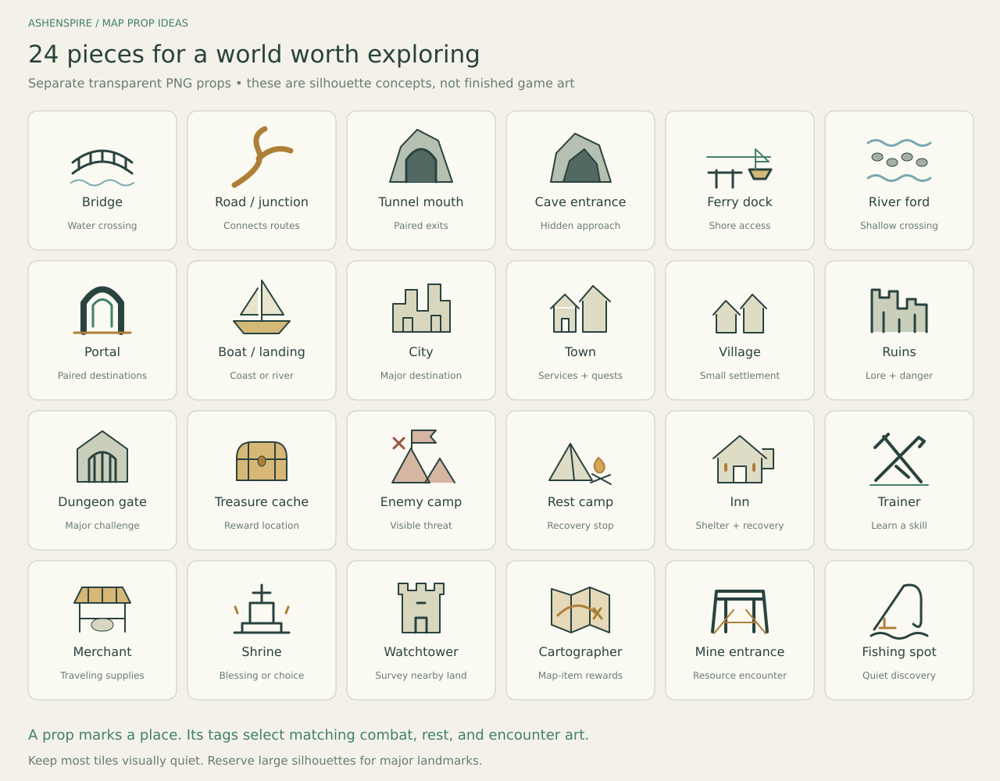
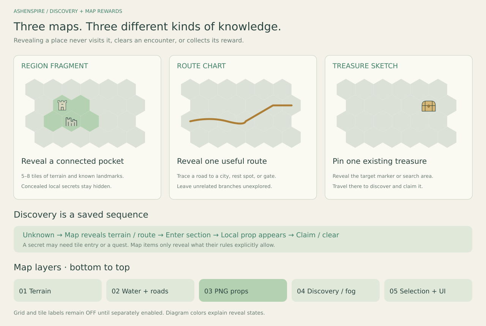

# Layered map props and discovery

**Recommended direction:** a painted landscape with separate PNG landmarks, sparse discoveries, and useful map rewards. This extends the design proposal; it does not yet change the game.

## 1. Build the map in layers

- **Terrain:** grass, jungle, snow, cliffs and clearings.
- **Water and connected routes:** rivers, roads, trails, bridge approaches.
- **PNG props:** buildings, entrances, boats, camps and treasure.
- **Fog/discovery:** hide only what the player has not learned.
- **Selection/UI:** selected location, optional grid, optional tile labels.

**Keep Grid and Labels independently OFF by default.** A known location can still have an icon without a text label.

**PNG production rules:**

- Use transparent backgrounds and consistent perspective, palette and light direction.
- Author most props at 512 px; use 256 px delivery variants where suitable. Large towns may need 1024 px masters.
- Give each prop a ground anchor, placement footprint, click target and minimum readable display size.
- Sort overlapping props by their ground contact point. Bridge decks sit over water; boats meet the waterline.
- Keep route pieces separate from landmark badges: roads need curves, junctions, endings and reciprocal tile-edge connectors.
- Use orientation variants for bridges/roads. Rotating a painted building can rotate its lighting incorrectly.
- Keep discovered, cleared, claimed and disabled state badges separate from the base art.
- Match the map landmark to the combat/rest prop family: a ruined arch should remain recognizable in its battlefield.

## 2. Suggested PNG library

**Travel and crossings**

- **Bridges:** wood, stone, rope, broken bridge.
- **Paths:** road, fork, crossroads, jungle trail, mountain pass.
- **Caves and tunnels:** cave mouth, mine entrance, paired tunnel exits.
- **Water travel:** boat, ferry dock, river ford, landing, shipwreck.
- **Special travel:** portal, sealed gate, lift, ancient waystone.

**Places to explore**

- **Settlements:** village, town, city, isolated homestead.
- **Adventure:** ruins, dungeon gate, crypt, abandoned fort.
- **Threats:** enemy encampment, watch post, monster den, boss landmark.
- **Rewards:** treasure chest, buried-cache marker, resource deposit.

**Helpful stops**

- **Rest:** campfire, sheltered camp, inn courtyard, oasis.
- **People:** trainer, wandering merchant, herbalist, cartographer.
- **Choices:** shrine, standing stones, fishing spot, hunter's lodge.
- **Scouting:** watchtower, hilltop lookout, lighthouse.

**Best first batch:** village, town, bridge, road junction, ruins, cave, dungeon, treasure chest, enemy camp, rest camp, trainer and portal. Add a cartographer early to introduce map rewards.

The sheet is an original silhouette concept illustration. It is not a finished or registered game asset pack. Rebuild it with `node docs/design/improve-map-battlefield-art/render-discovery.mjs` when Sharp is available.

## 3. Random placement without clutter

- **Leave roughly 70–80% of eligible optional-landmark tiles empty** as an initial tuning target. Terrain and connected roads can still appear there.
- Keep cities, major bridges and required quest locations authored. Randomize optional discoveries around them.
- Start with **one optional main landmark per tile**. A small accessory, such as a chest inside a ruin, can use a separate slot.
- Place props only where they make sense: a boat needs water, a bridge needs two banks, a cave needs rock, and a camp needs usable ground.
- Space repeated landmark types apart; use a minimum graph/hex distance instead of uniformly sprinkling duplicates.
- Establish roads, rivers and settlements first. Place optional encounters after valid slots and access are known.
- Keep required routes and objectives reachable. Generate portals/tunnels as paired connections, never isolated random exits.
- Save placement per run. Reloading, revisiting or toggling overlays must not move things.
- Keep availability separate from visibility: an already-generated camp may stay concealed until its section is entered.
- Tie trainer, enemy and rest props to existing saved gameplay availability. Do not roll an icon and its encounter separately.

**Suggested placement sequence:** fixed landmarks → road/water network → valid optional slots → seeded candidate ordering → chance roll → spacing/density checks → save accepted placements. Never retry a failed chance until it succeeds. If too few valid slots exist, accept fewer landmarks.

The companion example uses 25% chance per eligible tile and a 30% occupancy cap, rounded down, excluding fixed landmarks and accessories. This is a starting policy, not a promise of exact density in a small region. Required services should be authored separately if a tiny region would otherwise have none.

## 4. When things appear

- **Terrain revealed:** obvious towns, bridges and large ruins appear with mapped land.
- **Section entered:** local camps, trainers and minor cave entrances can appear once the player enters that discovery section.
- **Tile entered:** concealed entrances or small finds appear on arrival.
- **Clue or quest satisfied:** special caches and hidden routes reveal only when their rule allows it.

Use small, named discovery sections containing connected tiles; a section need not equal a whole biome/region. Show a brief “new discovery” highlight, then return to a calm map. Respect reduced motion.

**No blind pixel hunting:** if a player meets a discovery condition, expose a clear interactable prop. Future clue-based secrets should give an actionable clue and a reachable target.

## 5. Map items as rewards

**A. Region fragment — “Show me what is nearby.”**

- Reveals a few connected tiles, typically 5–8 in a larger map.
- Shows terrain and obvious mapped landmarks.
- Concealed camps, entrances and treasure keep their discovery requirements.
- Good sources: cartographer, explorer's journal, watchtower reward.

**B. Route chart — “Show me how to get there.”**

- Reveals an existing path to a city, rest spot or dungeon.
- Reveals only the route ribbon and endpoint markers; surrounding tiles stay unknown.
- Does not open locked gates, create a road or grant travel permission.
- Good sources: merchant, caravan quest, defeated bandit captain.

**C. Treasure sketch — “There is something here.”**

- Marks an existing treasure tile, or gives a small search area in a future variant.
- Does not spawn a new chest or expose the reward contents.
- Leaves travel, discovery interaction and claiming to the player.
- Good sources: trainer side quest, buried journal, rescued traveler.

**Later additions**

- **Dungeon survey:** reveals entrances and known chambers; traps remain unknown.
- **Smuggler's chart:** reveals an existing hidden branch or ferry route.
- **Portal rubbing:** reveals a paired destination without activating it.
- **Surveyor's notes:** reveals land from a vantage point, but not concealed secrets.

## 6. Keep discovery and rewards fair

- **Known is not visited. Visited is not cleared. Cleared is not claimed.** Store these separately.
- Generate content first, then select map-reward targets from existing valid locations.
- Save the target when the reward is created; reopening an inventory must not retarget it.
- A connected-area reward uses a connected graph flood fill, not a random set of scattered tiles.
- A route reward follows real route edges. A treasure clue references a stable prop ID.
- Map knowledge must not leak hidden enemies, loot contents, undiscovered quest markers or concealed props through labels, tooltips or counters.
- If a chart teaches nothing new, keep it unconsumed and say so. Prefer unexplored targets when generating new rewards; an explicit exchange rule can be added later.
- Persist item consumption and newly learned information together. Reusing or reloading the same reward cannot duplicate effects.
- Preserve discovered terrain, but do not claim an old chart reports live enemy positions.
- A chart can bypass a prop's normal concealment only when that prop explicitly allows a map clue. Otherwise, reveal the area while keeping the prop hidden.

## 7. Editable example and implementation boundary

- [map-discovery.example.json](map-discovery.example.json) adds readable proposal sections for layers, placement rules, sections, prop types, authored instances, map items and reward sources.
- It references the seven-tile [world example](hex-art.example.json). Its three-tile fragment is intentionally smaller than the suggested 5–8 tile production reward.
- `requiresAll` lists evaluated placement facts, not only literal tile tags. For example, `reachable` comes from route analysis; `settlement` can come from authored tags; `paired-destination` requires a real paired connection. These facts must be validated before placement.
- Its small prop-type list demonstrates the data contract; the illustrated 24-item library is the proposed expansion.
- Visibility rules reference the prop instance's owning section/tile. Rest props also require the saved rest discovery to have succeeded.
- `pngAssetId: null` marks an unmade/unregistered PNG. Do not invent asset paths or import these examples as complete game content.
- Road endpoints may be known through a chart while intervening terrain remains fogged. Render only the authorized knowledge, not an entire hidden prop layer.
- The instance state model distinguishes a clue's `knownPropIds` from locally `discoveredPropIds`. A treasure map may create a known marker without triggering tile-entry events or loot.
- The existing world JSON schema is unchanged. This is a separate draft companion, pending a dedicated schema and runtime adapters.
- New content placement, map inventory rewards, discovery triggers and travel changes require explicit gameplay spec/save integration. Keep visual revisions independent of gameplay revisions.

**First playable proof:** one small region, 12 icon types, sparse optional props, one section-entry discovery, and the three map rewards above. Check reveal masks, connectivity, save/reload stability and claimed-state handling before expanding the library.
