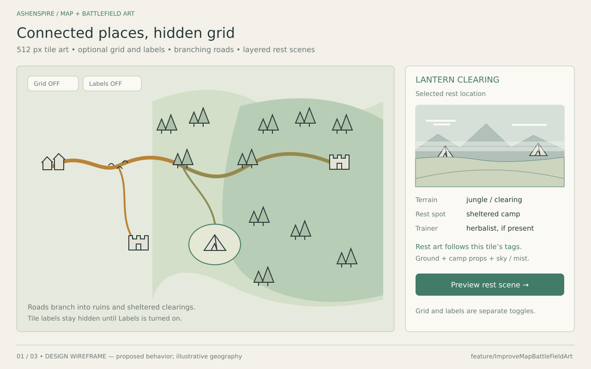
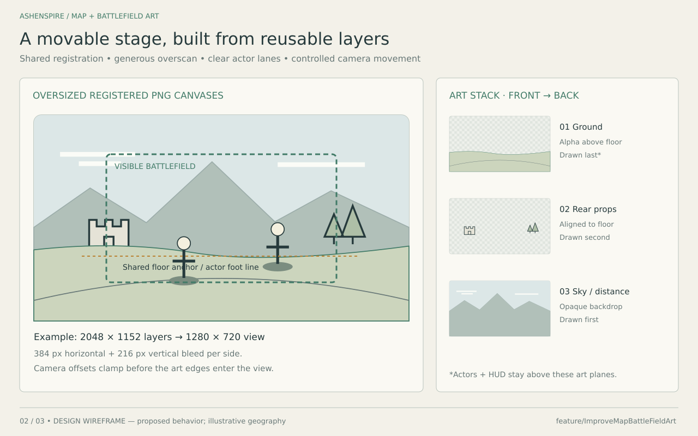
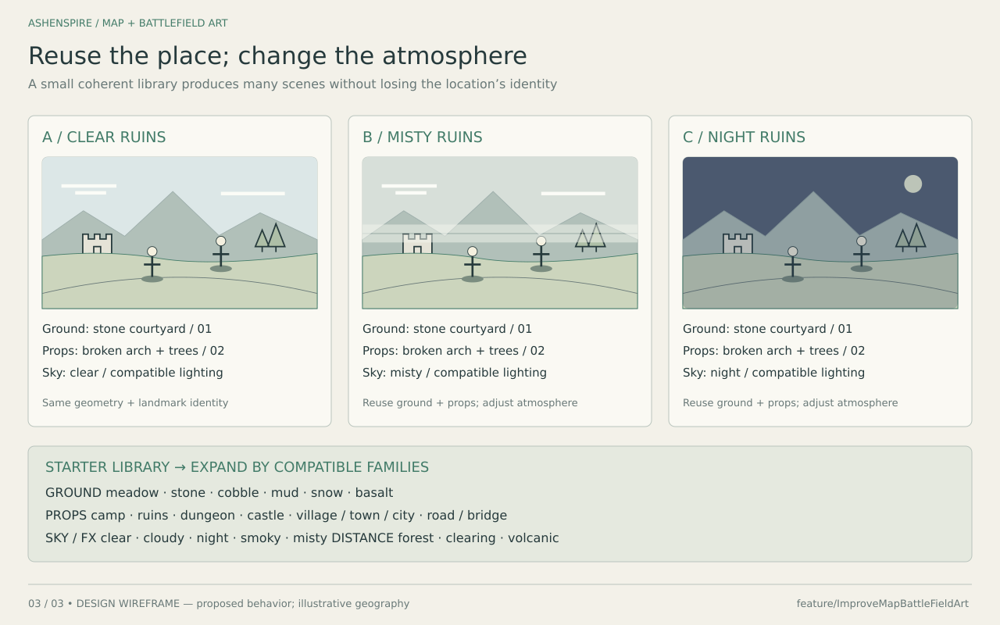

# Improve map and battlefield art — proposal

Branch and chat: `feature/ImproveMapBattleFieldArt`.

Build a sharper, addressable hex world whose locations assemble matching battlefields and rest scenes from reusable, oversized PNG art layers. Each tile also owns editable encounter, enemy, difficulty, discovery, loot and quest properties, with weather effects reserved for later gameplay integration. Each place keeps a recognizable terrain, material, and landmark identity across exploration and combat. JSON controls the eligible art pools; a saved deterministic selection keeps the scene consistent during a visit and after reload.

This package is a design proposal, five illustrated design sheets, an editable region/tile JSON example, a reusable content catalog, an editor schema and an editing guide. It does not change gameplay, ship new art, or implement the renderer. The diagrams are original technical illustrations, not screenshots of a working feature. The agent team contributed art direction and two architecture reviews (two GPT-6.1 Sol agents and one available GPT-6 Luna agent; no Luna 6.1 model was available).

## Map props and discovery extension

- [PNG prop suggestions and discovery rules](MAP-PROPS-AND-DISCOVERY.md): 24 icon ideas, sparse placement, section-entry discoveries, and map rewards.
- [Icon concept sheet](04-map-prop-ideas.png) and [map-reward diagram](05-map-reveal-ideas.png).
- [Editable discovery companion](map-discovery.example.json): prop instances, connected sections, reveal items and reward-source examples. This is a separate draft, not an extension already supported by the world schema.

## Visual directions

| Proposal | Appearance | Cost / consequence |
| --- | --- | --- |
| **A. Painted hex atlas + layered dioramas — recommended** | Existing dark fantasy palette, softly joined terrain, distinctive miniature landmarks; richer combat camera | Fits the current artwork and layer renderer; requires matched perspective and lighting families |
| B. Crisp pixel atlas + pixel stages | Strong silhouettes, intentional pixel clusters, limited palettes | Requires redrawing the asset library and integer scaling; simply enlarging current paintings will not produce this style |
| C. Isometric miniature world | Taller castles, bridges and towns with tabletop depth | Most demanding prop alignment, overlap sorting, and biome seam work |

Use A with grid lines and tile labels both off by default. Add independent small Grid and Labels toggles; neither enables the other. A selection marker may highlight the current place without exposing its address. Keep cards, characters and encounter states readable over restrained environment detail. Map art and combat art share identity and tags but use different perspectives.

## Wireframes

### 1. Hex world and location inspector

Pointy-top hexes use offset rows and optional labels A1, B1 ... Z1, AA1. A1 is northwest. Store zero-based column/row for easy editing; derive axial q/r and display addresses. No duplicate editable address field is needed. Keep permanent location IDs unchanged. A map ID scopes addresses, so world A1 and a dungeon A1 are distinct. Locations may span several cells; a town gate, central plaza, and surrounding road can have separate visual tags while belonging to one settlement.

Show built features in the art: bridge spans, road forks, castle entrances, rooftops, camps, ruined walls. Use six edge connector records for roads, rivers, paths and walls; opposite edges must agree. A bridge crosses a river and connects usable banks. Decoration does not automatically add travel links or encounters: preserve the authored travel graph in the first phase. Nonadjacent existing travel links need a route over intervening cells, without making those cells new gameplay stops.

Grounds clip to hex footprints and use compatible border masks/blends. Tall props may extend beyond a cell, sorted by their ground contact position. When enabled, labels stay above the art; selection markers remain readable independently. At world scale show landmarks; reveal surface texture at close zoom. On phones, the location inspector becomes a bottom sheet. Selection, hover and zoom never automatically reveal tile labels. With Labels off, the map shows no tile text or coordinate-axis labels.

### 2. Oversized combat stage

Preserve the requested **front-to-back art order: ground → props → skybox**. Render back-to-front: skybox first, props second, ground last. Ground must be transparent above its intended floor silhouette; otherwise it hides the props and sky. Place rear props so their bases meet that silhouette. Draw actor shadows and actors above these background planes, with HUD above actors. Props placed within the playable floor require an optional foreground-prop slot or depth sorting; a single rear-prop plane cannot handle every overlap.

All PNG layers in a composition share canvas dimensions, origin, horizon and floor registration. Export transparent ground and prop layers without trimming their canvas. Keep the central standing area clear and maintain the current formation system's foot anchors. Bound the camera and layer offsets; do not independently slide a grounded prop away from the ground. Restrict parallax to appropriate distant layers. A 2D skybox here means a backdrop plane, not a six-face 3D cubemap. Dungeon interiors can use a vault or distant-room backdrop in this same slot.

For a 1280 × 720 visible battlefield at 1× sampling, a 2048 × 1152 registered layer gives 384 px horizontal and 216 px vertical margin on each side. This example is a 1.6× canvas in each dimension. Author masters around 3072 × 2048 where the current battlefield aspect benefits; establish the actual viewport/crop envelope before freezing export sizes. Use dedicated portrait framing when needed, maintaining the same scene identity.

Calculate export requirements from **visible CSS pixels × capped device pixel ratio × overscan factor**. Reserve some of the available bleed for shake/parallax; clamp remaining camera motion. Larger canvases alone do not add detail. Three 2048 × 1152 RGBA layers decode to about 27 MiB; three 3072 × 2048 layers about 72 MiB, before compositing buffers. Load the selected scene and bounded neighboring assets, with smaller phone variants. Retain layered PNG masters; evaluate alpha-preserving compressed delivery exports separately.

### 3. Reusable combinations

Use compatible lighting variants or a coherent scene-wide lighting treatment. A night sky alone must not leave the ground and buildings brightly sunlit. Mist and smoke may need a transparent atmosphere plane in front of the scenery; they should not be baked exclusively into the sky. The drawing only illustrates reuse, not finished materials or lighting.

## Resolution recommendation

Interpret the requested **256–512 px as per-hex texture width**, not the entire world. Start with 512 px exports for approximately 256 CSS-pixel close-view hexes at 2× sampling; keep 256 px versions for lower detail. Pointy-top hex art is taller than it is wide (about 512 × 592 px before padding), not necessarily a 512 px square. Landmark cutouts can be larger. Full world paintings and combat backgrounds require much larger dimensions.

The current mobile policy caps environment images at 256 px. The square map fallback is 256 × 256 and combat atlases are 256 × 171, with only roughly 128 px across an individual scene crop. An optional map-detail pyramid exists; its 512 px square chunks subdivide a single painting and are unrelated to semantic hex tiles. The square map's registered detail levels currently top out at 1254 px. These are sources of enlargement softness, though a live capture should confirm which path is active on each device.

A quality-only first step can improve fallback/detail selection and inspect sampling, zoom, DPR and source density before hex conversion. Re-export from higher-quality masters or repaint missing detail; resizing a blurry thumbnail to 512 px does not restore it. For a hex displayed at 512 CSS pixels on a 2× screen, use a 1024 px asset or cap that zoom.

## Tag vocabulary and starter library

Keep independent dimensions rather than placing every term in a skybox list:

| Dimension | Suggested values |
| --- | --- |
| Terrain / biome | grassland, forest, jungle, swamp, snow, volcanic |
| Setting | clearing, ruins, dungeon, legacy-dungeon, castle, camp, road, bridge, village, town, city |
| Material | earth, grass, cobble, cut-stone, rubble, mud, ice, basalt |
| Weather / atmosphere | clear, cloudy, misty, smoky, rain, snowfall |
| Time / lighting | day, dusk, night; controlled compatible light direction and palette |
| Landmark / construction | bridge-stone, gate, tower, broken-arch, tent, cottage, market, wall |
| Composition compatibility | camera family, horizon, floor anchor, interior/exterior, palette family |

“Lush forest” is forest plus lush vegetation; “forest clearing” combines forest and clearing; “snow castle” combines snow and castle. Volcanic terrain can have clear, smoky or night skies. Interpret “routines” as **ruins** and “snow scalste” as **snow castle** for this draft. Retain `legacy-dungeon` as a distinct art setting pending its intended meaning.

Suggested full starter library: six ground families (meadow/earth, stone/rubble, cobble, mud/wetland, snow/ice, basalt); prop families for forest/clearing, camp, ruins, dungeon/legacy dungeon, settlements, castles, roads and bridges; sky backdrops for clear/cloudy/night plus forest/volcanic distant silhouettes and transparent mist/smoke. Roads and bridge decks are anchored overlays, not arbitrary sky or ground substitutions. Village, town and city share architectural materials but differ in scale, density and skyline. Snow-specific props need snow-covered variants.

## JSON and selection

Start with [hex-art.example.json](hex-art.example.json): **regions → shared defaults → tiles → property overrides**. The [editing guide](EDITING.md) explains each field and includes a copyable tile example. [tile-content.catalog.json](tile-content.catalog.json) contains reusable art profiles/pools, weather, effects, enemy groups, loot, quests, trainers and rest spots. [hex-art.schema.json](hex-art.schema.json) supplies editor field validation. JSON uses two-space indentation and one property per line, without embedded implementation essays.

The seven illustrative tiles connect two cities through grassland, forest and jungle. Roads branch toward a dangerous ruin and a sheltered clearing. Tile properties can override art components through a profile, enemy pools, encounter probability, difficulty, loot, quests, trainer chance and rest chance. Missing properties inherit the region default; arrays replace; optional null references clear. All sample IDs, positions, probabilities and balance values are proposals, not existing runtime content.

The art relationship is **tile → resolved biome/setting/tags → art profile → map/combat/rest layer pools**. A rest spot adds its own compatible prop tags, so an inn courtyard and a jungle camp can share the same composition system. Keep asset choices stable across reloads and device changes. Pools are intentionally empty until real compatible assets are supplied; no working renderer or complete asset coverage is claimed.

Visual tags do not implicitly cause gameplay. Explicit fields control encounters, buffs/debuffs, rewards and quests. Future weather and rest effects are present but disabled. Enemy territories follow region defaults with local tile overrides. Difficulty spikes have a named warning. Trainer/rest rolls are independent and saved once per tile per run. Unique drops record failed rolls, pending rewards and claims so reloads cannot farm them. Quests reuse the existing offer/progress/completion machinery.

Keep visual and gameplay revisions separate. This friendly authoring format may compile into normalized tables; adding gameplay rules is a later specification/migration step. The schema catches shape/range errors, while cross-file references, inherited completeness, connected roads and content coverage require semantic validation. The current examples have been checked for those references and road adjacency, but have no production art or gameplay bindings.

## Existing integration points

| Area | Files / approach |
| --- | --- |
| Atlas + travel | `src/ui/screens/worldAtlas.js`, `src/model/worldAtlas.js`, `content/source/worldAtlas.json`; preserve location IDs, route edges and exploration state |
| Presentation selection | `content/source/locationPresentation.json`, `src/model/locationPresentation.js`; extend deterministic location-based selection |
| Combat art | `src/ui/alternativeArt.js`, `src/ui/alternativeArtCatalog.js`, `src/ui/components/environmentArt.js`; reuse registered layer layouts and floor alignment |
| Source quality / delivery | `tools/mobileart-policy.mjs`, `tools/map-detail-build.mjs`, `src/content/mapArt.generated.js`; inspect fallback and detail choices |
| Existing validation | `tests/environment-art.test.mjs` and location-presentation tests; extend once runtime implementation begins |

**Save compatibility:** `atlasRevision()` hashes most worldAtlas data; adding art fields or moving nodes there can change route seeds and reject existing saves. Store hex placement and art metadata in a separate presentation source keyed by stable node ID. The expanded encounter, difficulty, loot, quest, service and weather-effect rules, as well as any gameplay hex-traversal conversion, require an explicit gameplay revision, migration and spec change. Presentation-only changes must not invalidate existing journeys.

Production art follows the repository's established `AshenSpire-art` intake/release path and asset-ID resolver. These local wireframes are documentation only. No art release, game deployment or PR is part of this proposal pass.

## Suggested delivery sequence

1. **Clarity proof:** inspect map and combat source selection at phone/tablet/desktop sizes; establish texture and memory budgets. Compare current source against a true high-detail sample.
2. **One small region:** compose 12–20 hexes containing grassland, forest, ruins, a village, a road and a bridge. Add editable JSON associations and independent Grid/Labels toggles, both off by default, while retaining travel behavior.
3. **Battlefield and rest proofs:** grassland camp, ruined bridge and jungle clearing; show compatible weather variants and layered rest scenes. Verify that the map landmark survives the camera change.
4. **Composition controls:** preview each layer, adjust constrained offsets, show crop bounds/standing areas, inspect resolved tags and pin or reroll an art variant independently of gameplay RNG.
5. **Regional gameplay pass:** map enemy pools, signposted difficulty spikes, trainer/rest probabilities, unique rewards and quest hooks through the existing gameplay systems and versioned migration. Enable weather buffs/debuffs only after their rules are specified.
6. **Expand coverage:** snow castle, town/city, swamp, dungeon/legacy dungeon and volcanic settings. Audit all supported weather/time combinations and explicit fallbacks.

Acceptance for implementation: legible close-zoom hexes at the target pixel density; stable IDs and unchanged seeded routes; matching location landmarks in combat; valid connectors; no empty overscan edges at camera extremes; intact feet/props alignment; readable actors/cards; valid alpha edges; coherent night lighting; stable scene on save/reload; bounded decoded memory and loading time on the target phone. Capture portrait phone, landscape phone, tablet and desktop with real assets.

The updated proposal was checked by rendering and visually inspecting the revised default map diagram, validating the world JSON against its schema, and checking inherited properties, catalog references, tile positions and road/transition adjacency. Schema rejection checks cover out-of-range chances and unknown property names. Runtime tests are not relevant to these documentation-only additions. Rebuild the diagrams with `node docs/design/improve-map-battlefield-art/render-wireframes.mjs` when Sharp is available.
