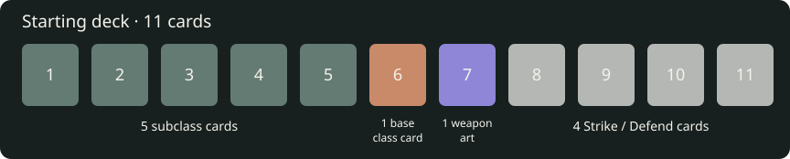

# Subclass progression — implementation handoff

Status: design brief only; no gameplay change. Parent branch: `Feature/AddSubClasses`.
Worker: `worker/AddSubClasses/design`. Baseline: current `origin/dev`, 2026-10-11.
The owner's latest subclass request governs this proposal; SPEC amendments must
land before changes to its contractual state shapes and combat rules.

## Required identities

Display spellings preserve the request. IDs below are proposed normalized IDs,
not new content already registered. `harold` is interpreted as existing Herald.

| Base class / existing ID | Requested subclasses / proposed IDs | Current tier-3 IDs to migrate |
| --- | --- | --- |
| Reaver / `reaver` | Heavy Knight / `heavyKnight`; SwordMaster / `swordMaster` | `warlord`, `bulwarkKing` |
| Starseer / `starseer` | BattleMage / `battleMage`; FrostMonarch / `frostMonarch` | `conduit`, `reservoir` |
| Rogue / `rogue` | Ranger / `ranger`; Assassin / `assassin` | `assassin`, `shadow` |
| Herald / `herald` | Cleric / `cleric`; Monk / `monk` | `martyr`, `saint` |

Do not rename old nodes in place and silently give old saves different mechanics.
Retaining the `assassin` spelling does not authorize changing its existing rule
without an explicit migration/version decision.

## Eleven-card opening

Every new character starts with **5 subclass + 1 base-class + 1 unique weapon art
+ 4 basic Strike/Defend instances = 11**. The core-slot class identity is a
projection, not an extra playable card. This table allocates roles, not authored
card names, damage, costs or final balance. The last slot's choice is proposed;
the owner specified Sweep OR Spell depending on subclass.

| Subclass | Smash | Counter | Power | Skill | Fifth role (proposal) | Base-class card | Weapon art | Basics | Total |
| --- | ---: | ---: | ---: | ---: | --- | ---: | ---: | ---: | ---: |
| Heavy Knight | 1 | 1 | 1 | 1 | 1 Sweep | 1 | 1 | 4 | 11 |
| SwordMaster | 1 | 1 | 1 | 1 | 1 Sweep | 1 | 1 | 4 | 11 |
| BattleMage | 1 | 1 | 1 | 1 | 1 Spell | 1 | 1 | 4 | 11 |
| FrostMonarch | 1 | 1 | 1 | 1 | 1 Spell | 1 | 1 | 4 | 11 |
| Ranger | 1 | 1 | 1 | 1 | 1 Sweep | 1 | 1 | 4 | 11 |
| Assassin | 1 | 1 | 1 | 1 | 1 Sweep | 1 | 1 | 4 | 11 |
| Cleric | 1 | 1 | 1 | 1 | 1 Spell | 1 | 1 | 4 | 11 |
| Monk | 1 | 1 | 1 | 1 | 1 Sweep | 1 | 1 | 4 | 11 |

The four basics' Strike/Defend split is undecided. Candidate base-class cards
already authored in `src/content/classes.js` are ability cards `brace`, `attune`,
`prepare`, `warmLitany`; this is a
reuse proposal, not an approval to discard signatures. The unique weapon art
must be defined per supported starting loadout: weapon ownership and technique
requirements still matter. Ranger's Smash and Counter delivery need explicit
ranged-compatible recipes; Monk's unarmed art needs an authored legal profile.
A Spell can also be a Skill or attack: do not treat these overlapping tags as
five mutually exclusive values of the existing `card.type` field.

## Existing seams and contractual conflicts

- `content/source/classTree.csv` has four tier-1, four tier-2 and two exclusive
  tier-3 nodes per class. `src/model/classTree.js` gates drafts by
  `balance.skill.class.tierAt`, currently `[1,3,5]` in `src/content/balance.js`.
  `nodeRelations.csv` makes the pair mutually exclusive; `nodeEffects.json`
  defines rules and `nodeTerms.csv` defines presentation.
- SPEC's class-tree contract presents a subclass only after choosing a
  top-tier node. `src/model/classCard.js` derives `subclassId` from `coreTags`;
  `runClassIdentity` already feeds subclass names to presentation. Five subclass
  cards at creation therefore require an explicit choice between opening
  specialization and later subclass unlock, before implementation.
- SPEC's **The starting deck** paragraph at line 461 grants bound cards first
  without a total cap and fills `max(0, cap - bound)` basics. Equipment can
  overrun eleven and leave zero basics. `src/model/loadout.js`'s
  `startingDeckPlan` currently includes both signature and ability grants.
  Exact eleven/four basics requires a new authored composition contract, with
  legal starting kits validated against it; silently dropping equipment-owned
  grants violates the current contract.
- `src/content/progression/rules.js` exposes `balance.progression`.
  Existing class card milestones are `[2,4,6,8,10,12,14,16,18,20]`; feats,
  armory, relics and attributes have separate cadences. `classMilestones.js`
  records earned grants and `classMasteryContent.js` / `classMastery.js` govern
  content/unlocks. No new subclass cadence is approved by this request.
- SPEC §3.14 and CONTRIBUTING require data-authored content and headless engine
  rules. Smash/Counter/Sweep are maneuver tags in `nodes.csv`; Spell is
  `source:spell` and/or the relevant camp/school taxonomy. Power/Skill remain
  existing card types. Inspect actual recipes before choosing tags.
- SPEC §13.4's class carrier scopes properties by its own tags;
  `src/engine/properties.js` mounts it per solo/co-op seat and restore.
  A tag's presence does not automatically add damage or buildup. Those effects
  must be explicit property/effect recipes with sourced numbers.
- Current SPEC does **not** remove Frost wholesale: §5's status palette removes
  `frostbite`, keeps threshold-proc `frost`, and §13.4's Poise consolidation
  explicitly keeps `frostExposed`. Stable damage ID `frost` displays as Cold;
  the spell school `frost` is a separate classification. `statuses.js` still
  defines Frost and exposure scoped to `starstone`. The request introduces
  additional weapon Cold damage plus Frost buildup; it does not authorize
  resurrecting a `frostbite` status or changing the exposure scope implicitly.

## Proposed model: explicit identity and derived weapon infusion

1. Author one subclass definition per requested identity, with parent class,
   five opening card references, tags, property references and progression
   unlock references. Validate parent, exactly two choices, exclusivity,
   registered cards and five required role slots. Choose its source/schema
   deliberately; do not duplicate progression content ownership.
2. Prefer an **opening specialization** chosen with the class at creation,
   with progression improving that specialization. This satisfies the requested
   starting deck. Amend the existing level-5 choice contract accordingly;
   retain the existing class XP system until a cadence is explicitly approved.
   Alternative: opening themed cards before a level-5 specialization, which
   requires a separate deck-theme identity and a rule for changing paths.
3. Keep the class identity and subclass identity distinguishable. If tier-3
   nodes remain authoritative, adapt their availability and projection rather
   than adding a second conflicting selected-subclass field. Any new save
   field requires a schema migration and combat snapshot projection.
4. FrostMonarch's property derives an effective `frost` tag on **all weapons**
   owned/used by that character. Preserve item definitions and instance tags;
   recompute effective tags when equipment, class or subclass changes. Reserve
   actual bonus damage and buildup for a generic source-scoped rule on a
   resolved weapon hit. A tag alone must not become a second damage component.
5. `src/model/equipmentCombatProfile.js` already projects source tags and
   buildup from armaments/runes. Audit its consumers alongside the active
   loadout/property path before adding an infusion seam. Cards that resolve an
   infused weapon source receive bonus Cold damage and Frost buildup; pure
   spells or unrelated damage do not inherit it simply by being in the deck.
   Preview and resolution must share the same effective source projection.
6. Specify whether every hit or once per card receives the bonus, offhand and
   dual-wield attribution, multi-target behavior, no-HP-damage behavior,
   resistance application and stacking with existing Cold/runes. Use existing
   resistance/proc rules once applicability and values are agreed.
7. No global registry mutation. In co-op, the other seat cannot inherit the
   infusion. Save/restore, classless state, switching learned classes, mirror
   reset and class respec must preserve or remove the right derived property.

## Decisions needed before gameplay implementation

- Opening subclass selection versus later unlock; proposed opening selection.
- Which fifth role each subclass gets, and which four-basic split/loadouts.
- Which base-class card remains; whether signatures become the unique art.
- Five named recipes per subclass, costs and numerical balance; reuse versus
  newly authored cards must be grounded in compatible existing content.
- Subclass progression unlocks and cadence; preserve current cadence until set.
- Frost bonus damage/buildup amounts and hit/stacking policy; no guessed values.
- Legacy node/save migration and respec behavior, including existing Assassin.

## Implementation slices and acceptance

1. Amend SPEC separately: opening identity, exact eleven-card composition,
   grant ownership/starting-kit legality, progression and Frost source rules.
2. Add validated identities/content and migration; test each of eight openings
   for 11 instances, five subclass roles, one base ability, one unique art and
   four basics; illegal loadouts fail with named explanations.
3. Connect creation and progression projections; test mutually exclusive picks,
   earned unlocks, class switch/classless/respec and save round trips. Keep this
   work isolated from the concurrent CharacterCreation editor branch.
4. Implement generic effective-source infusion; test actual weapon damage plus
   buildup, pure spell exclusion, multi-hit/dual-wield rules, resistance, rune
   stacking, restoration and co-op seat isolation using approved values.
5. Show fresh creation/progression/card previews and verify live interaction;
   run `node tests/run-node.mjs` before merging gameplay. Docs-only verification
   is link/reference review, composition arithmetic and `git diff --check`.

Workers commit locally, the manager pushes the worker to origin and reviews it,
then merges into `Feature/AddSubClasses`. No feature-to-dev merge is authorized
by this design handoff; CONTRIBUTING requires the owner's reviewed-head approval.
