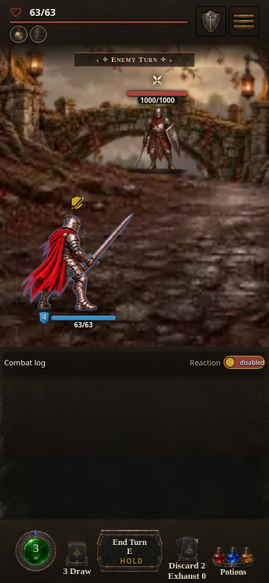
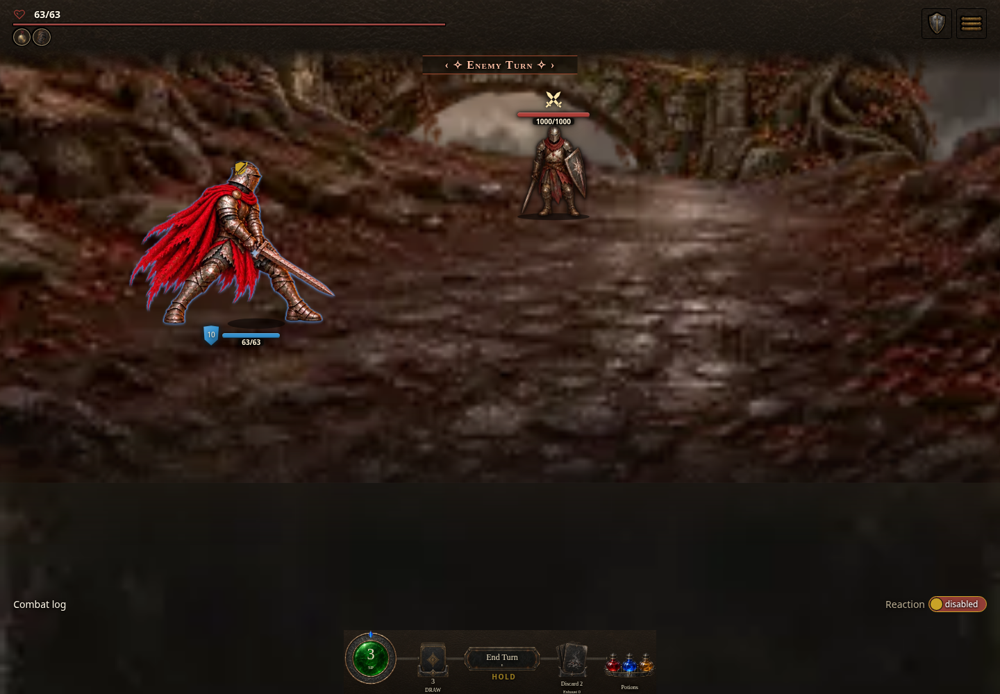

# Approved greatsword runtime sequence proof

[PR #1897](https://github.com/cehinds/AshenSpire/pull/1897) merged into Dev at [`a2327fdd820331aed0cf0a3afc65a11ab0adaaee`](https://github.com/cehinds/AshenSpire/commit/a2327fdd820331aed0cf0a3afc65a11ab0adaaee) after final independent browser approval and green PR checks. This record identifies the local compiled candidates used for that approval; the subsequent Dev build stamp is separate.

| Compiled candidate | Source | Browser proof |
| --- | --- | --- |
| **0.7.1.1426 / 972390821c** | [`544714e66cc89ddc20240867fde047bfb30cf57b`](https://github.com/cehinds/AshenSpire/commit/544714e66cc89ddc20240867fde047bfb30cf57b) | **22/22** final Guard-tag and Evasion-tag Counter assertions |
| **0.7.1.1425 / ad3fb4fb84** | [`07751afbe02b6288f181815175289f6e67fe2828`](https://github.com/cehinds/AshenSpire/commit/07751afbe02b6288f181815175289f6e67fe2828) | **31/31** Attack, Smash, invulnerability and partial-damage assertions; **6/6** reduced-motion mitigation assertions |

The final Counter recapture observed each intended reaction phase once, AT4 at actual return-attack contact, and exact restoration to the prepared Counter or Evade hold. The 390 px phone scene fit its viewport. No watchdog or application errors occurred. The earlier non-Counter cases remain valid because the final correction only associates decorated combat receipts with the already-consumed Counter prelude. The earlier Counter captures were superseded and are not used here.

The browser drove an unpatched compiled game through supported Shot Kit startup, real pointer/keyboard card plays and End Turn. Deterministic scene setup used registered opponents and production cards; the engine produced the combat receipts. No HTML, module or network patches, or direct animation-player calls, supplied the proof. Independent visual review confirmed complete weapons and grounded figures.

Eligibility remains solo default-armour Reaver, a sole actual greatsword in either active hand, and an empty other hand. Other classes, armour, weapons and co-op keep their existing presentation. These are the approved runtime sequences; the later iai Sweep and jumping ground-slam Smash studies remain separate review work.

## Final phone Guard-tag Counter

The impact sequence plays once before the six-phase retaliation and returns to Counter.

## Final Evasion-tag Counter

The Evade phases lead directly into the six-phase retaliation and restore the prepared Evade hold.

