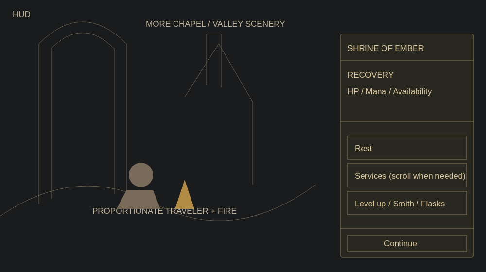
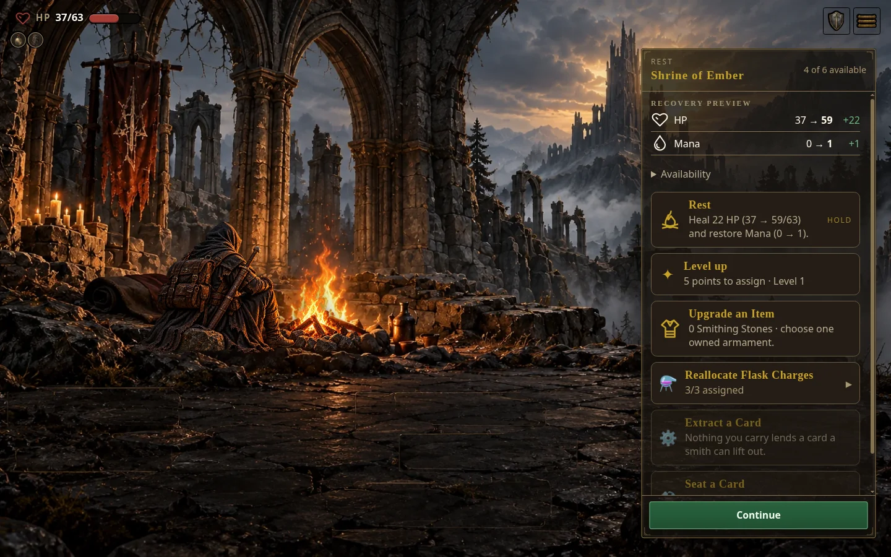
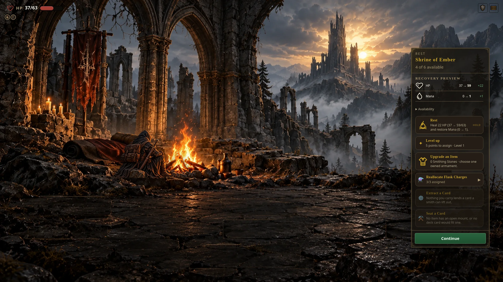
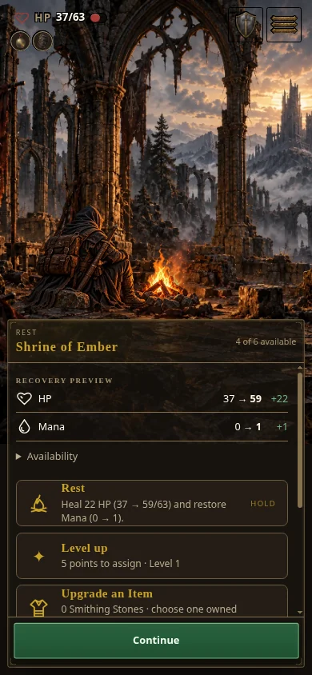
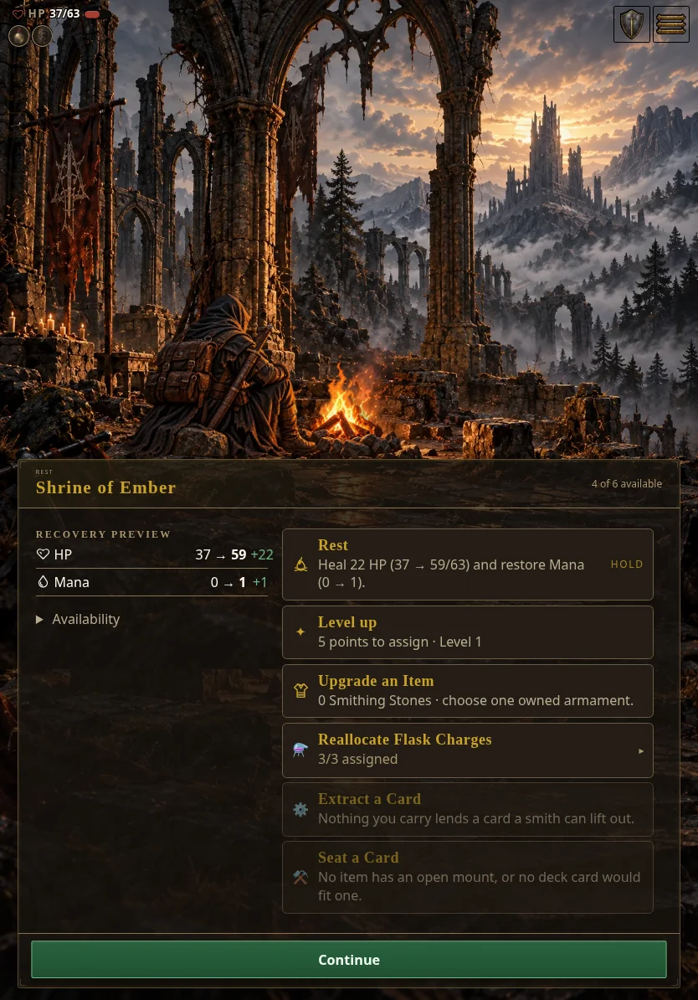
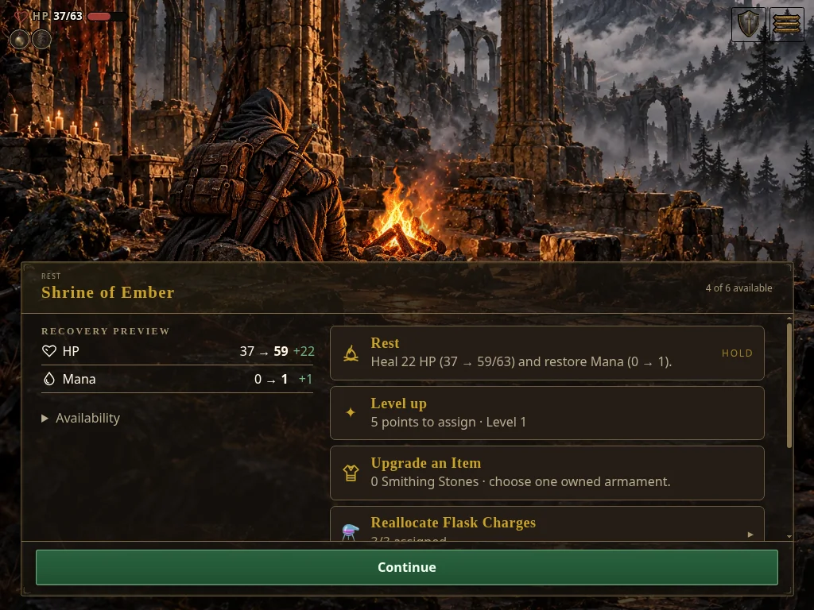
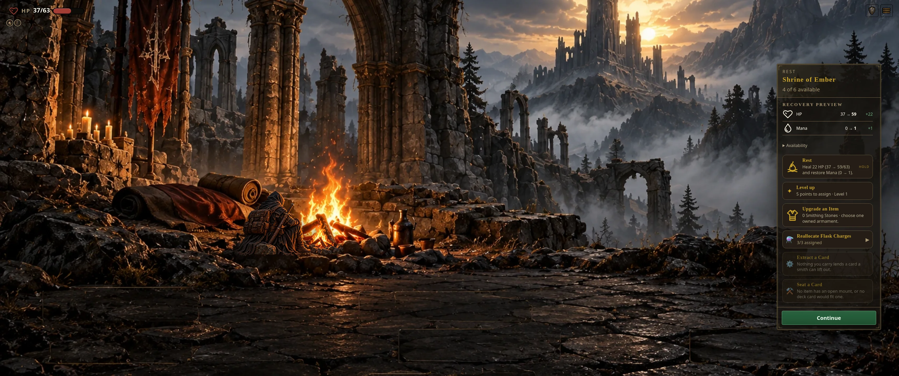

# Shrine rest layout review

**Local source preview:** [Open Shrine of Ember](http://127.0.0.1:8795/index.html?shot=rest&shotRestState=wounded). This loopback URL works only while the local preview server is running; it is not a hosted build.

**Artifact publication is blocked.** The new wide painting needs a canonical art release and then a game pin/derived-manifest update. Writes to `cehinds/AshenSpire-art` returned HTTP 403 through Git and the GitHub integration. No art PR, release, game feature promotion, or hosted artifact was published. The existing published channels do not contain this layout.

The desktop panel is 380 physical pixels wide; widescreen and ultrawide panels are 400. Service descriptions stay 16 physical pixels, with 18-pixel titles. The traveler preserves its aspect ratio and caps at 462 pixels wide; additional screen width does not enlarge it. Tablet and mobile use a scrollable lower tray. Recovery, services, and Continue retain their existing gameplay behavior.

## Gallery

[Wireframe](wireframe.png) · [Desktop](after-desktop.webp) · [Widescreen](after-widescreen.webp) · [Mobile](after-mobile.webp) · [Tablet portrait](after-tablet.webp) · [Tablet landscape](after-tablet-landscape.webp) · [Ultrawide](ultrawide.webp)















## Validation

Renderer source commit: `b923f9bc5c34af0c8fa8a0ea76182047cb35ba61`. [Capture provenance](capture-provenance.json) records each actual viewport, UTC capture timestamp, original PNG hash, and renderer file hashes. Captures were taken from the local worktree immediately before the corresponding source commits; these are source previews, not published artifacts.

The flow tested was wounded rest arrival → recovery/services displayed → Level up opens → Escape returns → final service scrolls fully above Continue → flask allocation expands.

The four primary profiles and tablet landscape had no page errors or horizontal overflow. Level up opened in all five. Final-service scrolling and flask expansion passed on mobile, tablet landscape, and desktop. The 3440 × 1440 ultrawide retained a 400-pixel rail and 462-pixel traveler, with no overflow or runtime errors. Its floor anchor follows the actual background cover height. **Ultrawide visual acceptance remains provisional:** the available 16:9 painting still scales up under cover, cropping the skyline and enlarging its baked campfire relative to the capped traveler. There is no authored 21:9 chapel source in the repository. A faithful full-bleed 3440 × 1440 result needs an approved side extension to 2248 × 941, preserving the existing 1672 × 941 center and adding 288 pixels per side. No new art has been generated. The alternative is height-fit with dark side gutters; that preserves proportions but supplies no additional scenery. Both original high art and the canonical 720p light export loaded successfully; the light export was additionally photographed at 2560 × 1440.

Focused tests: 22 shrine/revisit/one-choice tests and 5 art-policy/distinct-art tests passed. Browser plugin instructions were inspected, but the associated browser JavaScript tool was unavailable; local Playwright and Chromium were used for source preview validation. No production pack/build validation is claimed while the new art release is unavailable.

Commands from the repository root:

```sh
node --test tests/shrine-one-choice.test.mjs tests/rest-revisit.test.mjs tests/rest-order-revisit.test.mjs
node --test tests/mobile-art-rest-scene.test.mjs tests/mobile-art-distinct.test.mjs
```

[Before/after physical geometry](geometry-before-after.json) · [Interaction results](interaction-metrics.json) · [Ultrawide geometry](ultrawide-metrics.json)

## Reproduce the current local preview

Current source checkout: `/workspace/scratch/rest-screen-layout`, branch `worker/rest-screen-layout`. The canonical artwork preparation is in `/workspace/scratch/rest-art-delivery`.

In one terminal, serve the existing art-capable checkout (already running on port 8766 in this workspace):

```sh
node /workspace/AshenSpire/tools/serve.mjs --port 8766 --no-open --no-lan --host 127.0.0.1
```

In another terminal, from this worker checkout:

```sh
ASHENSPIRE_REPO="$PWD" node docs/feature-evidence/rest-screen-layout/preview-server.mjs
```

This preview-only server serves changed source first and falls back to the existing local art server. Override `ASHENSPIRE_ART_FALLBACK` if that server uses a different URL. Port 8795 is already running in the current workspace; stop that instance before starting another.

Until canonical publication, the source preview needs **untracked local copies** of the high painting at `assets/player-polish/scenes/chapel-rest-desktop.webp` and canonical light export at `assets-mobile/player-polish/scenes/chapel-rest-desktop.webp`. They are deliberately excluded from the game commit. Obtain them from the reviewed art patch in a separate art checkout, or the preparation checkout above. Do not publish this preview-server fallback or bypass the game's release pin for shipping.

Current full-resolution screenshots, capture scripts, and original metrics are under `/workspace/outputs/Feature-updateCharacterCreation/rest-screen-layout/`. Reproduce screenshots in this workspace with:

```sh
node /workspace/outputs/Feature-updateCharacterCreation/rest-screen-layout/capture.mjs after
node /workspace/outputs/Feature-updateCharacterCreation/rest-screen-layout/capture.mjs ultrawide ultrawide
node /workspace/outputs/Feature-updateCharacterCreation/rest-screen-layout/interactions.mjs
```

## Art dependency and continuation

Canonical asset ID: `assets/player-polish/scenes/chapel-rest-desktop.webp`.

| Tier | Dimensions | Bytes | SHA-256 |
| --- | --- | --- | --- |
| High | 1672 × 941 | 472908 | `c9ca548404a596d4b0e36b9c0fbc147b7ba9554b6baf640b910d66909c77a14a` |
| Light | 1279 × 720 | 128362 | `45efc8a65c5995f97bd3008db6431cbd107108d053899bbf8d8f13362aed27ee` |

The exact-path light policy uses a 1280 × 720 ceiling, quality 78, alpha quality 80, and never upscales. Other scenery keeps the existing 256-pixel policy.

[Portable binary art patch](chapel-rest-art.patch) · [Art validation and blocked-write receipt](chapel-rest-art-receipt.md). Art commit `d606aaece937379261cd1591ab5cd6811ae11145` is prepared locally, based on art main `b9daa888a83b0cf430fc606e983673778dec1a2d`.

After repository write access is restored: apply/review the patch in the art repository → run normal art CI → merge the art PR → publish the next immutable art release → update the game pin and derived manifest through the normal workflow → validate both game tiers/builds → only then promote the game feature. The current game manifest and release pin have not been changed by this work.
