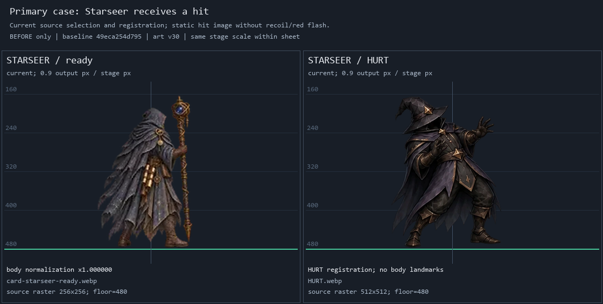
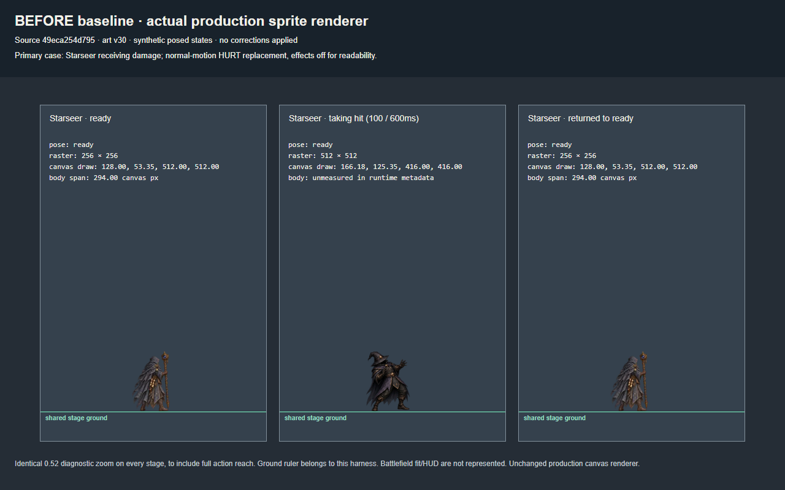
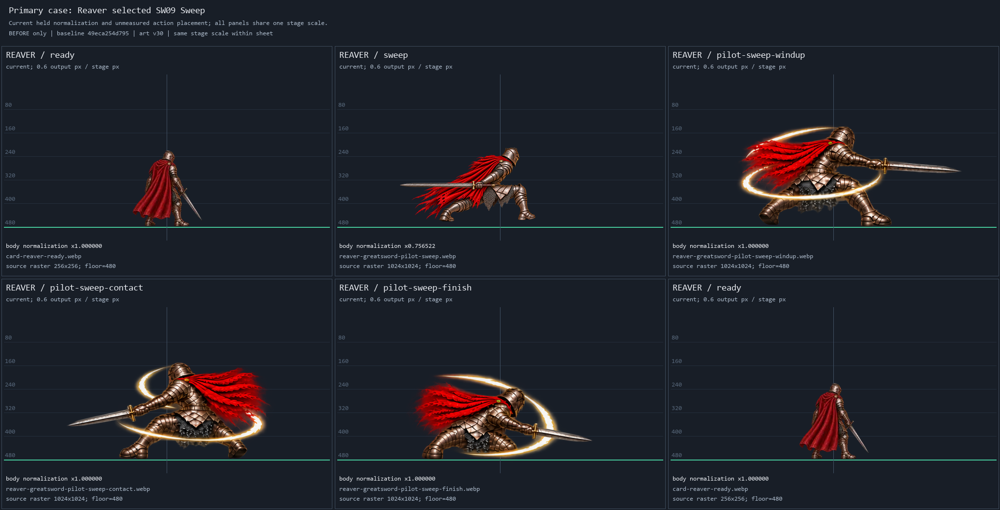
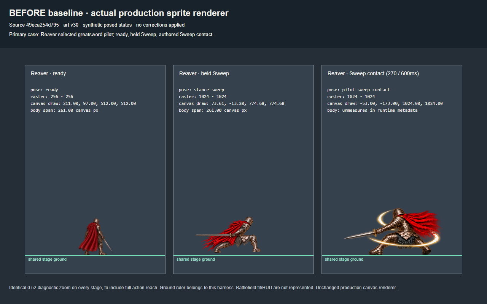

# Player sprite cleanup plan

Planning baseline: 2026-11-26 (America/Anchorage). **Cleanup plan with before-only
evidence; no sprite fixes implemented.** Final verification/review is recorded
in [VALIDATION.json](VALIDATION.json) and the continuation note.

The primary acceptance cases are **Starseer taking a hit** and **Reaver performing
Sweep**, following the owner's clarification. The broader audit covers all four
player classes. [Continuation and milestone record](CONTINUATION.md).

## User stories and delivery status

Each column identifies investigation delivery separately from implementation
acceptance, so a baseline screenshot cannot be mistaken for a delivered fix.

| ID | User story | Investigation | Implementation/final acceptance |
| --- | --- | --- | --- |
| US-01 | As a player, I recognize the same class character through every stance, action, and reaction. | [x] Default-family inventory and selected-pose identity sheets delivered. Exhaustive visual acceptance remains open. | [ ] Not started. |
| US-02 | As a player, my Reaver bends during Sweep without changing physical scale or popping between held and action poses. | [x] SW09 scale-policy difference measured, reconstructed, and sampled in the production renderer. Anatomy calibration remains open. | [ ] Not started. |
| US-03 | As a player, my Starseer retains the same character design when taking a hit. | [x] Wrong-character HURT source and current alpha-height registration demonstrated. Matching replacement not established. | [ ] Not started. |
| US-04 | As a reviewer, I can reproduce the baseline and follow measurements, images, and tests for each task. | [x] Evidence package, scripts, source/image hashes, and task-linked checklist delivered; final validation/review recorded separately. | [ ] Final implementation PR evidence and candidate preview remain open. |
| US-05 | As a player, sprite cleanup preserves readable combat, HUD placement, targeting, and supported display/motion settings. | [x] Shared consumers and verification matrix documented. Full-game regression acceptance remains open. | [ ] Not started. |

## Baseline identity

- Repository: `cehinds/AshenSpire`.
- Source: `49eca254d795d06266aa23941cb2b31fe77b27bf`, fetched `origin/dev` and
  independently checked against live `git ls-remote` for this investigation.
- Test source ref observed: `f33b112f89ad1029f48112dd84266006ddc3fe15`.
- Art repository/pin: `cehinds/AI-Art`, `ashenspire-hd-assets-v30`.
- Planning branch: `codex/player-sprite-cleanup-plan`.
- Published builds observed separately: Test **0.7.5.134**, content digest
  `4fc712b163`, edition `high`; Dev **0.7.5.141**, content digest `815d2ca479`,
  edition `light`. Observation timestamps, URLs, HTML SHA-256 and markers are in
  [published-baseline.json](verification/published-baseline.json).
- Published HTML did not establish the owning game Git SHA or art-release tag.
  A content digest is not a Git SHA. These local v30 source captures are not
  labeled as captures of the published game, and published/local parity remains
  unverified. The audit target is the explicitly identified development source.

This checkout is separate from the owner's original checkout and its existing
edits. Production code, tests, catalogs, art masters, and pinned cache are not
modified by this planning task.

## Findings and priorities

The selected Reaver profile is `reaver-greatsword-pilot`, with the selected SW09
Sweep sequence. Its ready semantic head-to-feet span is 130.5 pixels on a
256-pixel raster, drawn as 261 logical stage units. The held SW09 frame has a
345-unit semantic span on its 1024-pixel raster. Current per-pose normalization
therefore applies `261 / 345 = 0.756521739` to that held frame. The following
unmeasured action frames do not take this correction. Their scale-policy ratio
to the held image is `1 / 0.756521739 = 1.321839080`.

This confirms inconsistent treatment of source families and posed height; it
does **not** establish anatomical size from a vertical measurement alone. The
selected Reaver case must not be described simply as "the renderer enlarges
every crouch": the held SW09 image is shrunk, and action images bypass that
normalization. The detailed measurement report distinguishes this scale-policy
finding from the physical/anatomical calibration still needed.

| Finding | Evidence | Priority and remedy |
| --- | --- | --- |
| Reaver SW09 held/action frames have different applied scale policies. | Ready span 261; held span 345 before normalization; factor 0.756521739 vs unmeasured action 1.0. | **P1:** calibrate ready and the whole SW09 source family; preserve physical scale through bookends and action. Do not merely delete normalization. |
| Starseer HURT depicts a different hat/outfit/body design. | Hooded staff reference vs pointed-hat reaction; alpha heights both 312 stage units despite different characters. | **P1:** search canonical source history, then use or author a matching reaction; register anatomy independently of silhouette extent. |
| Selected Reaver, Rogue, Herald HURT also show visual identity drift. | Inspected all-class reference sheets. | **P2:** resolve against each class's proposed canonical ready appearance after the primary pilot. |
| Partial landmarks give selected poses different normalization behavior. | **117** distinct available paths; **33** landmarked, **84** unmeasured. | **P1/P2:** establish explicit physical calibration rather than adding posed-height normalization indiscriminately. |
| Existing tests encode equal vertical pose spans; shared helpers serve enemies. | Player held-body tests and enemy/shared body tests. | **P1:** replace incorrect player assertions selectively; preserve enemy and settled HUD behavior. |

The runtime inventory covers **184 rows**, **157 distinct assembled frame paths**,
and **330 decoded physical raster files** for **298 asset identifiers**. No
physical raster was missing and no provided catalog hash mismatched. Hashless
catalog entries have observed hashes; this is not a claim that archive ZIPs or
editable source masters were reverified. The distinction between available
family paths and actual card/save reachability is recorded in the measurement
report.

## Primary baseline images

These are untouched **before** references. The static sheets expose image
identity and local registration at common scales. The browser screenshots use
the unchanged production stage with deterministic posed time and a shared 0.52
diagnostic zoom to preserve action reach; they are not full-game playthroughs.

### Starseer receiving a hit

### Reaver performing Sweep

The Reaver static sheet's final ready panel is a reference comparator, not a
claim that every Sweep returns to idle. Actual `origin` bookends resolve to the
current held/rest pose. The static authored-placement sheet is another before
diagnostic, not a proposed after-fix.

Mobile-width production-stage samples:
[Starseer 390×844](verification/runtime-starseer-390-before.png) and
[Reaver 390×844](verification/runtime-reaver-390-before.png). These are full-page
images of a vertically stacked comparison harness at that viewport, not native
battlefield screenshots.

## Delivered artifact index

- [Implementation plan](IMPLEMENTATION-PLAN.md): method, standards, priorities,
  dependencies, concurrent assignments, remedies, and acceptance.
- [Evidence checklist](EVIDENCE-CHECKLIST.md): task IDs and story-linked status;
  completed investigation is separate from unchecked future fixes/after-images.
- [Measurements](measurements/MEASUREMENTS.md): formulas, units, source references,
  inventory, calibration factors, hashes, and landmark coverage.
- [Inventory CSV](measurements/inventory.csv) and
  [action mappings](measurements/action-mappings.json).
- [Visual identity report](visuals/IDENTITY.md): eight inspected before-only
  reference sheets, canonical appearance proposals, and provenance limitations.
- [Verification report](verification/VERIFICATION.md): published/local identities,
  focused tests, runtime capture conditions, and remaining coverage gaps.
- [Runtime capture receipts](verification/runtime-capture-record.json) and
  [static image manifest](visuals/image-manifest.json).
- [Evidence verifier](verify-evidence.mjs) and [integrity result](VALIDATION.json).
- [Independent review and coordinator checks](REVIEW.md).

## Verification and remaining work

The coordinator reproduced the measurement audit and inspected the primary and
all-class sheets. The coordinator also reran Worker C's focused existing tests:
**68/68 passed**; commands and the limited scope are in its report. Passing those baseline tests does not
prove the visual issues are fixed. Source/hash guards prevent reproduction
scripts silently relabeling drifted inputs as this baseline.

The isolated production-stage samples establish selected image draw/placement,
not battlefield fit, HUD or target correctness. A separate full-game developer
shot attempt timed out waiting for its expected stage selector; no full-game
capture is offered as evidence, and this is not diagnosed as a gameplay failure.
Normal-motion primary states are sampled; repeated-hit/action interruption,
reduced-motion, complete tier selection, all variants/fallbacks, inspection, and
full-game acceptance remain open. No matching Starseer replacement has been
established; canonical AI-Art source-history search is a future implementation
preflight task.

Recommended next work: the bounded **Reaver Sweep + Starseer hit** pilot described
in the implementation plan, followed by remaining P2 class/action cleanup only
after that pilot passes. No replacement art, source fix, final after-image,
implementation PR, merge, promotion, or release is included in this delivery.
