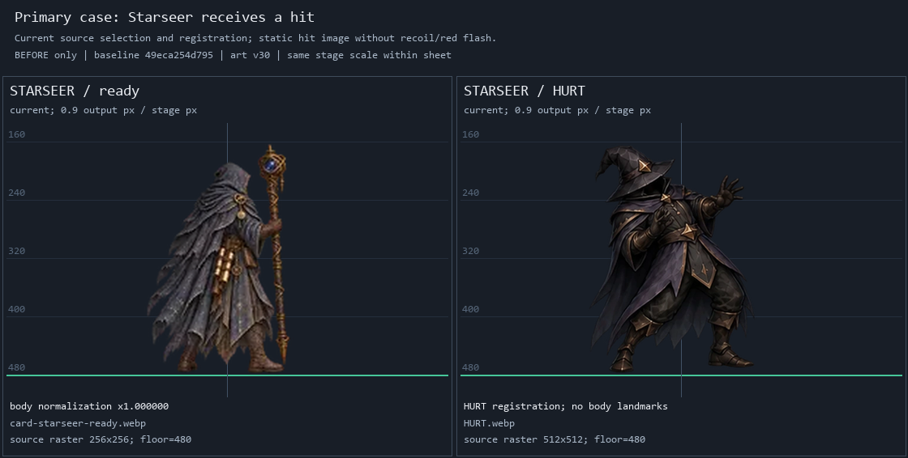
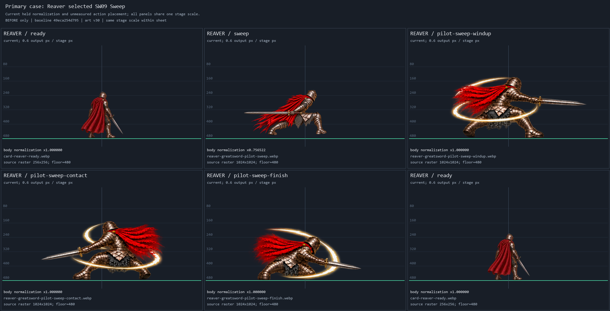
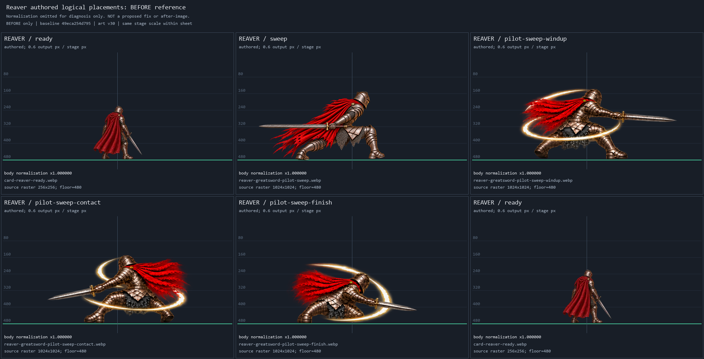
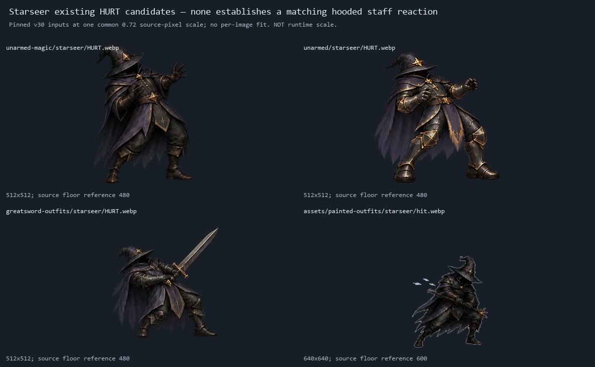

# Player sprite identity and visual baseline

**Starseer's hit image changes character design. Reaver's selected Sweep images
receive different scale treatment.** These before-only references document both
issues; they contain no replacement artwork or implemented fix.

Source: `49eca254d795d06266aa23941cb2b31fe77b27bf` (selected dev baseline).
Art: `ashenspire-hd-assets-v30`. Capture date: 2026-11-26, America/Anchorage.

## What the images establish

### Starseer taking a hit: character identity



Starseer's selected HURT source depicts a visibly different character design.
The ready source has a low hood, layered gray mantle, gold circular fasteners,
waist-hung cylindrical accessories, and a long staff with a blue/gold head. The
HURT source introduces a tall bent pointed hat with triangular gold ornament,
different torso panels and leg treatment, and a more frontal view with empty
hands. The hand change could be legitimate for a reaction, and perspective alone
is not a defect; the hat and clothing changes establish identity drift without
needing to infer hidden anatomy.

The primary source selection is in [playerHurtFrames.js](../../../../src/content/playerHurtFrames.js#L8):
`assets/animations/unarmed-magic/starseer/HURT.webp`, registered with scale
`0.8125`, dx `49.41`, dy `72`. The baseline renderer substitutes it during the
ordinary hit path in [alternativeCardStage.js](../../../../src/ui/alternativeCardStage.js#L153).
This identifies the source and renderer selection. The separate
[runtime capture record](../verification/runtime-capture-record.json) documents
browser observations; it does not establish identical bytes in the published game.

### Reaver performing Sweep: scale treatment



Reaver's active default profile is `reaver-greatsword-pilot`, and Sweep uses the
selected SW09 held, windup, contact, and finish images. The old
`assets/animations/player-counter-sweep/reaver/...` family is not the correct
primary visual example. Source selection is assembled in
[cardAnimationFamily.js](../../../../src/model/cardAnimationFamily.js#L14) using
[combatWeaponPresentation.js](../../../../src/model/combatWeaponPresentation.js#L7).

The SW09 action body and rendering detail visibly differ from the small ready
painting. The held normalization multiplier is `0.756521739` while the unmeasured
windup/contact/finish frames retain multiplier `1`. Therefore an action changes
the artwork's applied scale by `1 / 0.756521739 = 1.321839080` relative to the held
bitmap, before any differences between drawings. This is a **32.18% change in
the applied scale multiplier**, not an independently measured 32.18% increase in
anatomical size. Perspective, drawn anatomy, and poses still require calibration.

Normalization **shrinks** the selected Reaver held SW09 frame. Removing it alone
would enlarge that body. Calibrate ready and the whole SW09 family together,
then preserve physical scale through held/action transitions. A global removal
of resizing is not an established fix.



This second Sweep sheet omits the existing normalization to expose authored
logical placements. It is another **before diagnostic**, not a proposed fix or
an after-image. Both sheets retain the same mapping of stage pixels to output
pixels within each sheet. Neither sheet independently fits characters to cells.

## Canonical appearance proposals and wider findings

Use the current ready art as each class's proposed reference. These are not
owner-approved redesign decisions, and classes retain their own stature.

| Class | Proposed visual reference | Features to preserve | Confirmed visual concerns and priority |
| --- | --- | --- | --- |
| Reaver | `assets-display/alternative/card-reaver-ready.webp` | Steel helmet/plate, red cape, greatsword, rear three-quarter presentation | **P1:** SW09 scale/transition calibration. **P2:** HURT introduces darker gold-trimmed/spiked armor and maroon cape; compare its body and equipment identity to the proposed reference. |
| Rogue | `assets-display/alternative/card-rogue-ready.webp` | Low brown hood, brown leather, green-gray torn cape, rear three-quarter presentation, existing class equipment policy | **P2:** selected HURT uses a black/gold armored twin-sword figure. Smash has sharper/newer rendering and a round shield; determine intended equipment continuity before declaring every hand difference a defect. |
| Starseer | `assets-display/alternative/card-starseer-ready.webp` | Low gray hood, layered mantle, gold fasteners/accessories, blue/gold-headed staff | **P1:** HURT hat/clothing identity mismatch. **P2:** review Smash's much sharper rendering and scale with the same reference. |
| Herald | `assets-display/alternative/card-herald-ready.webp` | Red hood/mantle, tattered red cloth over brown layers, waist details | **P2:** HURT switches to black/gold hooded armor; Sweep has darker/duller cloth. Smash adds a bone-headed weapon under current policy—verify intended continuity rather than treating an attack prop as automatic identity drift. |

Class sheets cover ready, offensive, defensive, casting, counter, held Sweep,
held Smash, and the selected HURT source. They are enough to identify the listed
issues, but are **not** an exhaustive visual review of every action frame,
outfit, fallback, or setting.

- [Reaver selected visual baseline](reaver-selected-before.png)
- [Rogue selected visual baseline](rogue-selected-before.png)
- [Starseer selected visual baseline](starseer-selected-before.png)
- [Herald selected visual baseline](herald-selected-before.png)

## Existing Starseer alternatives checked



The pinned cache contains the selected `unarmed-magic/starseer/HURT.webp`,
`unarmed/starseer/HURT.webp`, `greatsword-outfits/starseer/HURT.webp`, and
`painted-outfits/starseer/hit.webp`. All four inspected images retain a pointed
hat character; the greatsword version also carries a greatsword. None establishes
a drop-in reaction matching the hooded staff character. The image compares
source rasters at a common **0.72 output pixels per source pixel**, not runtime
scale. Native sizes are 512×512 for the HURT family and 640×640 for painted hit.

The exporter [player-hurt-registration.py](../../../../tools/player-hurt-registration.py#L50)
uses the first available class candidate in both tiers. For Starseer it tries
unarmed-magic, unarmed, then greatsword-outfits. Its alpha-height registration
cannot repair identity drift. It also uses alpha extents rather than semantic
body landmarks; replacement registration should not let a new hat or weapon
decide anatomical size.

An additional local authoring checkout was identified read-only:
`C:\repos\AI-Art-recipient-effects`, remote `cehinds/AI-Art`, branch
`feature/ashenspire-recipient-effect-sequences`, commit
`9b72f401a036a9219dedfbf6de3c4487c3a94e63`. It is an unrelated feature branch,
not a verified current `ashenspire` baseline. File discovery found outfit
variants and old pose hit files, but their filenames alone do not establish
matching art, provenance, or owner approval. No files from that checkout were
used in these sheets. No art repository was modified, switched, or fetched.

Recommendation: first perform a bounded search of the canonical AI-Art
`ashenspire` source history for an already matching rear/three-quarter hooded
staff reaction. If none exists, create a reaction from that canonical character
reference in the later implementation phase. Do not substitute a different
outfit merely because the file is named Starseer. Retain original art and source
records; verify the new or reused asset's actual provenance rather than inventing
a license. Replacement generation/editing and its approval are not done here.

## Reproduction and evidence integrity

From the game checkout:

```powershell
node docs/planning/player-sprite-cleanup-2026-11-26/visuals/collect-visual-inputs.mjs
python docs/planning/player-sprite-cleanup-2026-11-26/visuals/build-reference-sheets.py --cache C:/repos/AshenSpire/.art-cache/ashenspire-hd-assets-v30
```

`collect-visual-inputs.mjs` imports the baseline's actual family assembler and
default profiles. [visual-inputs.json](visual-inputs.json) records 38 unique
selected paths and 29 semantic landmark records. It includes source metadata
and provenance pointers carried by catalogs; metadata is not proof of original
master integrity.

The collector first verifies all 23 owning source/catalog files in the retained
[source-hashes receipt](../measurements/source-hashes.json) against both the
actual Git blobs at `49eca254d795d06266aa23941cb2b31fe77b27bf` and the local source
bytes, ignoring CRLF line-ending differences. Verification completes **before
dynamic imports or output writes**. Thus a later source change cannot silently
produce a new input snapshot carrying this old baseline label.

[image-manifest.json](image-manifest.json) records each of the 38 input files'
resolved pack, native raster dimensions, observed SHA-256, alpha≥128 bounds,
and hashes/sizes of the eight output PNGs. These are actual cache-byte hashes,
not inferred source-master hashes. Alpha measurements describe raster extents,
not anatomy. No source image bytes were edited or replaced.

Before writing any PNG or manifest, the reference builder validates the input,
retained manifest, and measurement index baseline/art identities, requires the
cache directory to identify `ashenspire-hd-assets-v30`, and preflights all 38
actual raster SHA-256 hashes. It uses the retained
[raster-hashes receipt](../measurements/raster-hashes.json) by resolved pack/path.
The three extra existing-candidate paths outside that inventory use the
**previously retained** image-manifest input hashes, snapshotted at process start.
A missing, changed, or mis-pinned input fails before any output overwrite. The
guard does not establish original master provenance or archive integrity beyond
the retained file evidence; it prevents mislabeled regeneration from other bytes.

Guard verification passed after independent review:

- All **23 source checks** and **38 raster checks** passed.
- All **eight PNGs** remained byte-identical; `git diff` showed no PNG,
  manifest, or input changes.
- A copied ready raster in a temporary `ashenspire-hd-assets-v30` cache was
  changed by one byte. The builder rejected it with `Pinned raster mismatch`
  before decoding or writing outputs.
- Before/after hashes confirmed that all eight canonical PNGs and both input/
  image manifests were untouched. Canonical source and cache files were not edited.

The reference builder mirrors static registration with a shared floor at
**y = 480** and centre at **x = 384** stage units. Uniform canvas padding is omitted because it shifts
the whole stage and its floor together. Held measured frames use the baseline's
ready-body normalization. The pictured unmeasured SW09 actions retain authored
placement. HURT uses its separately generated registration. The builder checks
that the entire alpha reach fits within each panel; no body/weapon art is
independently fitted or hidden by neighboring panels.

These sheets intentionally omit viewport sizing, aura/red flash/recoil,
animation timing, action travel, HUD, and targeting. They are explicitly labeled
**static reconstructions, not gameplay screenshots**. They establish source
identity and placement comparisons; Worker C's real-browser captures are needed
to establish runtime behavior. Source raster resolutions differ, so differences
in sharpness are visible but do not by themselves prove an anatomical error.

## Visual investigation checklist

- [x] Inspect actual selected default ready/held/HURT paths for all four classes.
- [x] Use selected Reaver SW09 pilot, not the superseded Sweep family.
- [x] Produce matched before-only Starseer hit and Reaver Sweep references.
- [x] Produce four class identity contact sheets with common scale and floor.
- [x] Record asset input hashes, raster/alpha dimensions, and output hashes.
- [x] Guard regeneration against source drift and wrong cache bytes; prove rejection with a corrupted temporary input.
- [x] Inspect all eight generated images; correct clipped reach and overlapping labels.
- [x] Inspect the four pinned existing Starseer hurt candidates.
- [x] Separate observed design changes from uncertain anatomy/equipment intent.
- [ ] Search verified canonical AI-Art source history for a matching reaction.
- [ ] Establish owner-approved canonical references and replacement art decisions.
- [ ] Review every reachable action frame, outfit, fallback, and setting visually.
- [ ] Replace/calibrate artwork, produce after-images, and pass implementation acceptance.

The last four items remain open. The task is a cleanup plan with baseline
evidence, not an implemented sprite cleanup.
