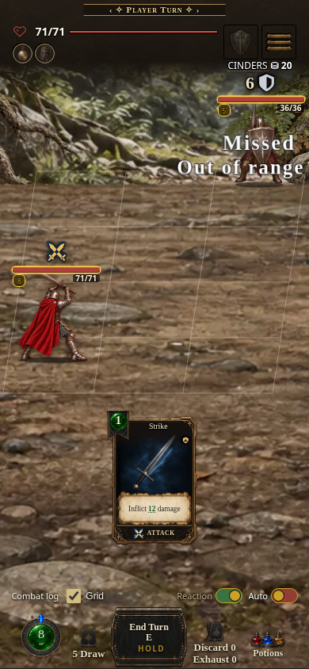
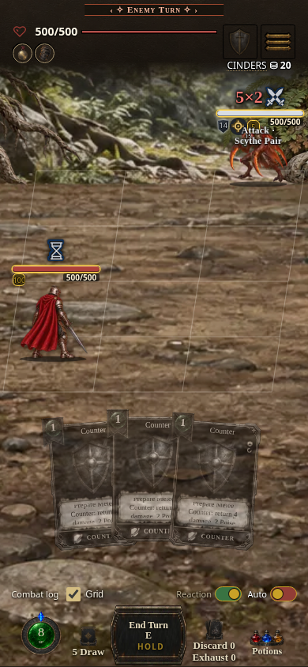
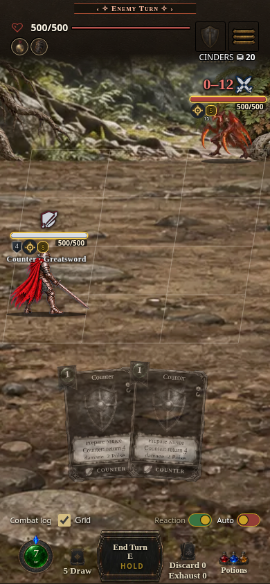
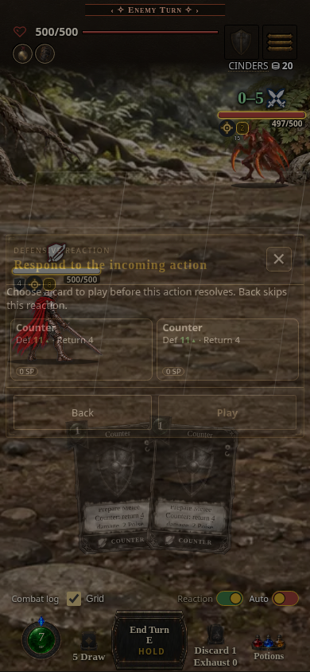

# Compiled combat phone evidence

Captured 20 October 2026 from compiled **0.7.1.1740**, digest `6754f90018`,
source `c39712261ffe301639b5b88f20f30f995e1a7428`, in Chromium 154/Linux at
390 × 844 with native touch input. The artifact SHA-256 and image hashes are
recorded in [provenance.json](provenance.json). These are compiled-game captures;
they are not physical-device or Safari measurements.

| Primary range feedback | Executing action identity |
| --- | --- |
|  |  |

| First paid Counter return | Separate second-hit choice |
| --- | --- |
|  |  |

The existing screenshot door poses two disposable fixtures: a registered Core
Strike against a target in a valid reach stance, and the canonical Cinder
Mantis two-hit Scythe Pair with registered Core Counter cards. Fixture setup
uses matching source helpers; actual touches, commands, costs, damage and FX
run through the compiled game. Production handlers are not replaced. Pacing is
normal and unthrottled; capture does not pause animations or extend callouts.
The range case also asserts that compact attack text omits Precision.

[Range receipts](range-trace.json) verify one card play, a range-caused miss and
unchanged target HP. [Sequence receipts and stage trace](sequence-trace.json)
verify an incoming sprite before its choice, no damage committed before that
choice, one incoming hit and paid return before the next choice, two total
paid returns, one original move execution, no false whole-attack refusal and no
page errors. The screenshots and trace together show the order; a still image
alone cannot prove timing. The artifact predates subsequent Smith-only polish.

## Performance investigation

The separate clean CPU probe uses the normal showcase Core Defend card, native
touch selection/confirmation, 390 × 844 at DPR 3, CPU throttle 4, and 1ms CPU
sampling. Coordinates are resolved before profiling. Each run commits exactly
once without page errors. The paired repeat waits for fonts and all 58
sprite/card images, then lets selection settle before recording.

[Measured results](performance-investigation.json) retain both rejected
prototypes. Batching the final combat fit did not improve the measured cost.
Ignoring unchanged pose attributes reduced tracking invalidations, but its
paired repeat did not establish a latency benefit. Neither prototype is merged
or present in these images. **Combat-latency improvement is not claimed.**
Profiles contaminated by the earlier harness's hit-test grid are excluded.
