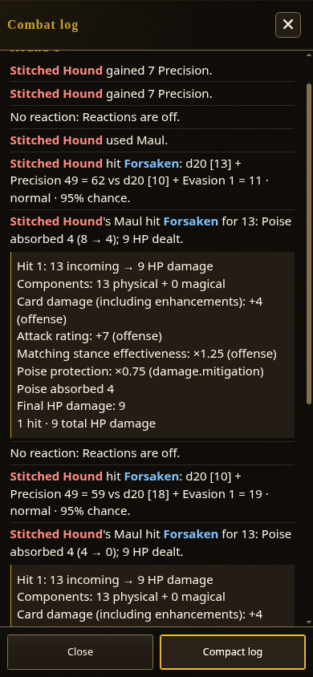
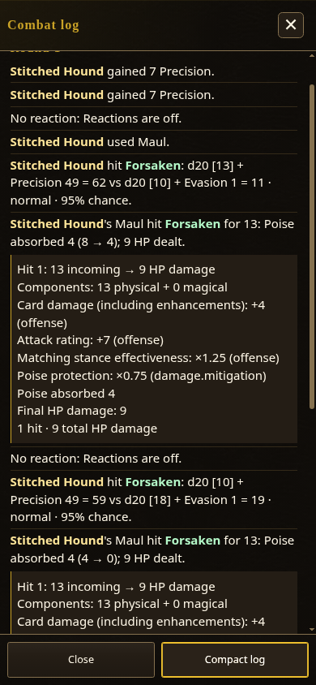
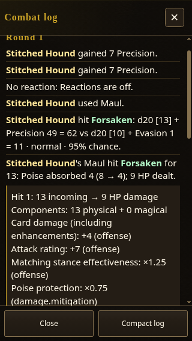
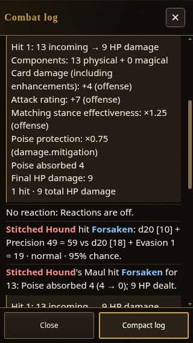

# Combat log palette browser verification

Source: 37ee041ee715c179a6895a1fcb00dc9b4bcdede8. Captured 2026-10-20 from the read-only source server; no full build was made.
Runtime build: 0.7.1.1739.

Verified through the actual game Settings controls and normal, persistent (non-shot) reload:

- Executed player actor segments use blue #7fc4ff and enemy segments red #ff8d83 by default.
- Custom colors #b4f8c8 / #ffe69a save through Settings and remain active after a normal reload.
- Each setting’s Reset restores the defaults; another normal reload retains those defaults.
- Both actor roles are present in the actual executed combat log. The 390px and 320px full-log views have no horizontal content overflow.
- A separate unknown-actor diagnostic uses the production log model and renderer inside the open log. Its actor has no side/color class and inherits neutral text color; no combat or saved receipt is modified.
- The browser reported no page exceptions. Screenshots were inspected separately.

The initial combat fixture was played through one actual enemy turn, then checkpointed through the production save APIs into this disposable browser profile. The remaining checks use normal game boot and durable local preferences; shot mode is not used to claim reload persistence. No profile JSON is committed.

| Default 390 | Custom 390 after reload | Custom 320 after reload | Reset 320 after reload |
| --- | --- | --- | --- |
|  |  |  |  |

[Settings controls](settings-390.png) · [Unknown actor neutral diagnostic](unknown-neutral-320.png)
