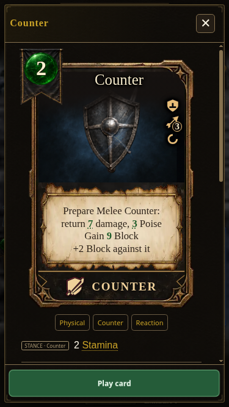
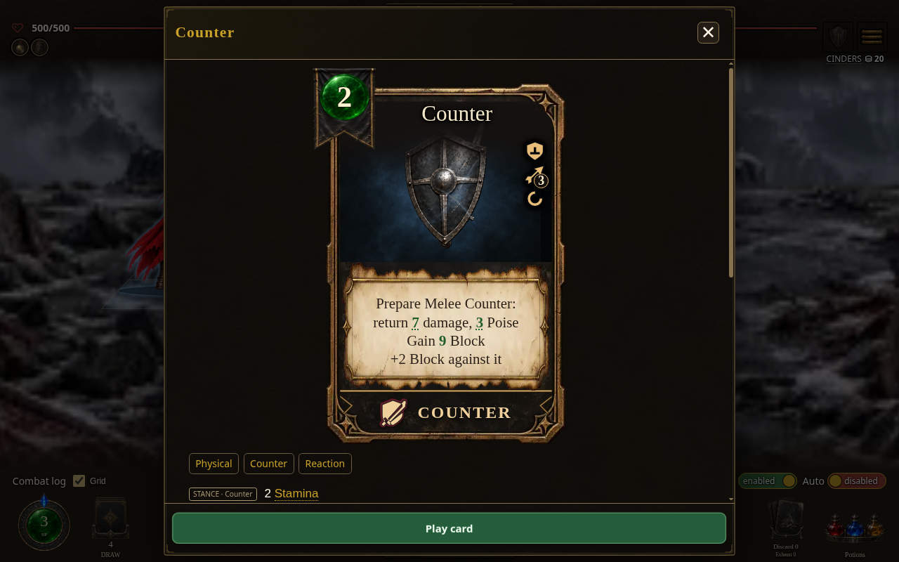
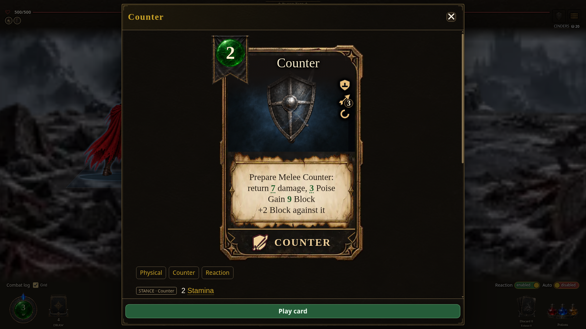
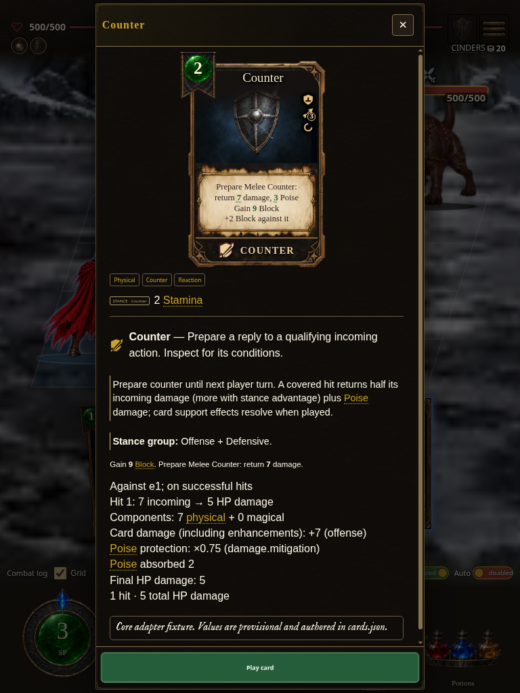
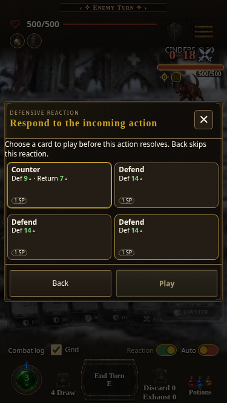

# Packaged Counter preview repair — PR #2227

[Feature preview endpoint](https://cehinds.github.io/AshenSpire/branches/fix/BundledCounterPreview/latest/) — the feature CI build passed; public Pages publication was still pending when these local standalone captures were recorded. These are captures of the actual locally built standalone HTML, not of an already verified public deployment.

- Captured 2026-10-21 UTC with Chromium, using native card inspection, End Turn confirmation, and reaction choices.
- Source commit: `8c9c63e81a5bda36848182ec363e38e87906bf9b`.
- Local artifact: `0.7.1.1749`, light edition, source digest `77b1ad4559`; SHA-256 `8d6523dd9bd23df8c4ea73ef4a17debe42d5498b27a040de177c542e76bd96ef`.
- Viewports: phone 375×667, desktop 1280×800, wide 1920×1080, tablet 768×1024. Browser viewports do not certify physical Galaxy A32 or iPhone SE performance.
- Controlled screenshot state: existing Core Reaver combat shot; actual starter Counter moved from its pile to the hand; player and enemy HP raised to 500; the canonical observer read set to exact. The original engine-derived Stitched Hound Maul intent and combat profile remain intact. Distance is set to Melee before the paid reaction.
- No source modules are loaded into the browser, no handlers are replaced, and no game UI is remounted. The existing screenshot renderer applies the disclosed data pose.
- The old standalone 1745 throws the user's exact `expandedEnemyMove is not a function` exception under this pose. The repaired build renders the nonempty Core return (7 damage, 3 Poise, +2 Block), offers the real paid Counter, spends 1 SP, deals 5 HP damage after defenses, and completes the enemy turn.
- Native ESM and production-bundle focused tests: 55 passed, two expected disabled-co-op skips. The production test reproduced the exact exception before the import fix.

| Phone | Desktop | Wide | Tablet |
| --- | --- | --- | --- |
|  |  |  |  |

The existing Release gallery remains 0.7.1.1517 / `d310c277fffaaec6ec7a58a87de846577f12312d`, confirmed against the release branch and successful Pages assembly run 39525676690. It was not replaced with these newer development captures.
