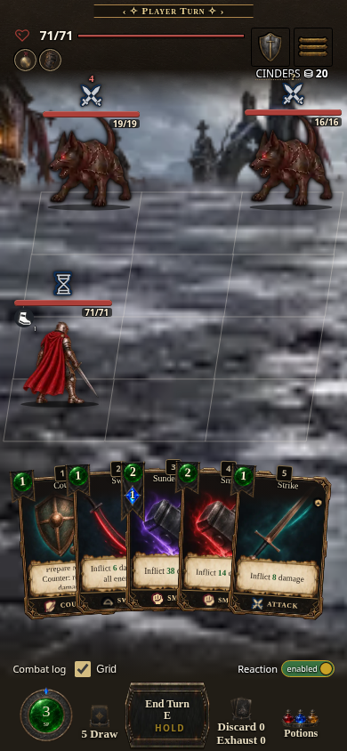
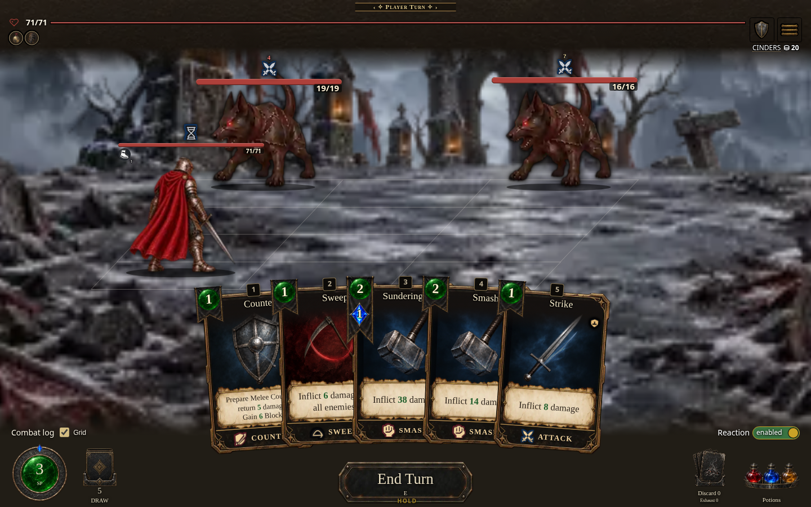
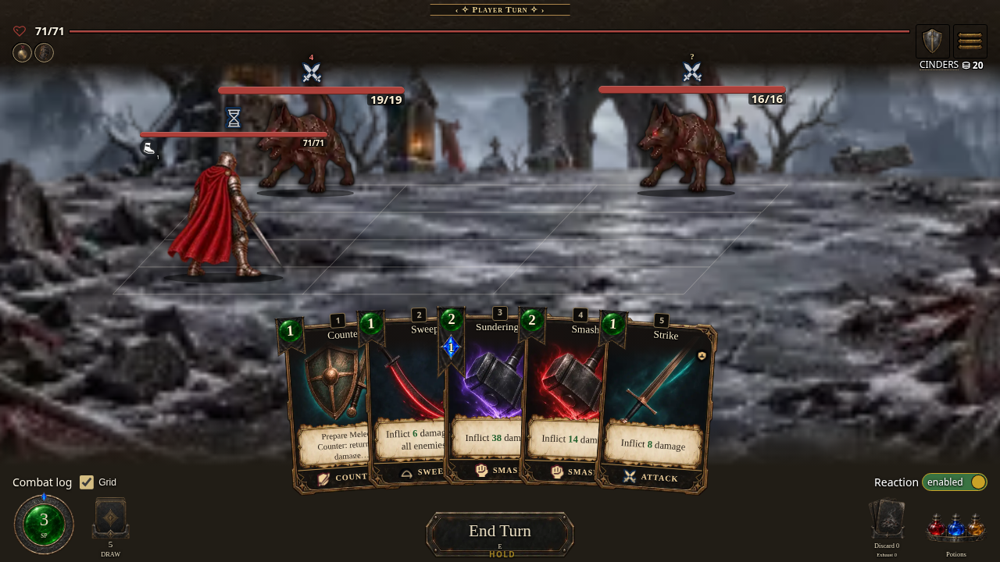
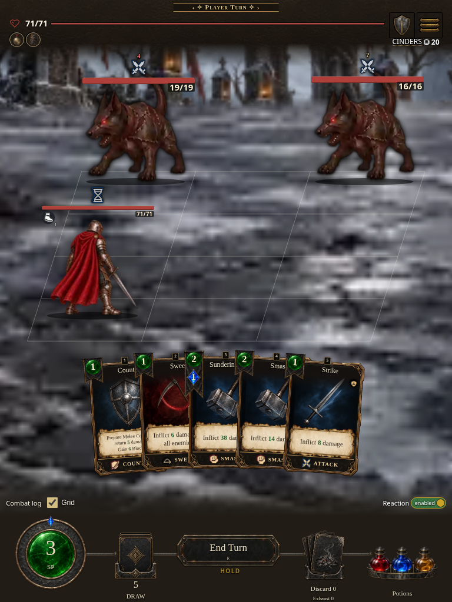

# Fresh layered-card combat capture

Captured 2026-10-18 from actual source `a3c84a08d0b5833f3793eff06006862ecfcacc3e`, parent canonical build **0.7.1.1562**, digest `737e86b2b2`. These new local `dist/AshenSpire.html?shot=combat` captures include the incoming layered hand artwork. Root inspected all four images: player/enemies and hand art are painted; fonts loaded and zero failed image elements were recorded. No capture-only CSS was applied.

The default solo-combat fixture documents rendering, not latency, hosted execution, live co-op or every profile. Local capture provenance is recorded separately from the current CI artifact below; exact public proof remains pending. Previous galleries retain their original historical provenance; these are fresh images.

| Phone · 390 × 844 | Desktop · 1440 × 900 | Wide · 1280 × 720 | Tablet · 768 × 1024 |
| --- | --- | --- | --- |
|  |  |  |  |

Canonical build passed 4/4; pack 15,929,510 JavaScript string units leaves 70,490 under unchanged 16M. Version 9 and census 438/20/46 passed. Existing About/changelog browser check passed 985/985 through the source and selected standalone Settings routes. See `capture-record.json` for exact checks.

Verified CI artifact source: `1a880f97d2abe07029401ddbe07393649c73763e`. [Artifact 12123792282](https://github.com/cehinds/AshenSpire/actions/runs/39093524516/artifacts/12123792282) is **0.7.1.1562 / 737e86b2b2**, ZIP SHA-256 `e0369d45522075f30f3a7ddf095832b71106ca95c8e650fe6df78a128d33e22f` ([run 39093524516](https://github.com/cehinds/AshenSpire/actions/runs/39093524516), job 117575076426). Exact-source [quick-start 39093528388](https://github.com/cehinds/AshenSpire/actions/runs/39093528388), job 117575453364, passed 536 hash checks plus loaded body image 256×256 and 5 input checks: contacts 296/255/387 ms (median 296), first numbers 731/614/746 ms (median 731), unchanged 400/750 ms limits. This is a scoped CI pass, not a universal gain; the separate historical local edb397/779 failure remains disclosed. Timing was uninstrumented and no failure diagnostic was needed; Dev preview, Workbench, HUD, receipts, art and feature checks succeeded; all five jobs in tests39093528297 are in progress. Remaining tests and final-head CI remain pending. Exact public proof remains pending.

These fresh screenshots retain their actual capture source `a3c84a08d0b5833f3793eff06006862ecfcacc3e` and local build 1562/737e86b2b2 identity. The verified CI artifact source has the same compiled values/build digest after intervening integration and documentation changes; this does not relabel local pictures as CI or public captures. All four actual captures have loaded fonts and zero failed images and were inspected by root. Earlier galleries remain historical.
