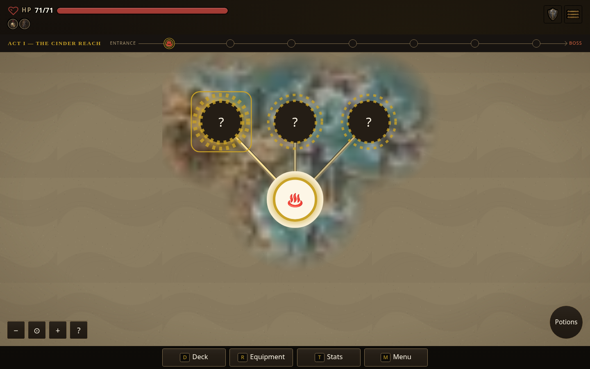
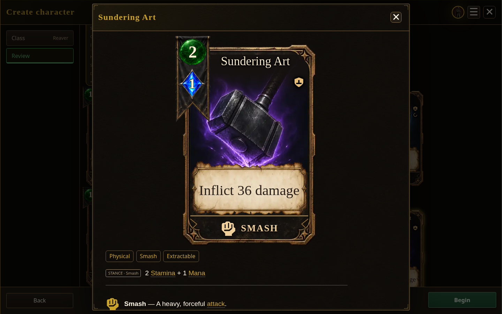

# Dark veil class preview

Captured October 15, 2026 in America/Anchorage (October 16 UTC). The approved cosmetic treatment places a translucent charcoal veil over the next locked class, with a large gold padlock centered in the card and the unlock note above the veil. Unlocked classes keep their existing presentation.

| Desktop · 1440×900 | Wide · 1920×1080 | Tablet · 1024×768 | Mobile · 390×844 |
| --- | --- | --- | --- |
|  |  |  |  |

[Mobile grid view](mobile-grid.png) checks the compact tile layout too.

The temporary Playwright helper checked the four list layouts and mobile grid with real mouse and keyboard input. The next class remained `aria-disabled`; mouse input, Enter, and Space could not change the selected Reaver. The visible gold padlock remained centered in both axes and did not intersect the unlock note. The current/full profile had no locked cards or veil overlays. No browser page errors occurred. These checks cover this cosmetic change; they do not repeat the prior Rest or full profile suites.

The capture artifact was built from source **dad857421**: build **0.7.1.1534**, runtime digest **554f3a5be2**, SHA-256 `f6b2176b03bb1d112d120102cb22929f3da9f94b5e5d1d89f7c70dcb331e0859`. These are local standalone captures. Published CI and Pages status is tracked separately in the root README.

## Initial Rest and route fog

This map follows the actual fresh-character flow: begin the Reaver run, enter its initial Rest, confirm Strategize, and Continue to the map. It shows three reachable branch destinations. Deeper intermediate nodes remain absent from the rendered map until discovered; the boss landmark remains visible by design. A narrow data check against the same core route verified one floor-one starting Rest (`n1_0`), three outgoing branches, and eight route levels. No old floor-two Rest assumption was used.

## Sundering Art display

The final Reaver review inspection shows the authored Sundering Art: **36 damage, 2 SP, and 1 MP**. The class captures also show the Reaver's 1 MP pool. This screenshot verifies the displayed values; the root task separately verifies the mana and balance rules.
