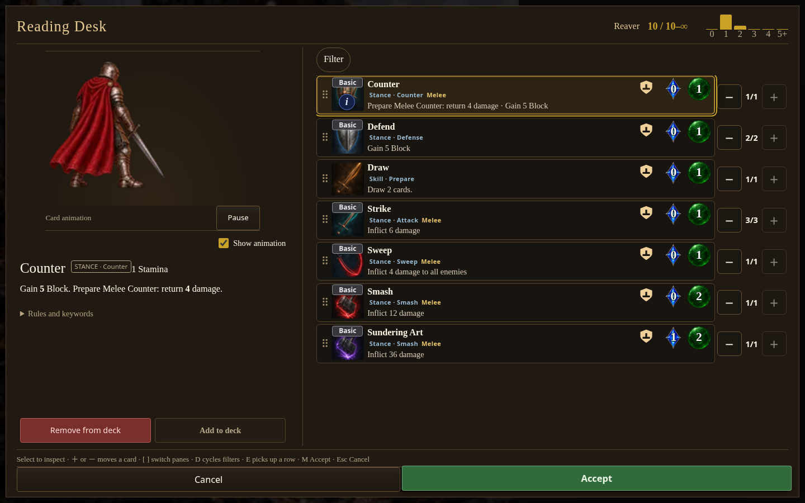
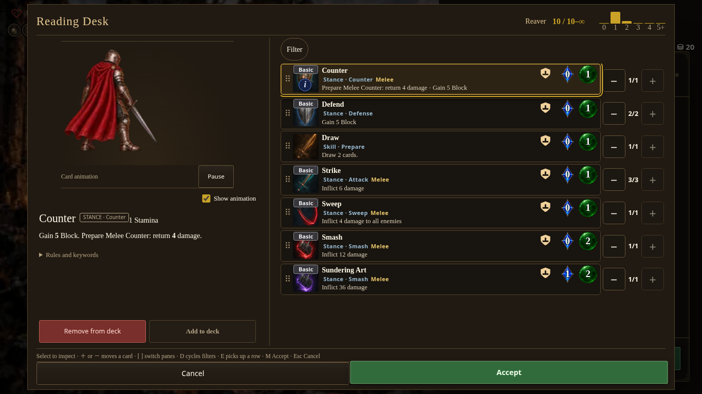
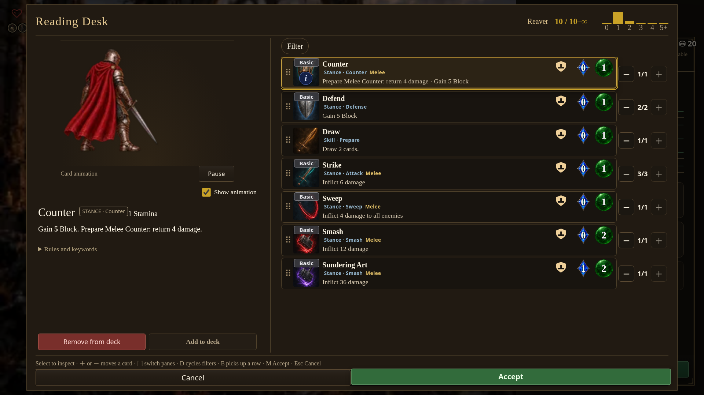
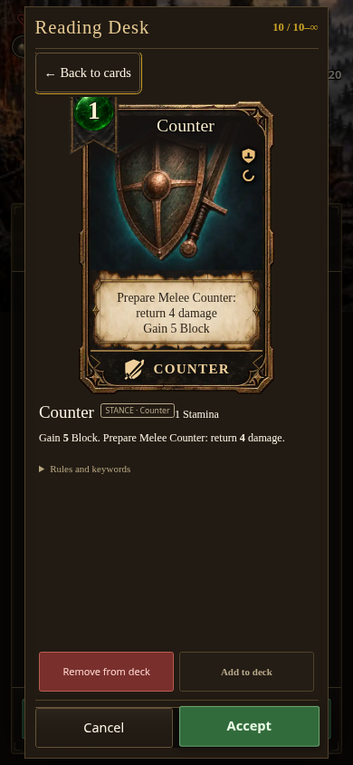

# Deck animation headroom

The Reading Desk animation now sits 2rem lower in its existing preview box. The character keeps its size and playback timing, and the card description keeps its position. At 1440×900, the ready pose’s head now clears the top by about 19px; before it clipped by about 5px. The character’s feet remain inside the preview throughout sampled action loops. Large authored overhead weapon arcs can still extend beyond the fixed preview; this correction targets the character’s head and body.

- [Core playable HTML download](https://github.com/cehinds/AshenSpire/actions/runs/38953953766/artifacts/12070470683), source `dd2e7eefddfef1169c55d2790fefae7a68501150`.
- [Current playable HTML download](https://github.com/cehinds/AshenSpire/actions/runs/38953971025/artifacts/12069821640), source `013761d62f03a60532dfe569f7512da768564e33`.

Both CI builds succeeded. Latest Pages publication remains unverified. Captured 2026-10-16 from the local packaged Core build, `0.7.1.1534`, runtime `d536bec1cf`, SHA-256 `ae39e98e049da18e65927956fda399d897274a02fed2b7234ffe847e6a44288a`. The captures use Rest → Strategize → Show animation, not a full playthrough. The source before-image uses the same runtime code before the CSS inset.

| Desktop · 1440×900 | Small desktop · 1366×768 | Wide · 1920×1080 | Phone · 390×844 |
| --- | --- | --- | --- |
|  |  |  |  |

[Before the inset](before.png). Mobile retains card inspection with animation disabled. No new gameplay or animation routing is introduced.
