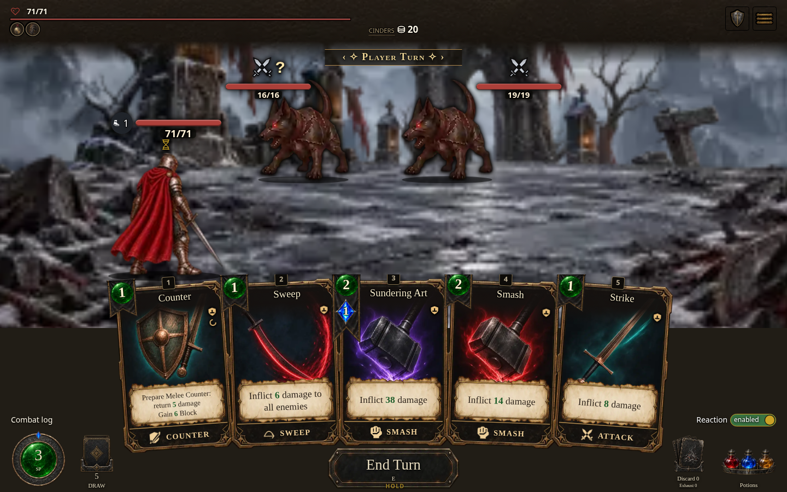
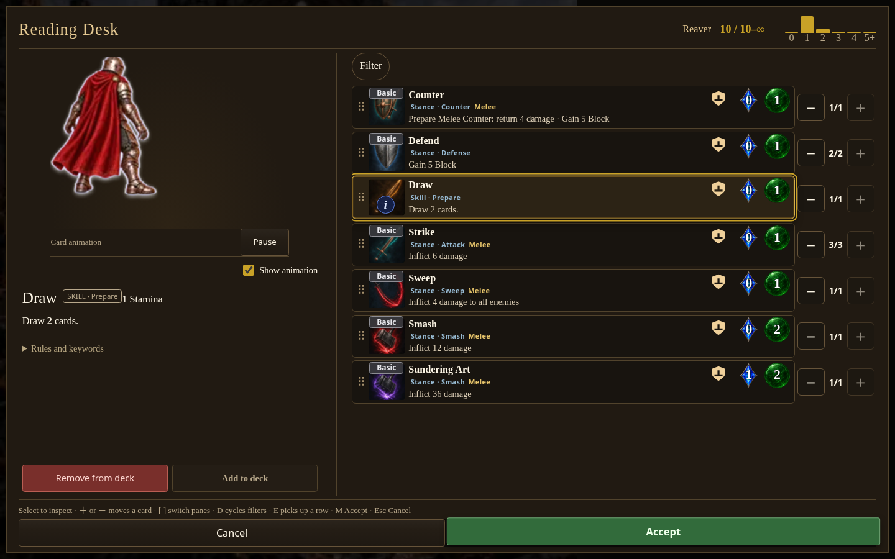
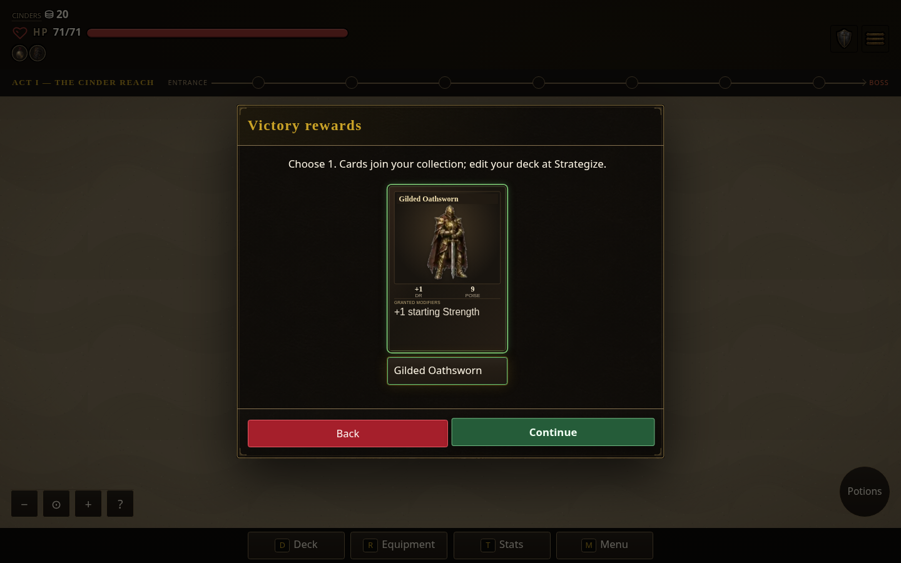

# Desktop D, Prepare cards, and reward review

The desktop/widescreen layout implements option D with a wider fan, larger proportional cards, and a lower opaque card-area background. Stamina and Draw anchor left; Discard and Potions anchor right; the enlarged End Turn sits low in the center. Combat Log and Reaction stay above their corner controls independently of hand size. Mobile and tablet retain their previous footer layout.

The shared HUD shows current Cinders. Core Settings hide unsupported mechanics in both the title and in-run menus. Fresh Core and Current maps use fog; Current still honors an explicitly saved full-path preference.

Rewards start with red Skip and disabled Confirm. Selecting enables green Confirm; review shows red Back and green Continue. Back returns to selection without granting anything. Continue grants and persists once, with save-failure rollback/retry coverage.

Skills, Spells, and Powers retain distinct public kinds and use Prepare. Draw remains the existing one-SP, zero-MP, draw-two Skill. Every Core class starts with three Strikes, two Defends, one Counter, one Smash, one Sweep, one Draw, and its class-specific card: ten cards total. Current's legacy equipment-bound starting grants remain intact. Combat and the deck editor share the character's action families; Counter preview demonstrates the return after preparation. Rogue, Starseer, and Herald have no authored Evade clip and consistently reuse their own Defend fallback.

## Verified build

- Source: `fe2799dcd5cda4370a5aa29dc35ad26dcf2b4dfe`
- Build: `0.7.1.1534`; runtime digest: `e2ff9e3d7b`
- Standalone SHA-256: `b38d28ffcdcea22ab22ce73502545beb39678dcc884223072b3db18745bc4481`
- [Core standalone build](https://github.com/cehinds/AshenSpire/actions/runs/38917569924/artifacts/12052941982)
- [Current standalone build](https://github.com/cehinds/AshenSpire/actions/runs/38917656053/artifacts/12052679950), source `5da5d28385283a83ebcc239d87e7648180483cbc`

These CI artifacts contain downloadable, self-contained playable HTML. Latest Pages publication could not be verified from this workspace. Both profiles in the screenshots run in the same local packaged HTML using `gameProfile=core` or `gameProfile=current`. The two Feature branches differ only in author JSON and generated profile files.

## Screenshots

| Desktop | Widescreen | Phone |
| --- | --- | --- |
| [1440 × 900](desktop.png) | [1920 × 1080](widescreen.png) | [390 × 844](phone.png) |

| Draw: Skill / Prepare and starter counts | Reviewed reward |
| --- | --- |
|  |  |

[Selected reward](reward-selected.png) · [Core Settings](core-settings.png) · [Core fog](core-fog.png)

## Checks and reproduction

131 focused integration tests passed, including game-profile/save migration, Prepare identity and actual Draw execution, rewards, animation parity, and footer geometry. Browser checks cover both profiles at desktop and phone sizes, both Settings entry points, reward selection/review/grant timing, fog, Cinders, and actual deck-preview action frames. The Core starter count and visible Skill / Prepare label are checked through the real Reading Desk.

`tests/battlefield-layout.browser.mjs` covers three- and five-card hands at 1440, 1920, 1024, and 390 pixels, fixed Log/Reaction positions, and real control interaction. Crowded cases verify Core's empty extra row and Current's seven-enemy encounter, including Inspect and targeted Strike on desktop and phone. Selected HUDs and auxiliary hit targets now yield to another fighter's visible artwork. [Crowded targeting measurements](crowded-targeting.json).

Run `tests/final-wave-ui.browser.mjs` with `BASE_URL`, `FINAL_UI_ENTRY=AshenSpire.html`, `PLAYWRIGHT_MODULE`, and `FINAL_UI_OUT`. Run the battlefield helper with `BATTLEFIELD_ENTRY=AshenSpire.html`; `BATTLEFIELD_PROFILE_CASES_ONLY=1` runs only crowded encounters. These are normal initialized screenshot fixtures and real inputs, not a full three-act playthrough.

Two pre-existing `hand-controls-fit.test.mjs` failures also reproduce on pre-change source `cdd646d82`; they are not included in the passing focused count above.
