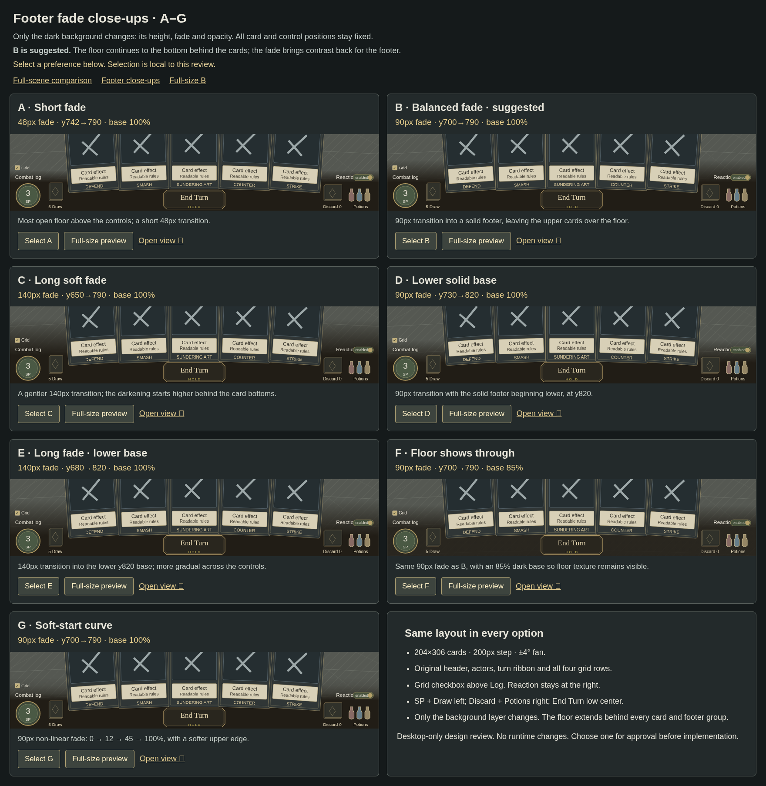
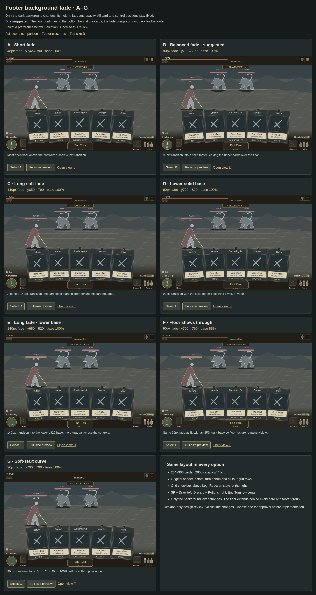
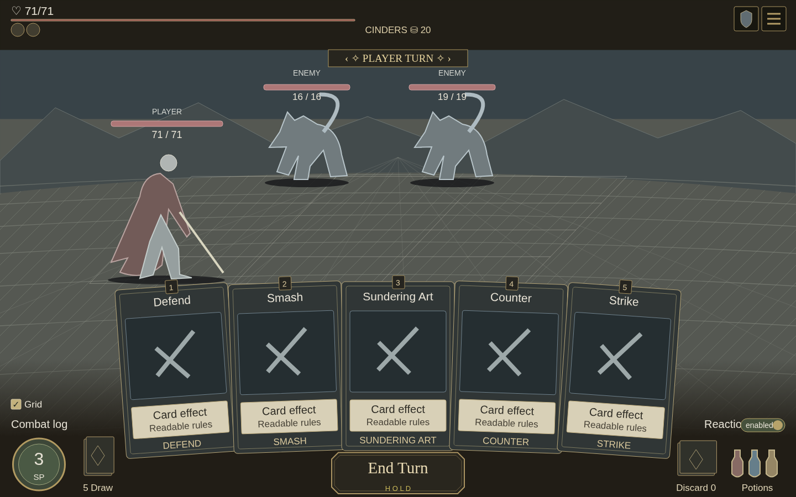
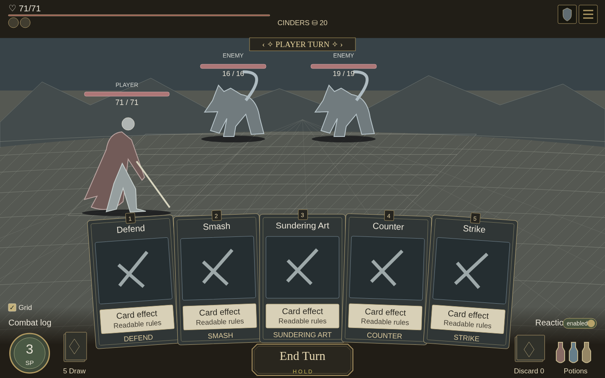
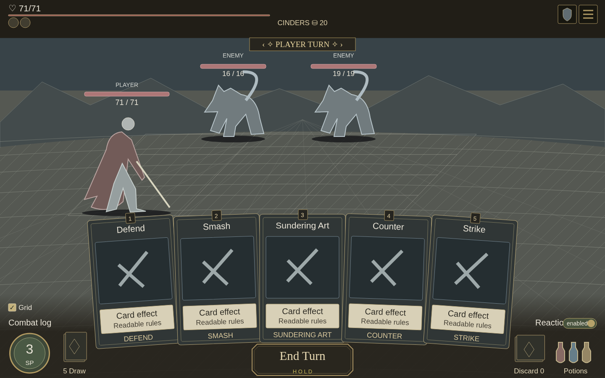

# Footer fade proposals — approval review

Design only. The game has not changed. Desktop reference: **1440×900**. Captured 2026-10-16 against the approved desktop composition at source `adbe7b07b`; the grey floor pattern is a wireframe illustration, not replacement game art.

[Interactive gallery](index.html) · [Footer close-ups](footer-comparison.html) · [Full-size B](option-b.html)

**B is suggested:** a 90px fade from y700 to y790, then an opaque footer. The scenery floor continues behind the upper cards. Every option uses the existing #211d16 footer color.

| Option | Name | Fade height | Fade start → solid/base start | Lower opacity |
|---|---|---|---|---|
| A | Short fade | 48 px | 742 → 790 | 100% |
| B | Balanced fade · suggested | 90 px | 700 → 790 | 100% |
| C | Long soft fade | 140 px | 650 → 790 | 100% |
| D | Lower solid base | 90 px | 730 → 820 | 100% |
| E | Long fade · lower base | 140 px | 680 → 820 | 100% |
| F | Floor shows through | 90 px | 700 → 790 | 85% |
| G | Soft-start curve | 90 px | 700 → 790 | 100% |

G uses opacity stops at 0%, 35%, 70%, 100% of the 90px fade, with alpha 0%, 12%, 45%, 100%. Other fades are linear. F retains 15% of the floor texture under its lower base.

Only the backing layer varies. All seven retain the same 204×306 cards, 200px card step, ±4° fan, actor positions/sizes, header, turn ribbon, four fixed grid bands, Grid checkbox, Combat Log/Reaction, and split original footer groups. SP + Draw stay bottom left; Discard + Potions bottom right; End Turn stays low center with its proportional 240×74.57 visible stone plate.

The card fan has unrotated y510–816, with outer cards displaced down 8px before ±4° rotation. Grid checkbox y718–746; Log/Reaction y750–786. The corner art begins about y786–803 and ends y894. No control or actor is moved to accommodate a fade. Review labels are outside the viewport and are not proposed game UI.

The hatched floor and line-art characters/cards are procedural wireframe placeholders. No existing screenshot or image was edited. `generate.py` writes the self-contained SVGs and HTML; PNGs are actual browser renders. The footer-only SVGs use viewBox 0 600 1440 300 to compare fades at a readable size. The selection buttons only mark a preference in this review page; controls inside the wireframes are illustrative.

## Complete comparison

### A — Short fade

Most open floor above the controls; a short 48px transition.

[Full-size view](option-a.html)

### B — Balanced fade · suggested

90px transition into a solid footer, leaving the upper cards over the floor.

[Full-size view](option-b.html)

### C — Long soft fade

A gentler 140px transition; the darkening starts higher behind the card bottoms.

[Full-size view](option-c.html)

### D — Lower solid base

90px transition with the solid footer beginning lower, at y820.

[Full-size view](option-d.html)

### E — Long fade · lower base

140px transition into the lower y820 base; more gradual across the controls.

[Full-size view](option-e.html)

### F — Floor shows through

Same 90px fade as B, with an 85% dark base so floor texture remains visible.

[Full-size view](option-f.html)

### G — Soft-start curve

90px non-linear fade: 0 → 12 → 45 → 100%, with a softer upper edge.

[Full-size view](option-g.html)

