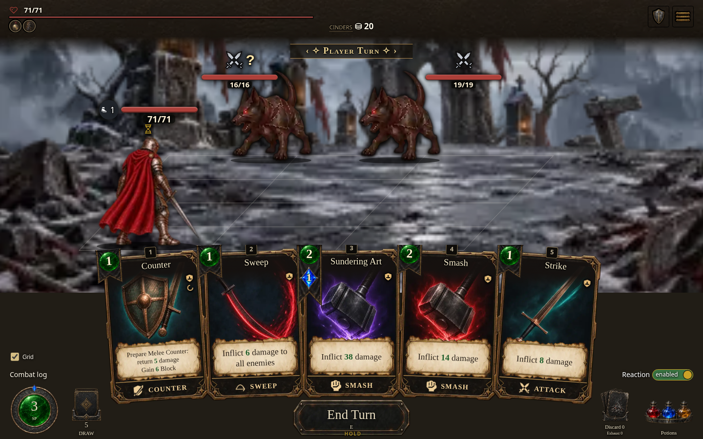
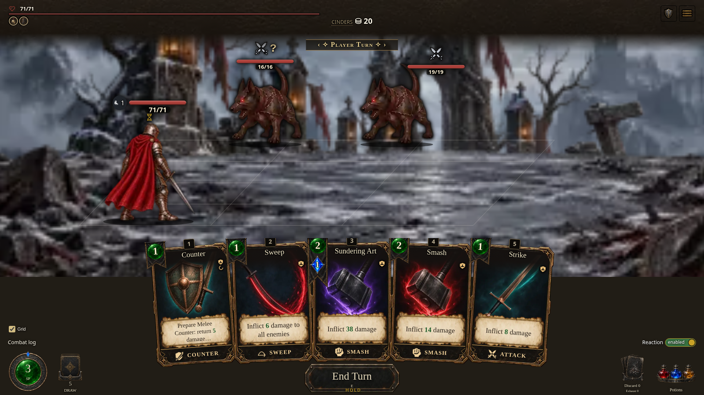
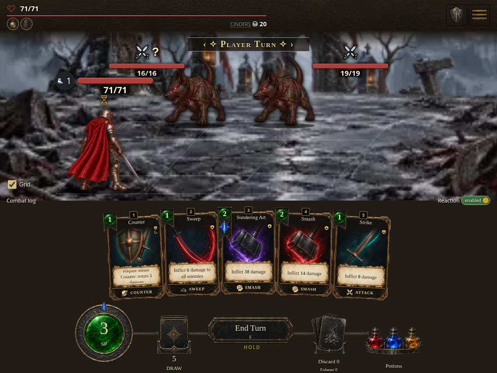
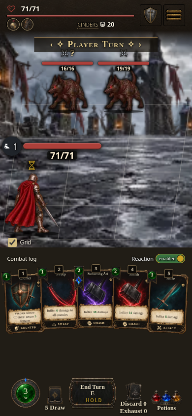

# Battlefield grid visibility

Thin, neutral, 32%-opaque lines outline the actual perspective cells, without fill or overlapping seams. A native **Grid** checkbox sits directly above Combat Log, with a 4px gap; Log and Reaction retain their fixed positions. The same preference appears as **Show battlefield grid** in Settings → General → Display → Interface.

The grid defaults on and remembers explicit off choices. Core displays all four rows, including its unused middle row, without enabling placement there. Grid visibility does not alter actor or footer geometry, targeting, or movement rules.

## Verified builds

- [Core downloadable playable HTML](https://github.com/cehinds/AshenSpire/actions/runs/38952859060/artifacts/12070010032), source `14d121b48deb11c1fd0fab065ed12c28cdea2b88`.
- [Current downloadable playable HTML](https://github.com/cehinds/AshenSpire/actions/runs/38952896396/artifacts/12068894262), source `4bb49184e85b91fab109ec0737dd3e3a0121af01`.
- Both CI builds succeeded. Latest Pages publication remains unverified from this workspace.

Captured 2026-10-16 from the local self-contained Core build, selecting each profile through its normal profile parameter. Build `0.7.1.1534`, runtime `a02392f1d9`, SHA-256 `39e5ab39830f831eeee1e129d9f1c61761c003f2ce75ad3a6cbfc363c6cad55a`. All nine captures record this runtime; these are initialized screenshot fixtures with real UI inputs, not a full-run playthrough.

| Desktop · 1440×900 | Wide · 1920×1080 | Tablet · 1024×768 | Phone · 390×844 |
| --- | --- | --- | --- |
|  |  |  |  |

[Core grid off](core-1440-off.png) · [Current grid on](current-1440.png) · [Current grid off](current-1440-off.png) · [Core Settings](core-1440-settings.png) · [Current Settings](current-1440-settings.png)

## Validation

50 focused unit checks passed. Browser checks passed for both profiles: live checkbox and Settings sync, on/off/reopen, durable preference reload, thin unfilled strokes, inert line overlays, real artwork selection, unchanged actor/Log/Reaction bounds, and disabled Core middle-row occupancy. Four viewport captures passed. Crowded encounters also passed in Core desktop and Current desktop/phone, including an actual targeted attack on the intended enemy.

A thrown settings write now follows the existing rollback path; regression coverage verifies a refused grid choice cannot leak into a later successful save.

[Grid browser results and capture provenance](summary.json) · [Crowded targeting results](crowded-targeting.json)

Reproduce with `tests/formation-grid.browser.mjs`, setting `PLAYWRIGHT_MODULE`, `BASE_URL`, `GRID_ENTRY=AshenSpire.html`, and `GRID_OUT`. Crowded checks use `tests/battlefield-layout.browser.mjs` with `BATTLEFIELD_PROFILE_CASES_ONLY=1` and `BATTLEFIELD_ENTRY=AshenSpire.html`.
