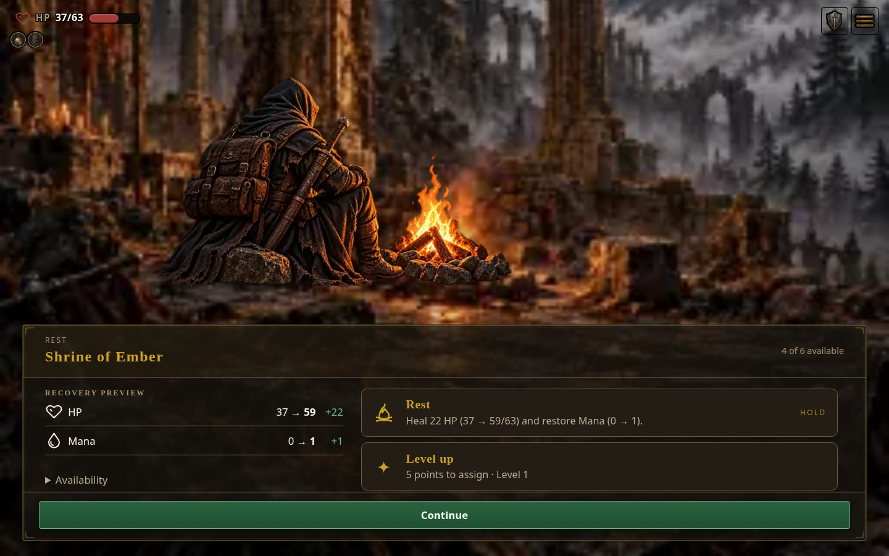
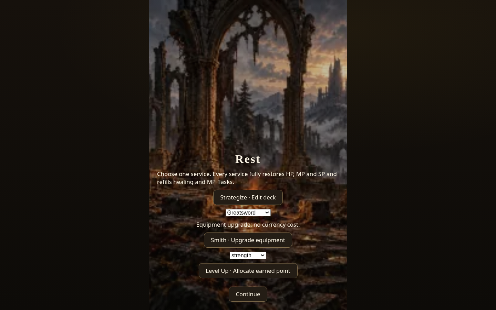

# Rest UI restoration evidence

The reference is the existing full game's Rest frame: a Shrine painting and seated figure, run HUD, and the shared gold choice body containing a recovery preview, service cards, and Continue. The configured/core rules retain their authored services and one-service-per-visit transaction.

Before restoration, the configured view used a narrow centered column with native equipment and attribute selects, without the full Rest HUD or choice body. These initial reference images were captured on 2026-10-15 UTC from the local standalone build 0.7.1.1534, runtime digest `200a7df16c`, SHA-256 `18ad55a340d0eca952243c8b5987daf8bb6d9cab57a210d1657d30625f1555ff`:

| Existing full/current reference | Configured/core before restoration |
| --- | --- |
|  |  |

The reference URLs used `?shot=rest&gameProfile=current&shotRestState=wounded` and `gameProfile=core`, respectively, at 1440×900. These isolated screenshot boots do not modify durable player saves.

## Restored core UI

The fresh images below use standalone build **0.7.1.1534**, runtime digest **1c863b4f85**, built from source **bed684518**. Artifact SHA-256: `e4719bb9ca366c358bc96725bb35b521119d651c5338d8ffd80dc80869359a85`. They were captured locally on 2026-10-15 UTC after the shared Rest frame, progressive class visibility, finite owned-card editor, and responsive sizing changes were integrated. These screenshots identify the local artifact; later CI and Pages publication status is maintained separately in the root README.

Rest captures use an isolated wounded arrival with one point earned through the ordinary XP claim path. Smith previews select one owned item at zero stones; the core's authored service is free. Level previews select Constitution and show the resulting pool maxima before commitment.

| Host viewport | Rest | Smith review | Level review |
| --- | --- | --- | --- |
| Desktop · 1440×900 |  | [Smith](desktop-smith.png) | [Level](desktop-level.png) |
| Wide · 1920×1080 |  | [Smith](wide-smith.png) | [Level](wide-level.png) |
| Tablet · 1024×768 |  | [Smith](tablet-smith.png) | [Level](tablet-level.png) |
| Mobile · 390×844 |  | [Smith](mobile-smith.png) | [Level](mobile-level.png) |

The shared frame retains its existing scrolling behavior: desktop choice and recovery columns scroll independently; mobile folds the content vertically. Service controls remain reachable through those panes. [Current/full Rest captured from the same artifact](current-desktop-rest.png) provides the visual comparison.

| Fresh class selection | Reaver review |
| --- | --- |
|  |  |

## Browser verification

`tests/rest-ui.browser.mjs` passed against this standalone artifact in Chromium:

- The full painted Rest frame, seated figure, run HUD, recovery ledger, choice body, and Continue were present at all four viewport sizes.
- Cancelling a changed Strategize draft, selected Smith review, or selected Constitution allocation left the live run unchanged.
- Strategize moved an owned card to the sideboard and restored that same card before confirmation, preserving the minimum ten-card deck and owned identities while persisting the changed order. A nine-card draft could not commit; no unlimited card minting was inferred.
- Each confirmed service restored HP, MP, SP, healing flask charges, and MP flask charges. The actual save manager's loaded slot matched the live state, including the deck, equipment upgrade, or allocated attribute.
- Each visit accepted one service. All service cards became unavailable after commitment; Continue reached the map, and returning to the same Rest retained the spent state.
- Level Up without an earned point displayed an unavailable reason. A fresh class screen showed Reaver and the next locked Starseer; the Reaver review displayed its ten-card starter.
- No browser page errors occurred.

The script accepts `REST_UI_BASE` and `REST_UI_ENTRY=AshenSpire.html` for a local standalone server. `REST_UI_CAPTURE_ONLY=1` refreshes screenshots; `REST_UI_BEHAVIOR_ONLY=1` runs service transactions without a gallery refresh.
