# Target HUD proposals — approval review

Design only. No game runtime, balance, saved positions, targeting or animation code is changed.

[Interactive state gallery](index.html) · [All seven](comparison.html) · [Panel close-up](panel-closeup.html)

## Fixed composition

1440×900. The approved large hand uses 204×306 cards, 200px step, ±4° fan. Footer B stays transparent at y700 and solid #211d16 at y790; floor continues behind cards. Grid, Log, Reaction and all split footer controls keep their current bounds. The current soft header treatment is retained in the wireframe; Player Turn is now inside the header at (594,48), 252×31, painted above the field. Cinders moves beside the top-right shield. These header placements are proposals, not runtime changes.

Four real perspective depth bands and three columns. Default fill order is explicit:

```
Back:   [2] [3] [1]
Front:  [6] [5] [4]
```

Two default enemies occupy back right first (Enemy 1), then back left (Enemy 2), leaving the middle empty. Their feet are inside that same back row at y329, x1081/x555. Middle examples add Enemy 3 at x818. The player stays at the leftmost bottom cell, x301, feet y505. Core’s intermediate band remains a visually reserved row; this proposal does not change occupancy policy.

## States

| State | Example | Detailed panel placement |
|---|---|---|
| A | Idle | None; overhead intent + HP |
| B | Left enemy focused | Left, x274 y94, 224×116; raised clear of player |
| C | Middle enemy focused | Below, x706 y341, 224×116 |
| D | Right enemy focused | Right, x1175 y150, 224×116 |
| E | Left-column player focused | Right, x435 y351, 224×116 |
| F | Offensive card preselects eligible enemies | All three panels; middle focused |
| G | Self-target card preselects player | Player panel right; separate middle/right placement insets |

Selected actors are highlighted and their cells tint red (enemy) or blue (player). Eligible card candidates use softer tint, while focus has a stronger outline. Candidate preselection only previews eligibility; it never auto-plays the card.

Idle actors show overhead intent/icon and HP. A selected actor retains overhead intent and perceived damage, but removes overhead HP. The detailed panel is vertical: HP bar, Poise bar, then intent icon–name–damage. The single status row sits below the panel, bottom-right aligned. The Dodge icon is larger and centered within its icon box; its small count sits at the bottom corner. The close-up supports real hover/focus/click-to-pin status tooltip illustrations.

Damage and all displayed stats/statuses are **illustrative**, not an authored balance change. Red is perceived damage; green shows a reduced stance-advantage preview (12 → 8). The middle enemy demonstrates failed perception: both overhead and detail show ?, with no hidden move or damage exposed.

## Timing interpretation for approval

One 500ms stable-target threshold, not three cumulative delays. Enter: hover/focus stable for 500ms, then a short fade. Exit: retain the current panel for 500ms, then fade. Switch: the new candidate must remain stable for 500ms before old→new crossfade. A ~150ms fade is drawn only as a proposed visual duration.

Clicks highlight immediately. Target clicks, card play and combat never wait for these detail presentation timers. A continuous pointer corridor joins actor and panel; sprite, corridor, panel and status row all retain the panel while hovered/focused. The leave grace permits travelling to statuses. Reduced motion keeps dwell/grace but switches opacity instantly.

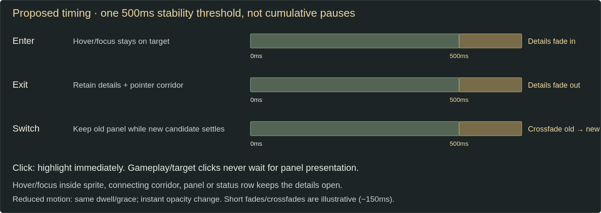

## Primary examples

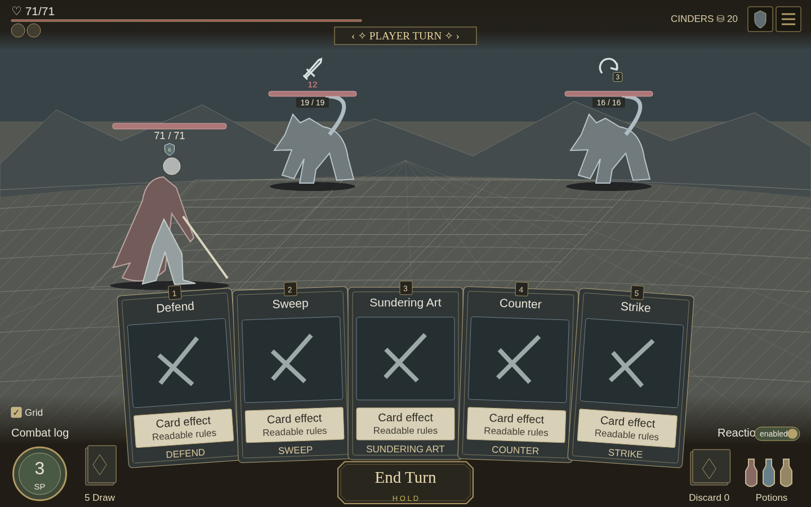

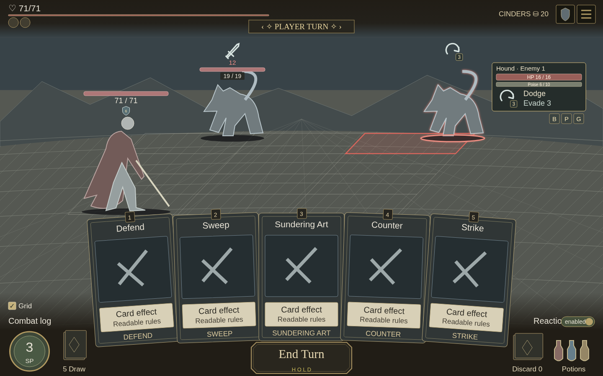

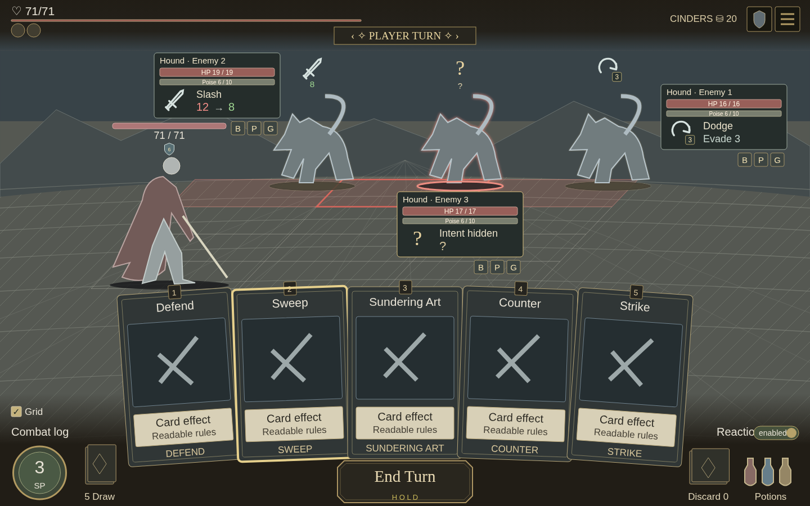

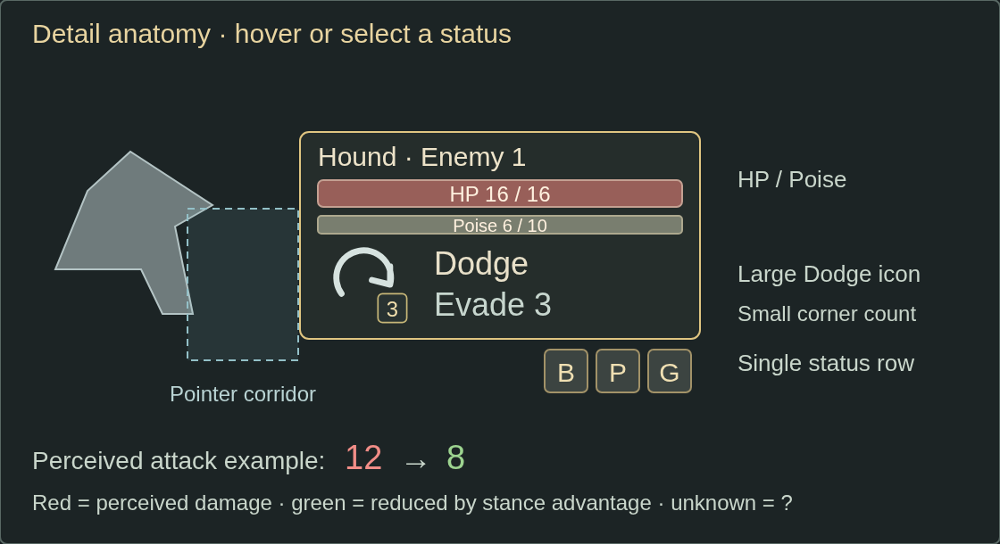

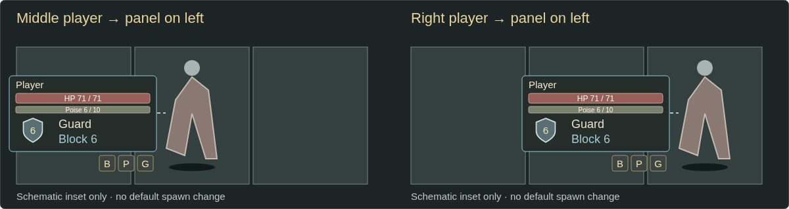

## Other states

### B — Left enemy focused

Enemy 2: panel left; status row below/right aligned. Stance advantage changes the illustrative perceived 12 damage to green 8 both overhead and in the panel; overhead HP is removed.

[Full-size view](state-b.html)

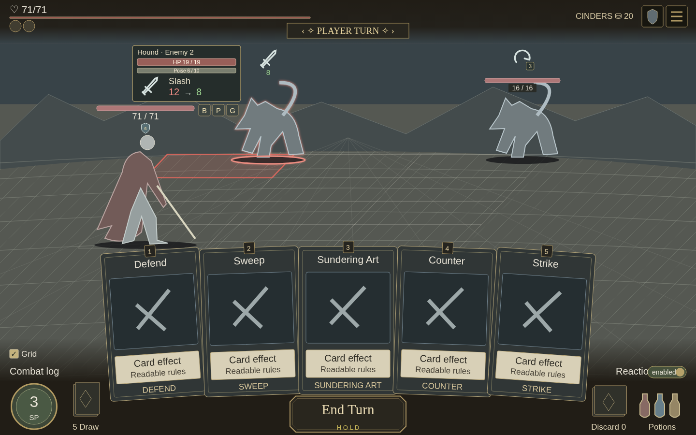

### C — Middle enemy focused

Enemy 3: panel below. This enemy’s intent is unperceived, so both overhead and panel retain ? and reveal no move or damage.

[Full-size view](state-c.html)

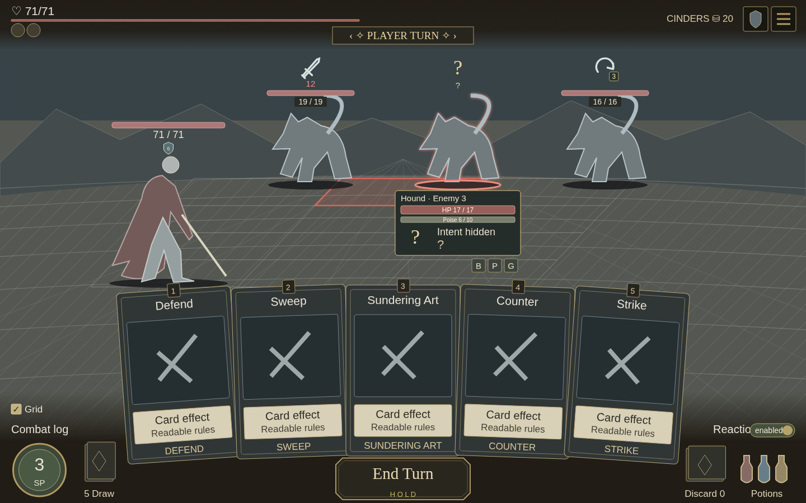

### E — Left-column player focused

Player panel sits to the right of the left-column player. Overhead HP is removed; intent remains above the sprite.

[Full-size view](state-e.html)

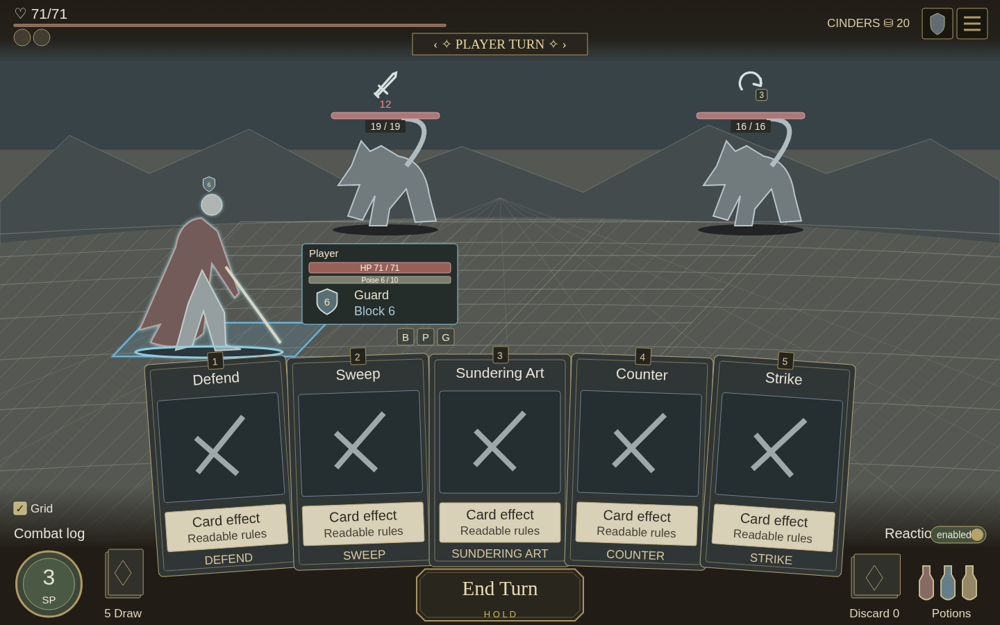

### G — Self-target card · player candidate

Defend preselects the player, with its panel on the right. The separate insets show middle/right player panels on the left. No play is committed.

[Full-size view](state-g.html)

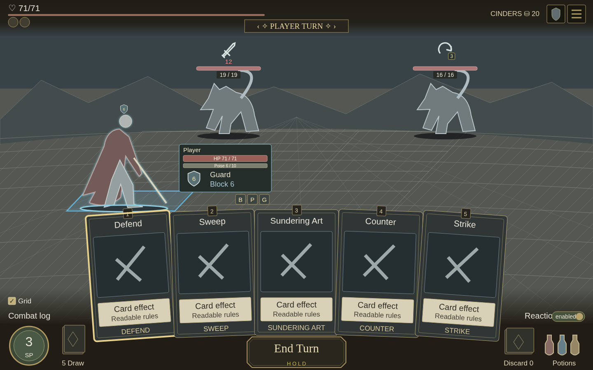

Procedural SVG wireframes only; no screenshots or game artwork are edited. All labels outside the viewport are review annotations, not proposed game UI. `generate.py` contains the shared geometry. PNGs are browser renders. Approval is required before runtime implementation.

## H — six-target ownership supplement

[Open H](state-h.html). Exploded ownership/paired-row schematic only, **not a proven 1440×900 HUD layout or an implementation**. All six panels remain visible. Before implementation, crowded back/front pairs need collision-aware compact/staggered placement that preserves preferred sides when possible. This review does not introduce a dock or silently hide any panel.

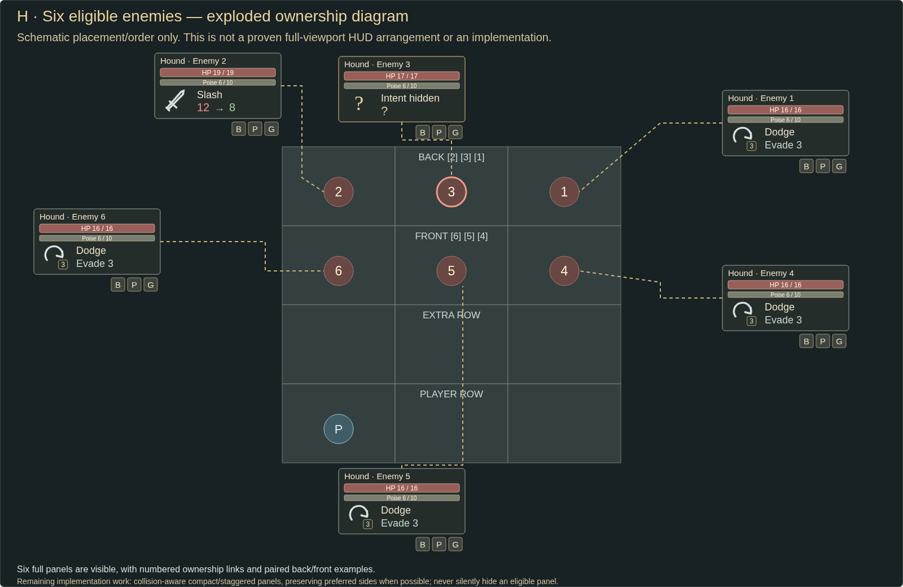
