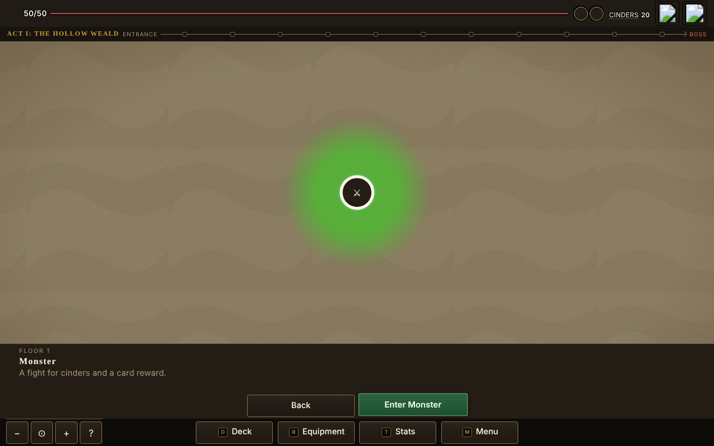
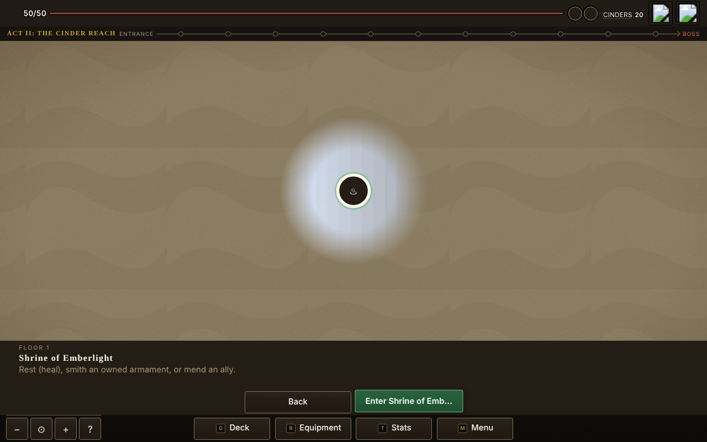
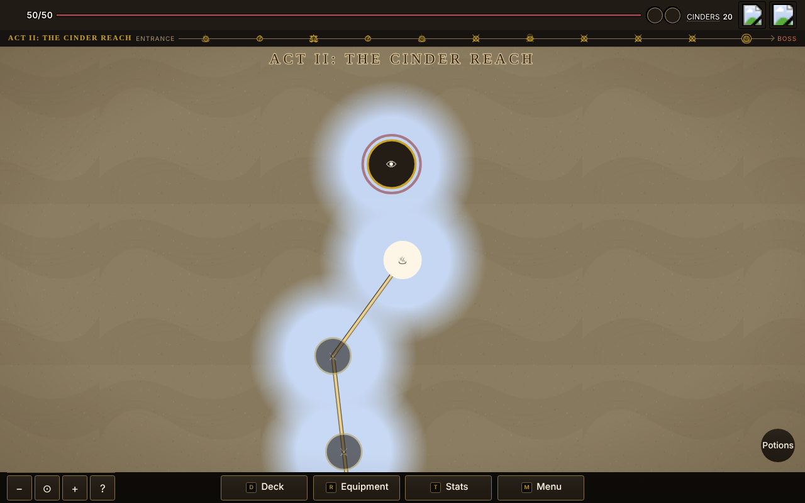
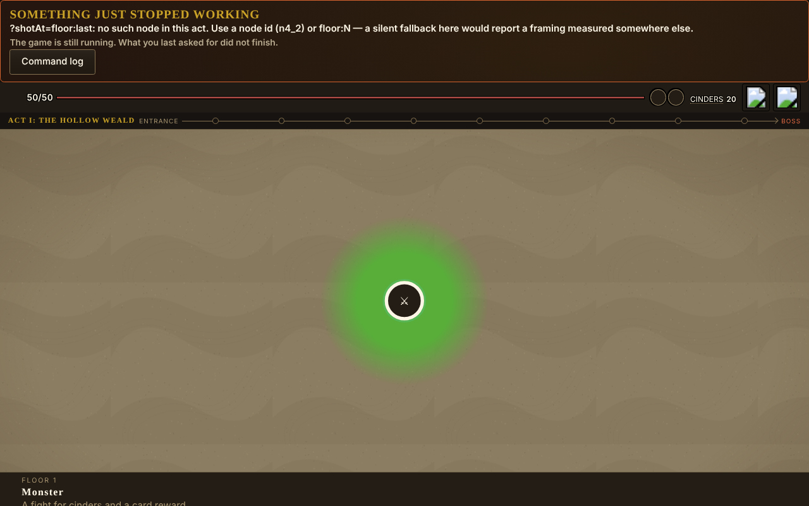
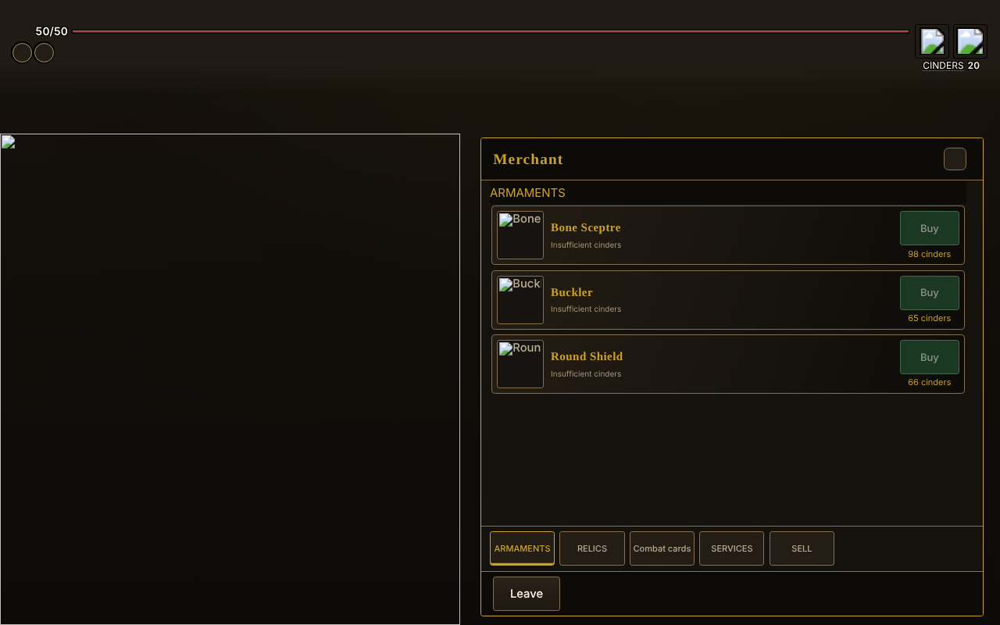
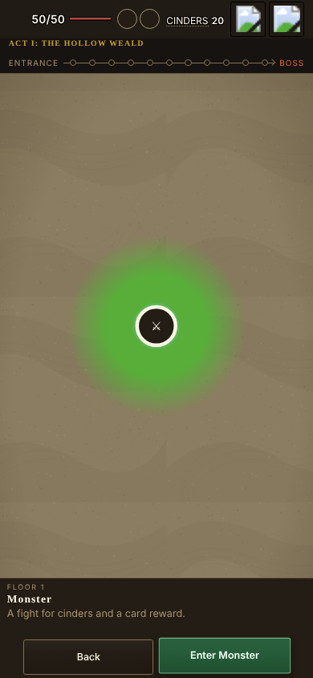
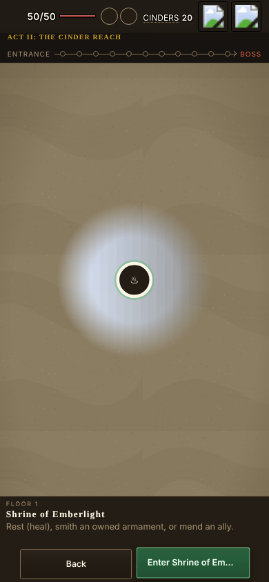
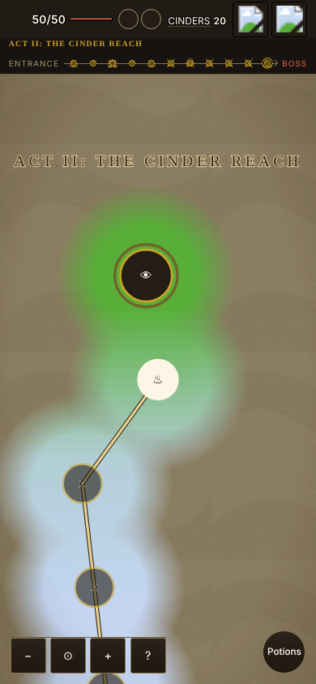
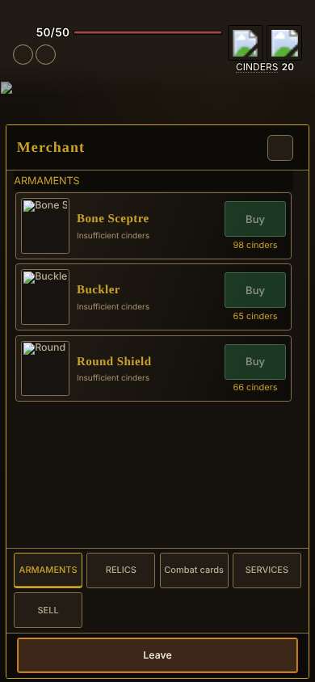

# QA sandbox report

## Request

> Owner request (2026-11-18), act map: two more depths per act (11 pre-boss depths); acts 2 and 3 start on a rest node (act 1 still starts on a combat node); rests 2-5 non-rest nodes apart; each boss branch fans away from the others like a V, and from a branch's pre-boss rest no other branch's late nodes or boss are visible or reachable; a trader or blacksmith you left re-opens by clicking the node you still stand on.

**Result: PASS** (50 passed, 0 failed); before = `origin/dev`

## desktop / act1-start-combat

| Group | Check | After (this tree) | Before (base) |
| --- | --- | --- | --- |
| success | Act 1 opens on a combat node at depth 1 | PASS visible | PASS visible |
| success | No rest is drawn at the act 1 start | PASS count 0 | PASS count 0 |
| success | No console errors | PASS none | PASS none |
| failure | Act 1 start drawn as a rest | PASS absent (not found) | PASS absent (not found) |

Screenshots:

- after: `desktop-act1-start-combat-after.png`
- before: `desktop-act1-start-combat-before.png`

## desktop / act2-start-rest-v-spread

| Group | Check | After (this tree) | Before (base) |
| --- | --- | --- | --- |
| success | Act 2 opens on a rest node at depth 1 | PASS visible | FAIL not found |
| success | The branch bosses are all lit and spread across the board (V) | PASS count 2 | FAIL count 1 |
| success | No console errors | PASS none | PASS none |
| failure | Act 2 start drawn as a fight | PASS absent (not found) | FAIL FAILURE PRESENT: visible |

Screenshots:

- after: `desktop-act2-start-rest-v-spread-after.png`
- before: `desktop-act2-start-rest-v-spread-before.png`

## desktop / v-spread-bosses

| Group | Check | After (this tree) | Before (base) |
| --- | --- | --- | --- |
| success | At least two branch bosses are lit and drawn apart across the widened board | PASS count 2 | FAIL count 1 |
| success | The act 2 start rest is on the board | PASS visible | FAIL not found |
| success | No console errors | PASS none | PASS none |
| failure | Only one boss is lit at the start | PASS absent (count 2) | FAIL FAILURE PRESENT: count 1 |

Screenshots:

- after: `desktop-v-spread-bosses-after.png`
- before: `desktop-v-spread-bosses-before.png`

## desktop / preboss-rest-no-other-boss

| Group | Check | After (this tree) | Before (base) |
| --- | --- | --- | --- |
| success | The pre-boss rest is where you stand | PASS visible | FAIL not found |
| success | Exactly one boss is drawn: your own | PASS count 1 | PASS count 1 |
| success | Only your own boss is reachable | PASS count 1 | PASS count 1 |
| success | No console errors | PASS none | FAIL 1 error(s): ?shotAt=floor:last: no such node in this act. Use a node id (n4_2) or floor:N —  |
| failure | Another branch's boss is drawn | PASS absent (count 1) | PASS absent (count 1) |
| failure | More than one node is reachable from the pre-boss rest | PASS absent (count 1) | PASS absent (count 1) |

Screenshots:

- after: `desktop-preboss-rest-no-other-boss-after.png`
- before: `desktop-preboss-rest-no-other-boss-before.png`

## desktop / trader-reentry-node

| Group | Check | After (this tree) | Before (base) |
| --- | --- | --- | --- |
| success | The trader you left is the node you stand on and is enterable | PASS visible | FAIL not found |
| success | Only that trader is enterable (no travel yet) | PASS count 3 | PASS count 1 |
| success | No console errors | PASS none | FAIL 1 error(s): ?shotAt=type:merchant: no such node in this act. Use a node id (n4_2) or floor:N |
| failure | The left trader is not enterable | PASS absent (count 1) | FAIL FAILURE PRESENT: count 0 |

Screenshots:

- after: `desktop-trader-reentry-node-after.png`
- before: `desktop-trader-reentry-node-before.png`

## desktop / trader-reentry-opens

| Group | Check | After (this tree) | Before (base) |
| --- | --- | --- | --- |
| success | Clicking the trader you still stand on re-opens its shop | PASS visible | FAIL not found |
| success | No console errors | PASS none | FAIL 1 error(s): ?shotAt=type:merchant: no such node in this act. Use a node id (n4_2) or floor:N |
| failure | The map is still showing after entering the trader | PASS absent (not found) | FAIL FAILURE PRESENT: visible |

Screenshots:

- after: `desktop-trader-reentry-opens-after.png`
- before: `desktop-trader-reentry-opens-before.png`

## phone / act1-start-combat

| Group | Check | After (this tree) | Before (base) |
| --- | --- | --- | --- |
| success | Act 1 opens on a combat node at depth 1 | PASS visible | PASS visible |
| success | No rest is drawn at the act 1 start | PASS count 0 | PASS count 0 |
| success | No console errors | PASS none | PASS none |
| failure | Act 1 start drawn as a rest | PASS absent (not found) | PASS absent (not found) |

Screenshots:

- after: `phone-act1-start-combat-after.png`
- before: `phone-act1-start-combat-before.png`

## phone / act2-start-rest-v-spread

| Group | Check | After (this tree) | Before (base) |
| --- | --- | --- | --- |
| success | Act 2 opens on a rest node at depth 1 | PASS visible | FAIL not found |
| success | The branch bosses are all lit and spread across the board (V) | PASS count 2 | FAIL count 1 |
| success | No console errors | PASS none | PASS none |
| failure | Act 2 start drawn as a fight | PASS absent (not found) | FAIL FAILURE PRESENT: visible |

Screenshots:

- after: `phone-act2-start-rest-v-spread-after.png`
- before: `phone-act2-start-rest-v-spread-before.png`

## phone / v-spread-bosses

| Group | Check | After (this tree) | Before (base) |
| --- | --- | --- | --- |
| success | At least two branch bosses are lit and drawn apart across the widened board | PASS count 2 | FAIL count 1 |
| success | The act 2 start rest is on the board | PASS visible | FAIL not found |
| success | No console errors | PASS none | PASS none |
| failure | Only one boss is lit at the start | PASS absent (count 2) | FAIL FAILURE PRESENT: count 1 |

Screenshots:

- after: `phone-v-spread-bosses-after.png`
- before: `phone-v-spread-bosses-before.png`

## phone / preboss-rest-no-other-boss

| Group | Check | After (this tree) | Before (base) |
| --- | --- | --- | --- |
| success | The pre-boss rest is where you stand | PASS visible | FAIL not found |
| success | Exactly one boss is drawn: your own | PASS count 1 | PASS count 1 |
| success | Only your own boss is reachable | PASS count 1 | PASS count 1 |
| success | No console errors | PASS none | FAIL 1 error(s): ?shotAt=floor:last: no such node in this act. Use a node id (n4_2) or floor:N —  |
| failure | Another branch's boss is drawn | PASS absent (count 1) | PASS absent (count 1) |
| failure | More than one node is reachable from the pre-boss rest | PASS absent (count 1) | PASS absent (count 1) |

Screenshots:

- after: `phone-preboss-rest-no-other-boss-after.png`
- before: `phone-preboss-rest-no-other-boss-before.png`

## phone / trader-reentry-node

| Group | Check | After (this tree) | Before (base) |
| --- | --- | --- | --- |
| success | The trader you left is the node you stand on and is enterable | PASS visible | FAIL not found |
| success | Only that trader is enterable (no travel yet) | PASS count 3 | PASS count 1 |
| success | No console errors | PASS none | FAIL 1 error(s): ?shotAt=type:merchant: no such node in this act. Use a node id (n4_2) or floor:N |
| failure | The left trader is not enterable | PASS absent (count 1) | FAIL FAILURE PRESENT: count 0 |

Screenshots:

- after: `phone-trader-reentry-node-after.png`
- before: `phone-trader-reentry-node-before.png`

## phone / trader-reentry-opens

| Group | Check | After (this tree) | Before (base) |
| --- | --- | --- | --- |
| success | Clicking the trader you still stand on re-opens its shop | PASS visible | FAIL not found |
| success | No console errors | PASS none | FAIL 1 error(s): ?shotAt=type:merchant: no such node in this act. Use a node id (n4_2) or floor:N |
| failure | The map is still showing after entering the trader | PASS absent (not found) | FAIL FAILURE PRESENT: visible |

Screenshots:

- after: `phone-trader-reentry-opens-after.png`
- before: `phone-trader-reentry-opens-before.png`

