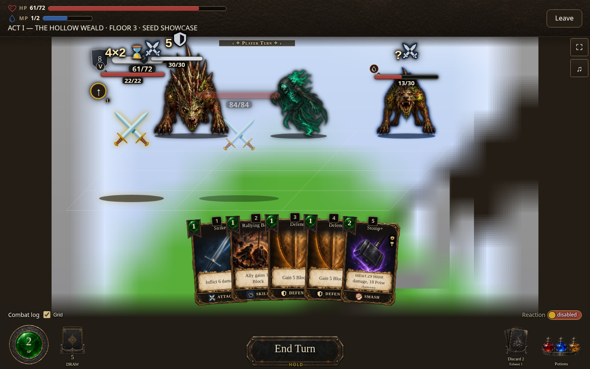
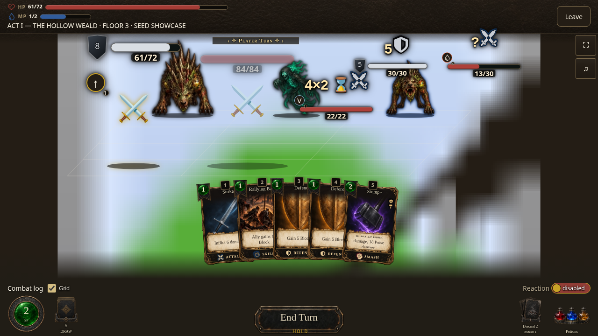

# Module Browser Compatibility feature preview capture

The feature preview is not yet publicly verified. Its expected URL is [Module Browser Compatibility](https://cehinds.github.io/AshenSpire/branches/fix/ModuleBrowserCompatibility/latest/).

These screenshots were captured locally from the production co-op renderer using a canned host snapshot and transport. The placeholder seats have no player appearance. They document the co-op HUD correction at four viewports; they are not screenshots of a live co-op connection or of the public feature route.

| Phone · 390 × 844 | Desktop · 1440 × 900 | Wide · 1280 × 720 | Tablet · 768 × 1024 |
| --- | --- | --- | --- |
|  |  |  |  |

The matching feature artifact is build **0.7.1.1554** (ordinal 1554, artifact `12113886530`, archive SHA-256 `4d254e002141550519860677a96f4fbb9c9c955d44fd40d5af407abd5b0305c2`, source digest `18e60cd573`). Its candidate runtime source is `7ba01e82987f43afb4a77bff2fd3e03da26f2b41`; see [workflow run 39067000100](https://github.com/cehinds/AshenSpire/actions/runs/39067000100). The public route is still pending read-only identity verification. Screenshots remain local source evidence from the earlier capture base and CSS. See [capture-record.json](capture-record.json) for provenance and limits.
