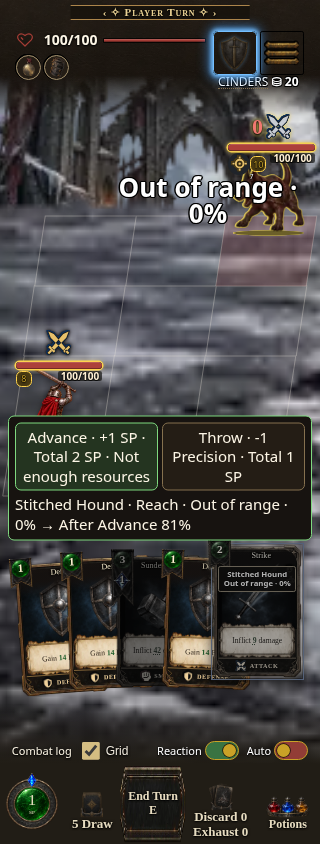
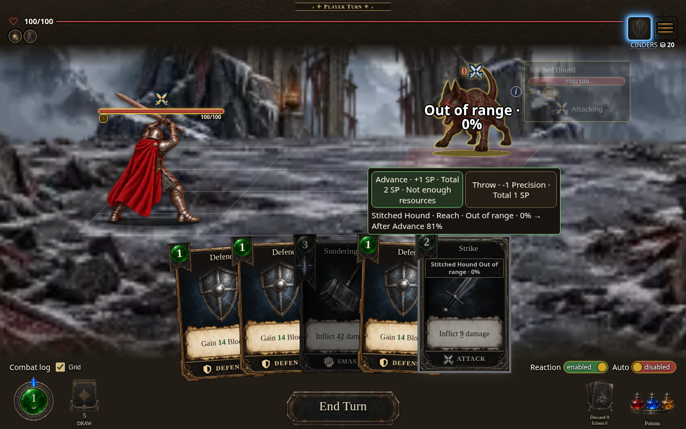
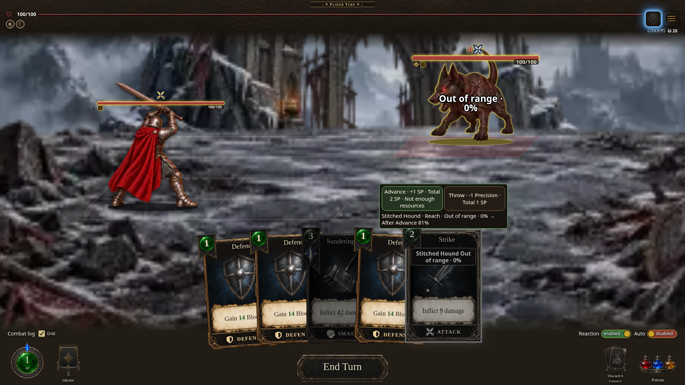
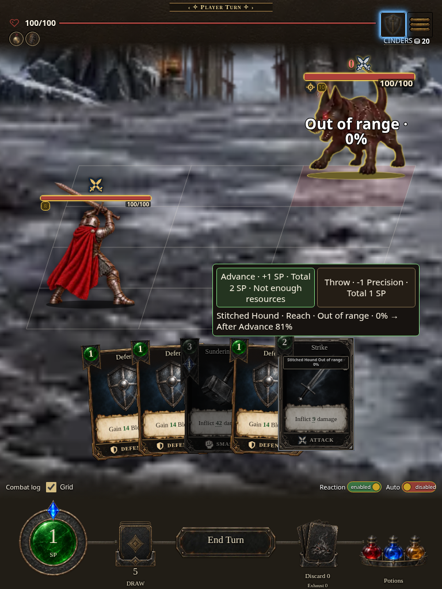
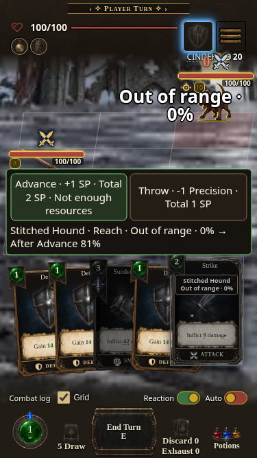
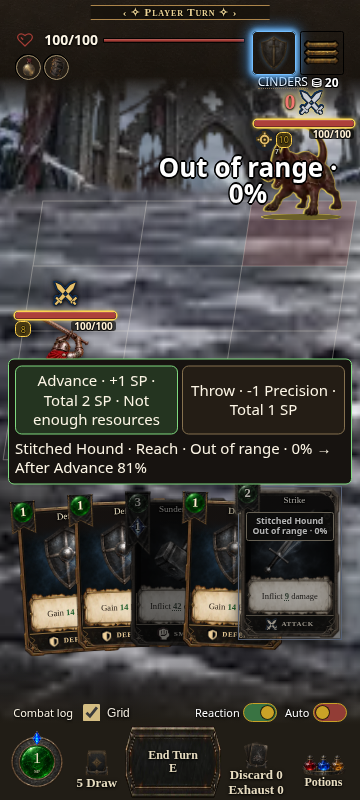
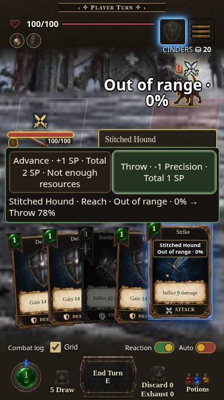
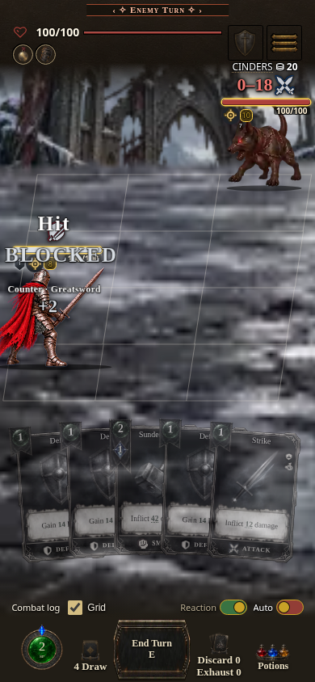

# Range Advance packaged captures

- Captured: 2026-10-20, Chromium 154; touch-capable CSS viewports, DPR 1.
- Actual artifact: `AshenSpire.html`, light single file, build **0.7.1.1745**.
- Embedded source digest: `90e45f9984`; source commit `3fb7b937b121878ff7ac5c0848a19861473bbc40`.
- Artifact SHA256: `60a89e35abddaf099964e746990e5e4595139747b12128cfc8eb4cb586169ab2`.
- [Intended public feature build](https://cehinds.github.io/AshenSpire/branches/feature/RangeAdvance/latest/): delivery verification pending; feature artifact CI940 succeeded. Public Pages access is blocked by this environment's domain policy; the Pages workflow verifies delivery.

| Mobile 320 × 844 | Desktop 1280 × 800 | Wide 1920 × 1080 | Tablet 768 × 1024 |
| --- | --- | --- | --- |
|  |  |  |  |

| SE-sized 375 × 667 | A32-sized 360 × 800 |
| --- | --- |
|  |  |

These are Chromium viewport checks, not physical iOS/Android device tests.
All six passed native touch selection, keyboard Tab/Enter route choice,
explicit Throw payment, unchanged persistent distance after Throw, viewport
bounds, and buttons at least 143 × 68.5 CSS pixels. The current target remains
**Out of range · 0%**, separate from the quoted after-route chance.

The browser boots the actual standalone file. It imports no source modules,
never remounts a screen, and replaces no handler/controller. The initial
starting-hand Strike is played natively without posing. For the layout images
only, the existing shot data handle equips a real authored Dagger on Reaver,
moves the pair to Reach, poses SP 1 and HP 100, and exposes an actual starting
Strike; the existing built shot render then paints that data. Real native
handlers choose and pay the route. This is a posed layout, not a playthrough.

The separate Counter probe poses an authored enemy attack, the actual starting
Counter in hand, reachable distance, and zero enemy Block/Barrier. Native
End Turn, its actual confirmation/shield lifecycle, and the real reaction
modal execute Counter. Receipts prove **1 SP paid**, a **7 damage return
payload**, and **5 HP damage** after mitigation. Its image captures playback
in progress; it does not claim the whole enemy turn has finished.

| Viewport | Pointer-down to first visible-panel frame sample |
| --- | ---: |
| 320 × 844 | 355.7 ms |
| 375 × 667 | 383.6 ms |
| 360 × 800 | 317.1 ms |
| 1280 × 800 | 317.3 ms |
| 1920 × 1080 | 305.2 ms |
| 768 × 1024 | 353.0 ms |

These are single instrumented observations in a shared environment, without
CPU throttling, a hard timing threshold, or a performance/speed claim.

No page JavaScript errors, source-module requests, or unclassified HTTP errors
occurred. Named optional sound probes returned 404 and used synthesis. The
exact default `music/manifest.json` also returned 404; `src/ui/audio.js`
explicitly falls back to the procedural score when that manifest is absent.
All other failed HTTP responses remain fatal in the harness.

Local reproduction/evidence is retained outside the removable feature gallery:
`/workspace/scratch/range-built-smoke.mjs`,
`/workspace/scratch/range-built-smoke.log`,
`/workspace/scratch/range-final-buildordinal.json`, and
`/tmp/range-built-smoke/` (full report and original PNGs). The first Counter
harness failure is retained in `/workspace/scratch/range-built-first-report.json`;
it omitted the actual End Turn confirmation and was fixed without runtime edits
or a longer deadline.
