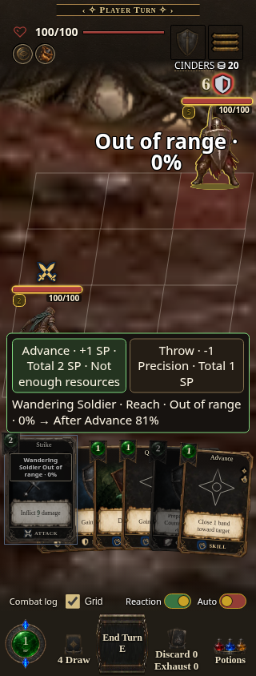
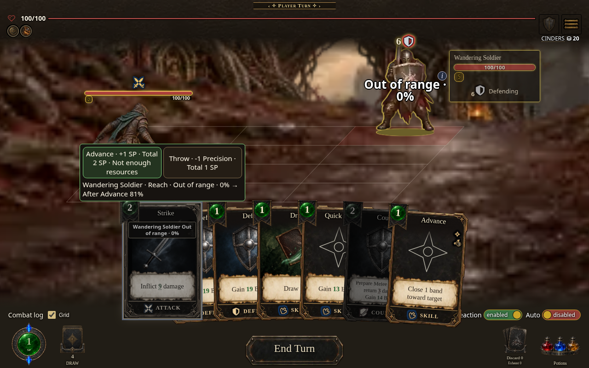
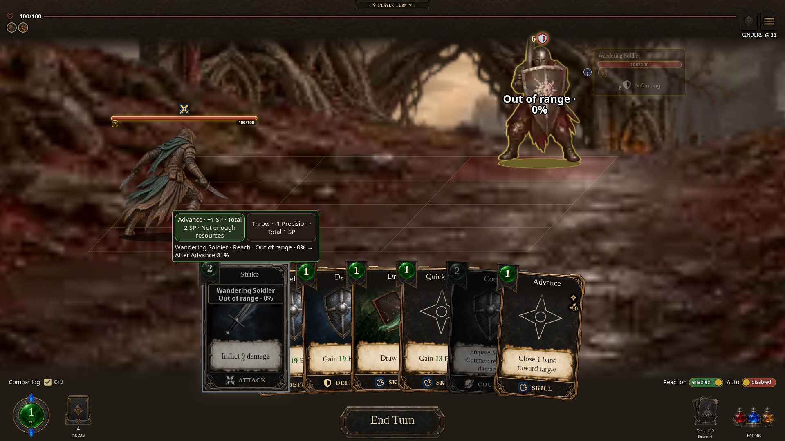
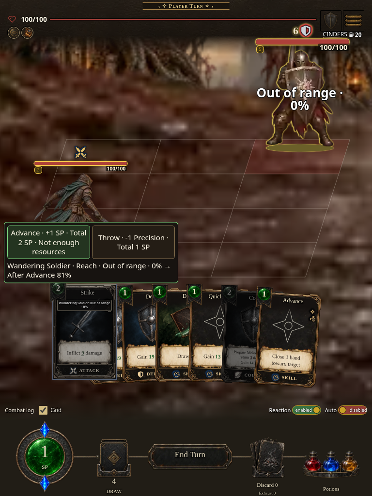
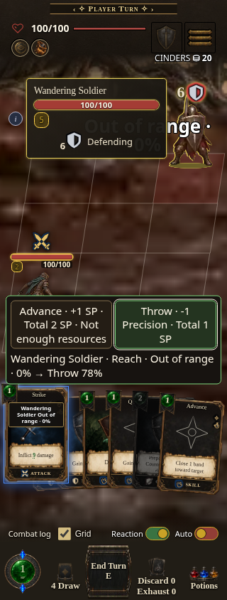
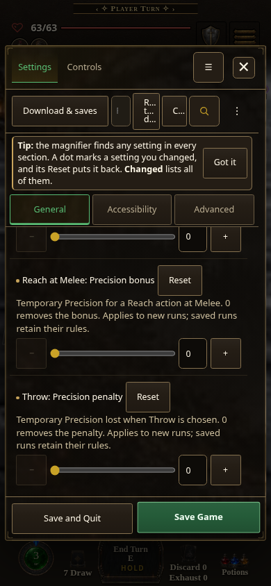

# Range Advance source QA

Captured 2026-10-20 in Chromium 154 from source commit
`1b3467276ac4e073052937122fad819ccb72ffe0`. These captures use the real source
renderer and native touch/keyboard input, with an explicit authored Core Rogue
fixture mounted after source boot. They are not packaged-build or playthrough
proof. No standalone build version/digest or published playable URL applies to
this source-only pass; final integrated build verification is separate.

The fixture uses the real Rogue/Dagger starting Strike and authored Advance,
poses the selected enemy at Reach, and sets SP to 1: Advance costs 2 SP and is
unaffordable, while explicit Throw costs 1 SP with -1 Precision. Target HP is
raised for a stable demonstration. The served high-art paths use the verified
hd-assets-v23 light cache fallback. Three optional local sound files
(holdTick, cardPlay and relic .ogg) return 404 during action input; no page
JavaScript errors occurred. No assets or gameplay controllers are mocked.

| Mobile 320 × 844 | Desktop 1280 × 800 |
| --- | --- |
|  |  |

| Wide 1920 × 1080 | Tablet 768 × 1024 |
| --- | --- |
|  |  |



All four layouts passed `tests/range-action-ui.browser.mjs`: current
Out of range · 0% text fits the viewport; route buttons have unobstructed
centers and at least 44 × 44 CSS pixels; keyboard Tab/Enter and touch route
selection do not play, roll or spend; a native enemy-body tap pays Throw once
without moving the persistent pair; pure authored Advance shows no Accuracy
badge or ordinary surcharge attachment. Existing 15-second readiness and play
deadlines are retained. The shared browser-launcher path also passed at 320.



`tests/range-settings-ui.browser.mjs` opens the actual in-run Settings modal:
Current remains the active profile while Core is selected for the next run;
Range defaults on, accepts off and numeric zero, and survives search/category
repaint. The active run profile/range policy stays unchanged. A production new
Core run constructed with the observed preferences snapshots those zero/off
values. This Settings pass had no page errors or HTTP errors.

`tests/range-ui-engine-transition.test.mjs` additionally plays authored Advance
in the real engine, then proves a previously selected Throw inside ordinary
coverage has no Precision penalty, normal odds/cost, no route attachment, and
exactly normal SP payment.

Reproduce from the repository root with installed Playwright and Chromium:

```sh
NODE_PATH=/path/to/node_modules CHROME=/path/to/chromium node tests/range-action-ui.browser.mjs
NODE_PATH=/path/to/node_modules CHROME=/path/to/chromium node tests/range-settings-ui.browser.mjs
node --test tests/range-ui-engine-transition.test.mjs
```

The browser gates write raw geometry/log evidence to `/tmp/range-action-ui`
by default; those transient files are intentionally not tracked. `RANGE_UI_OUT`
selects another directory; `RANGE_UI_ONLY=320` bounds a layout reproduction.
