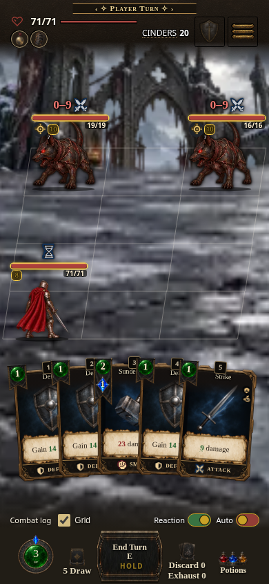
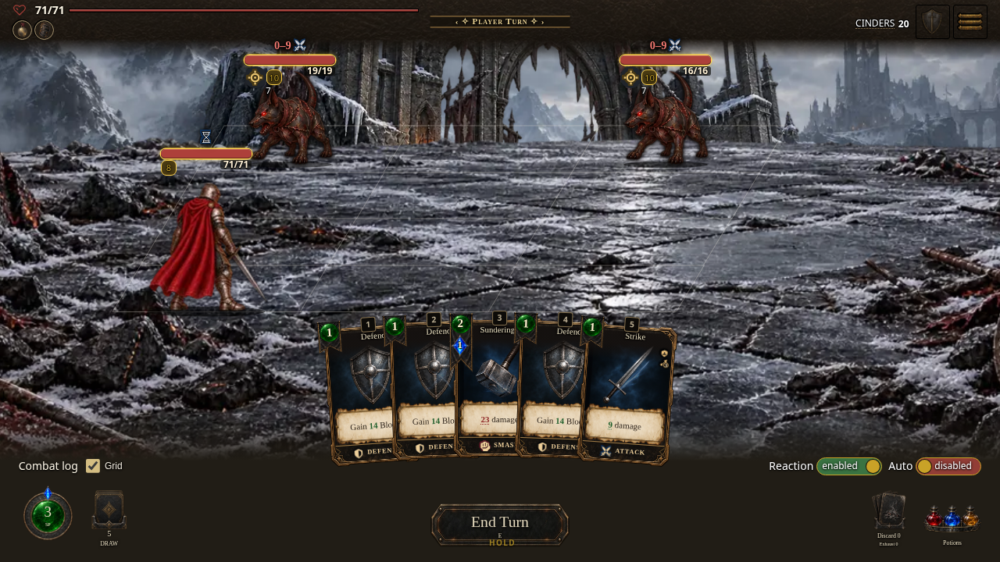
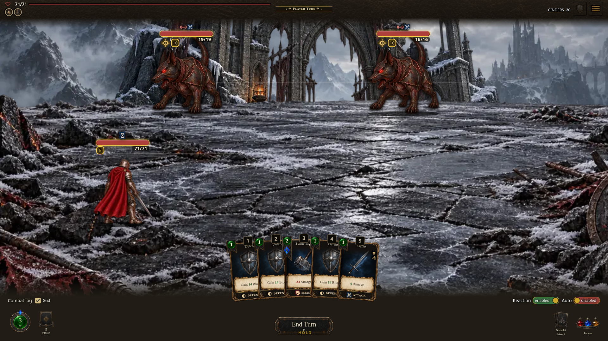
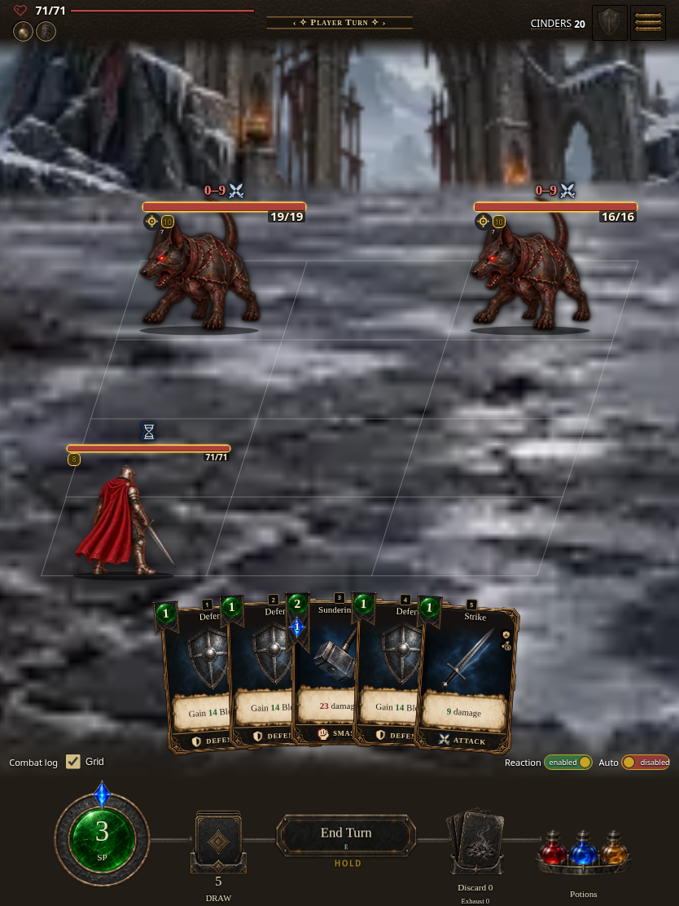

# Combat layout stability capture record

Source commit: b0acaf5fef2ca58eae8f01dd88747f45eebbccd4.
Captured: 2026-10-29 UTC, Chromium, local source server.
Route: `/?shot=combat&gameProfile=core&seed=T14`.

These are real resting combat captures from the corrective source tree, not completed playthroughs. The source server still carries stamped base metadata **0.7.1.1918 / 10520cb8b7**; this follow-up awaits its own integration stamp. Browser motion probes verify the changed behavior during actions (49 default, 36 Classic and 43 T14 checks pass). These still images document the inspected resting appearance.

| Phone 390×844 | Desktop 1280×720 | Wide 1920×1080 | Tablet 834×1112 |
| --- | --- | --- | --- |
|  |  |  |  |

Expected branch preview after CI publication: https://cehinds.github.io/AshenSpire/branches/fix/ReleaseQaStability/latest/ . Local source loading was verified; publication is reported separately by CI.
