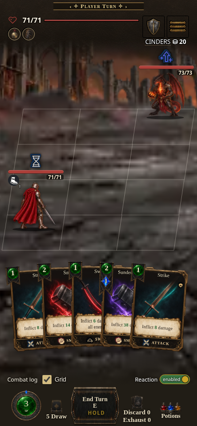
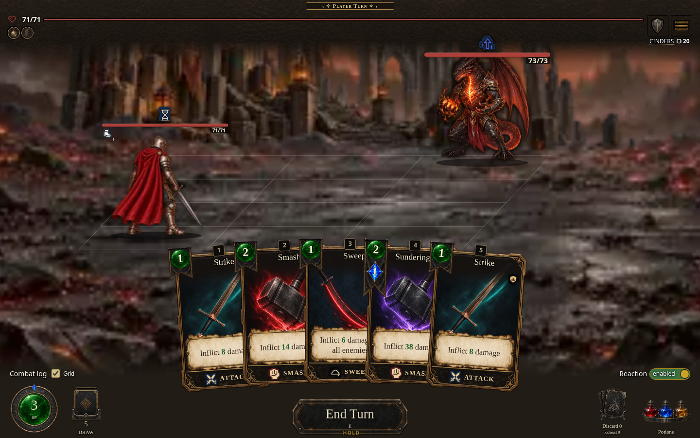

# Stance Animation Module feature preview capture

Captured 2026-10-17 from local source server (`index.html`), source commit `a7e4d21abff5cdc817d79cbfc6f5f305570934fe`. The matching standalone CI artifact is build **0.7.1.1550**, artifact `12111476110`, source digest `1779e6f1ff` (workflow run [39060894016](https://github.com/cehinds/AshenSpire/actions/runs/39060894016)).

Public feature route verification is pending. Expected URL: [Stance Animation Module](https://cehinds.github.io/AshenSpire/branches/feature/StanceAnimationModule/latest/). These local screenshots do not prove that public route is live.

| Phone · 390 × 844 | Desktop · 1440 × 900 | Wide · 1280 × 720 | Tablet · 768 × 1024 |
| --- | --- | --- | --- |
|  |  |  |  |

Capture details and evidence digest are in [capture-record.json](capture-record.json).
