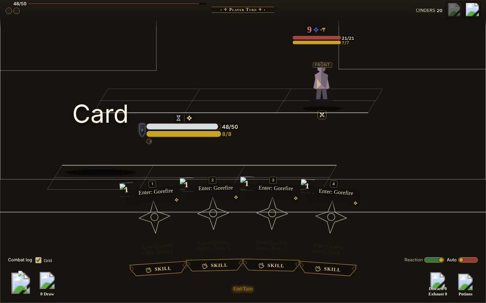
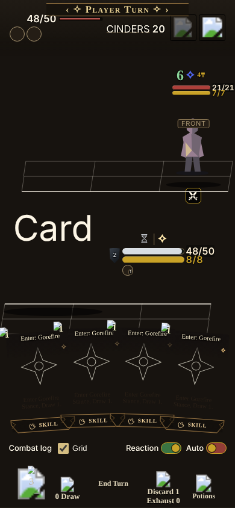

# QA sandbox report

## Request

> Cards whose effect changes stance (the enterStance op, e.g. Enter: Gorefire) do not change the player's sprite pose or the stance icon. The owner isn't sure the stance really changes. The stance bonus does seem to reach card numbers.

**Result: PASS** (18 passed, 0 failed); before = `origin/dev`

## desktop / before playing a stance card

| Group | Check | After (this tree) | Before (base) |
| --- | --- | --- | --- |
| success | Hand holds the stance cards | PASS count 5 | PASS count 5 |
| success | The resting action glyph shows before the card is played | PASS visible | PASS visible |
| success | No console errors | PASS none | PASS none |
| failure | A stance chip is already shown before any stance card is played | PASS absent (not found) | PASS absent (not found) |

Screenshots:

- after: `desktop-before-playing-a-stance-card-after.png`
- before: `desktop-before-playing-a-stance-card-before.png`

## desktop / after playing Enter Gorefire

| Group | Check | After (this tree) | Before (base) |
| --- | --- | --- | --- |
| success | The action glyph shows the Attack stance Gorefire enters | PASS visible | FAIL not found |
| success | The sprite holds the offensive stance pose | PASS visible | FAIL not found |
| success | No console errors | PASS none | PASS none |
| failure | The glyph still shows Prepare (casting) after entering Gorefire | PASS absent (not found) | FAIL FAILURE PRESENT: visible |
| failure | The sprite still holds the casting pose after entering Gorefire | PASS absent (not found) | FAIL FAILURE PRESENT: visible |

Screenshots:

- after: `desktop-after-playing-enter-gorefire-after.png`
- before: `desktop-after-playing-enter-gorefire-before.png`

## phone / before playing a stance card

| Group | Check | After (this tree) | Before (base) |
| --- | --- | --- | --- |
| success | Hand holds the stance cards | PASS count 5 | PASS count 5 |
| success | The resting action glyph shows before the card is played | PASS visible | PASS visible |
| success | No console errors | PASS none | PASS none |
| failure | A stance chip is already shown before any stance card is played | PASS absent (not found) | PASS absent (not found) |

Screenshots:

- after: `phone-before-playing-a-stance-card-after.png`
- before: `phone-before-playing-a-stance-card-before.png`

## phone / after playing Enter Gorefire

| Group | Check | After (this tree) | Before (base) |
| --- | --- | --- | --- |
| success | The action glyph shows the Attack stance Gorefire enters | PASS visible | FAIL not found |
| success | The sprite holds the offensive stance pose | PASS visible | FAIL not found |
| success | No console errors | PASS none | PASS none |
| failure | The glyph still shows Prepare (casting) after entering Gorefire | PASS absent (not found) | FAIL FAILURE PRESENT: visible |
| failure | The sprite still holds the casting pose after entering Gorefire | PASS absent (not found) | FAIL FAILURE PRESENT: visible |

Screenshots:

- after: `phone-after-playing-enter-gorefire-after.png`
- before: `phone-after-playing-enter-gorefire-before.png`

