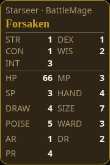

# Opened Review — all 16 character stats

Captured **0.7.1.1520 / `ee6988101d`**, source `c749675356517618d102789f8ea79965cdefad4e`, 2026-10-15 (America/Anchorage), using Starseer / Battle Mage.

All 16 glance stats are visible inside the Character card; its 2:3 dimensions still match the equipment cards. Review loadout is open in each screenshot.

[CI build passed](https://github.com/cehinds/AshenSpire/actions/runs/38754284560/job/116488453653) · [Download backup](https://github.com/cehinds/AshenSpire/actions/runs/38754284560/artifacts/11982198573) · [Capture hashes and provenance](capture-record.json).

Standalone SHA-256: `3f7ba1098cfc6bdc986a64c607c8660633f0015e185b504d425cec10142b229a`. Public delivery verification for this new revision is pending. The prior `a12edfdd78` revision passed public verification in run `38723725136`, job `116395824345`.

## 1440 × 900

## 1024 × 768

## 390 × 844

## 1920 × 1080

