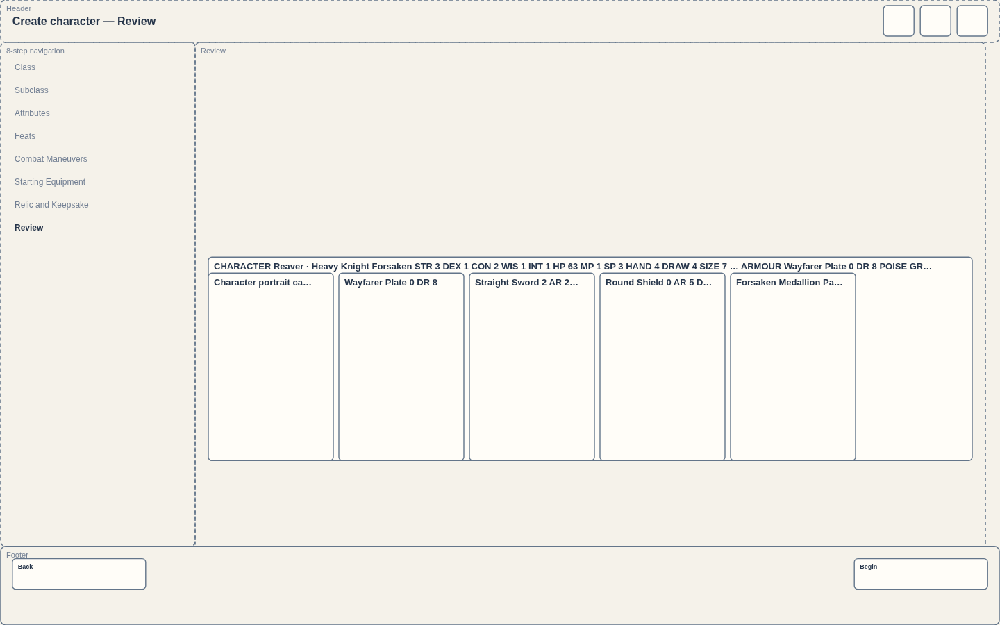
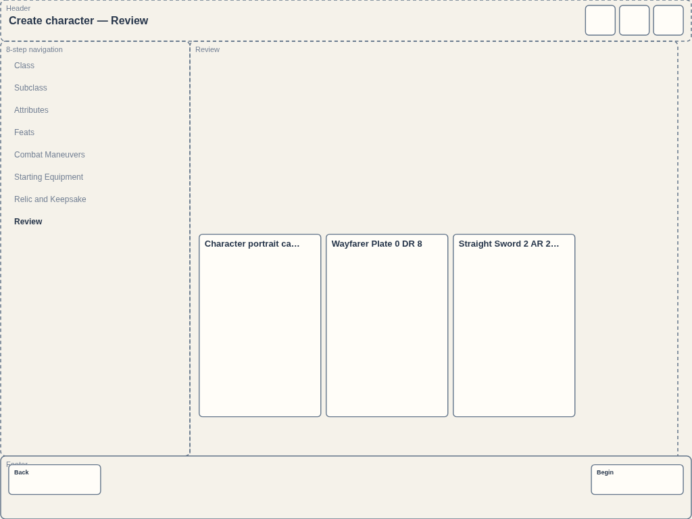
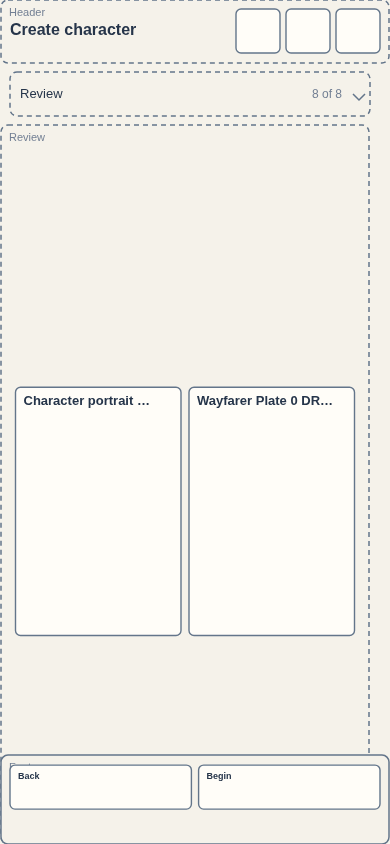
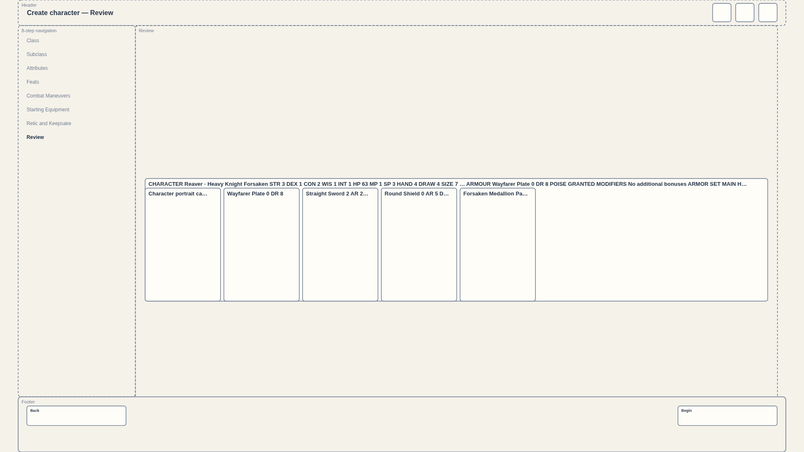

# Opened Review — character stat and equipment cards

Captured **0.7.1.1520 / `a12edfdd78`**, source `6d88c4d641fbd870beb5a8c25f6390636c9a2bbd`, 2026-10-14 (America/Anchorage).

Standalone SHA-256: `50da976c929e0dc4af4c983f90babd7b6db6c0a20fa0363ea6584de3d744321b`. [Capture record](capture-record.json).

The character stat card uses the equipment-card dimensions in the opened Review loadout. Review loadout is open in each screenshot. [CI build passed](https://github.com/cehinds/AshenSpire/actions/runs/38696812396/job/116295197508); [download backup](https://github.com/cehinds/AshenSpire/actions/runs/38696812396/artifacts/11954500967). Public delivery of this revision is pending; the existing hosted route was verified for the earlier `652574f013` revision.

## 1440 × 900

## 1024 × 768

## 390 × 844

## 1920 × 1080

