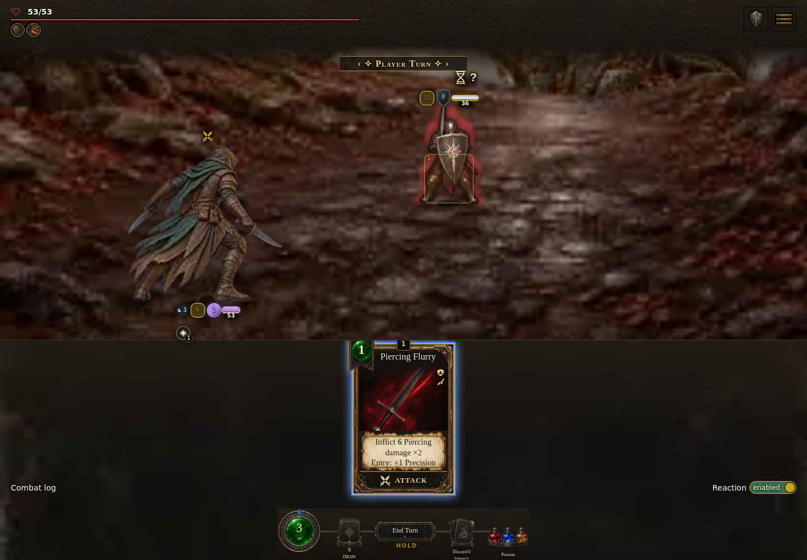
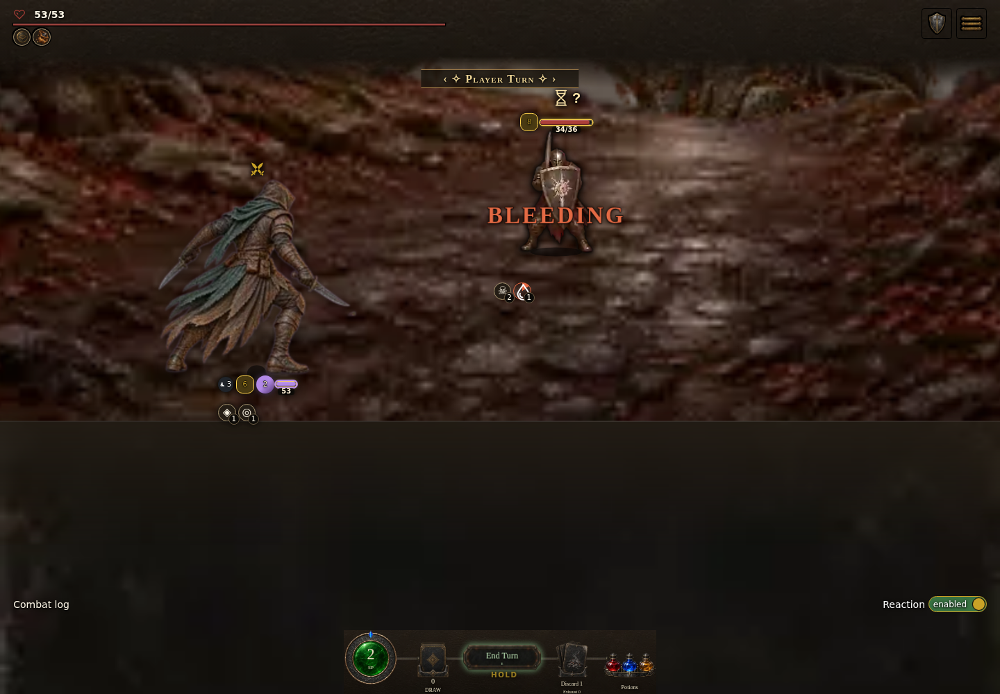
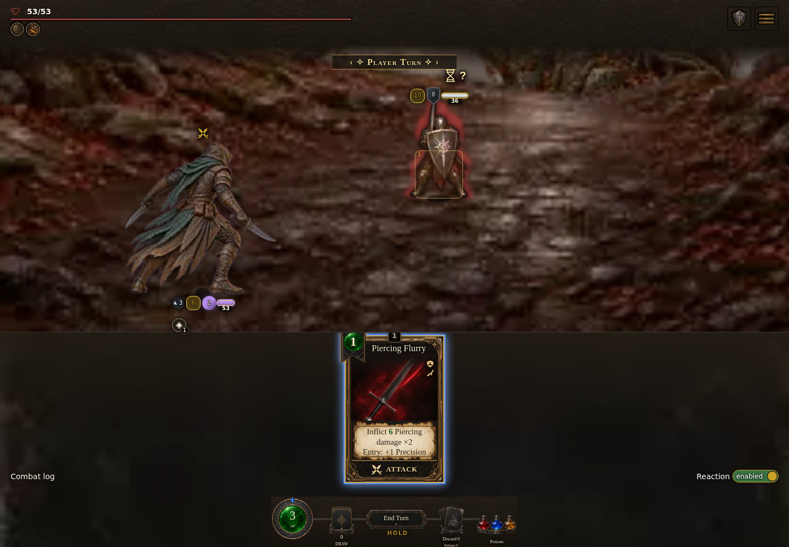
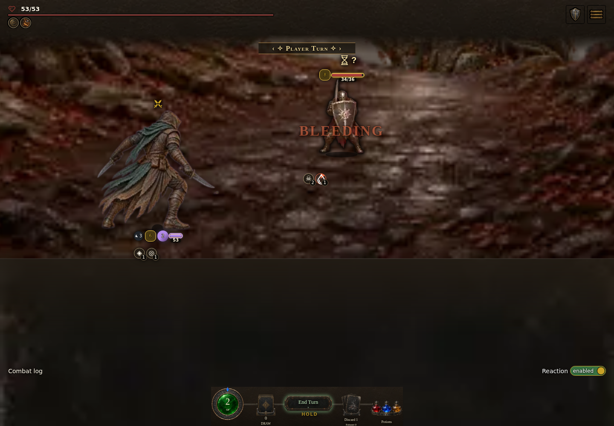
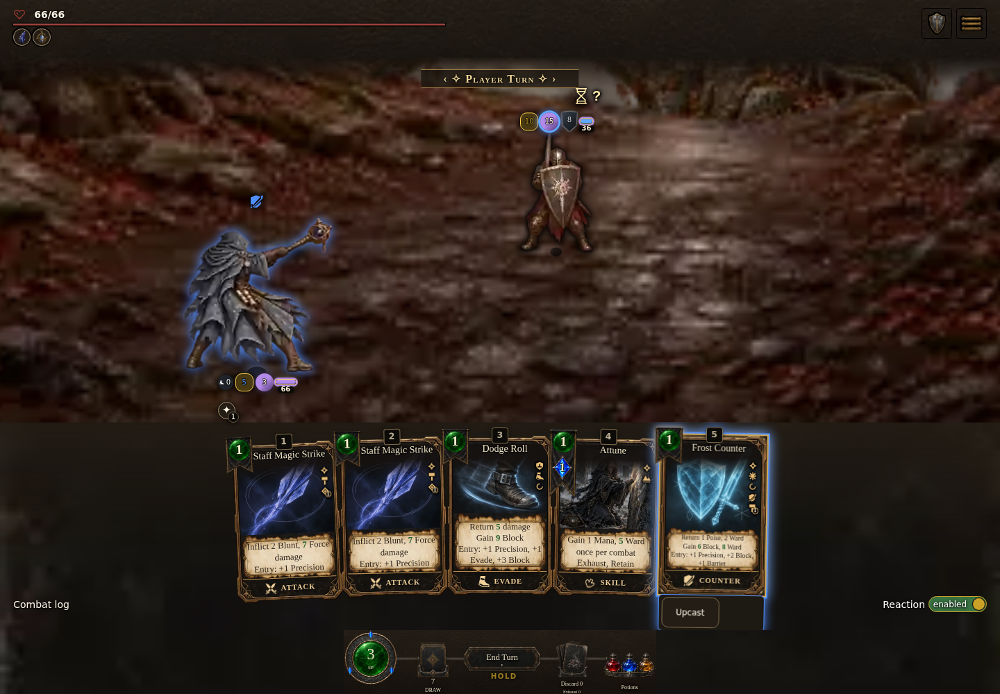
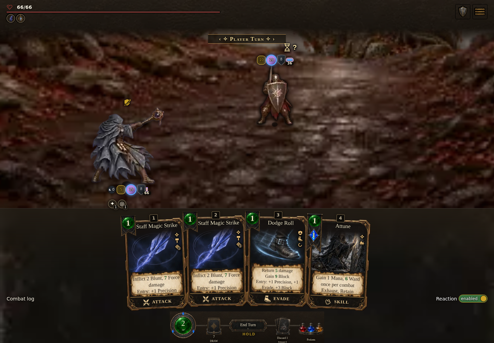

# Final focused compiled proof — 1538 / 5bec9d014c

Three focused actual-input cases passed on the existing Counter-fixed build. This proof is separate from 1537 and the earlier 1538/source 1548b38085 Rogue proof; none is relabeled.

## Immutable identity

- Gameplay commit: `5be5ec5e219ea10bb99acd08d1c5bbb1c930f4e1`; version 0.7.1.1538, source `5bec9d014c`, light standalone.
- Existing build: [run 38720084161](https://github.com/cehinds/AshenSpire/actions/runs/38720084161), [artifact 11964178167](https://github.com/cehinds/AshenSpire/actions/runs/38720084161/artifacts/11964178167). ZIP 50,376,524 bytes, SHA-256 `6b332f6a479f1170b9ccbb1437fd4e7428c3f5796a40efb9f64b8c3a3d7bceea`.
- Extracted HTML 79,979,392 bytes, SHA-256 `c42a61470fb7ecd292d36deb6756135e6c06b5d181916aeb5204d22997333dfc`. All three actual browser navigation bodies matched it; the file remained unchanged. No rebuild or product source edit.
- Capture: [run 38720640518](https://github.com/cehinds/AshenSpire/actions/runs/38720640518), [artifact 11964822196](https://github.com/cehinds/AshenSpire/actions/runs/38720640518/artifacts/11964822196), helper/workflow commit `c66d97fb4335c958f4548cb90cd5ca594ce90ec6` on `worker/FullCombatAudit/final-compiled-parity`.
- Capture ZIP 6,226,409 bytes, SHA-256 `d0b7338ca26474d42b087727a752a933dadad5da52f5503ac12d07ef5912db3f`; raw manifest SHA-256 `c8ff82cf6edf230c5044cc308240224c2d0646366ecdec71be21260d45e885fa`.
- Chromium 155.0.8059.39, 1440×1000, device scale 1. Captured 2026-10-15T10:29:49.027Z–10:30:38.619Z.

The worker checks fixed archive ID/run/head/SHA/length, then source/ordinal/edition/HTML length. Each loaded document body is obtained from its exact matching request ID in the same buffered CDP session (512 MiB resource/1 GiB total, durable messages), with base64 handling and bounded cleanup. This is executed compiled HTML, not a source reconstruction.

## Two Rogue rows

Neutral and data-only prior Defend mirror the reviewed canonical guard fixture. Native dagger Strike has profile `daggerPierceAttack`, rating 2, damage 3/hits 2; one instance is placed in hand, other piles emptied, host deck mirrors the instance. Seed B/11; player HP 53, stamina 3, mana 1. Enemy HP 36/Block 8/Poise 10/Barrier 0/Ward 0 and Defend. Accuracy is chosen through the original seeded RNG's saved counters, without replacing RNG functions.

Real card selection, pointer hover and unobstructed enemy-figure click are used. The selected face is **“Inflict 6 Piercing damage ×2” before defenses**, from base 3 plus accepted source Attack 3. It is not a post-defense total 2 display. Each paid play produces two contacts with incoming 6, blocked 4, Poise absorbed 1 and HP loss 1: enemy 36→34, stamina 3→2. One matching cardPlayed and one Precision application occur. Native/production-loader tests cover internal mitigated-preview values; this browser evidence verifies the offensive face and actual guarded paid result separately.

## Canonical Starseer Frost Counter preparation

The legal registered colorless `frostCounter` is appended to hand and host deck without profile/mods. Ordinary seed B/11 pools remain HP 66, stamina 3, mana 3; neutral prior stance, DR 2/PR 4/Ward 3, full Ward 3/3, Block 0/Barrier 0, configured v2/reaction2. Enemy state is untouched. This is a labeled registered-card fixture, not earned campaign progress.

Actual card selection projects **6 Block +8 Ward**. A real player-action click accepts the card. Authored support events grant 6 Block and credit 8 Ward; because Ward is full, the 8 support becomes Barrier. Separate stance-entry events grant 2 Block +1 Barrier and raise full Ward 3/3→6/6. Final pools are Block 8, Barrier 9, Ward 6/6, stamina 2, mana 3, HP 66. The screenshot's combined Ward/Barrier badge 15 is 6 Ward +9 Barrier. Exactly one Counter arm and one Counterstrike event at 0.5 occur. Enemy HP is unchanged and no damage event occurs. This proves preparation/support parity only; it does not test retaliation against an incoming action.

## Verification and limits

All three UI previews preserve the live player/enemies/piles/queue, event log and RNG counters. Each real accepted play records one matching cardPlayed; runtime function references and RNG object are preserved; queues finish idle with no pending reaction. All six full UI PNGs were visually inspected and match their recorded hashes. Default class artwork remains rendered. This is a three-case desktop check, not an all-card, touch, reaction or animation matrix.

Runtime page exceptions: 0. Diagnostics retain 18 HTTP 404 audio requests (three music manifests, 15 SFX) and 89 console entries (68 AudioContext autoplay, 3 blocked-vibrate, 18 failed-resource). These diagnostics do not gate the focused assertions. Audio playback/synthesis is not verified, and this is not zero-console/network proof.

The raw `manifest.json` remains in the capture artifact. [evidence-summary.json](evidence-summary.json) preserves the small curated field projection with its raw-manifest hash and artifact link. Prior failed transport and incorrect mitigated-face expectation runs remain recorded with the earlier source 1548b38085 proof; they were harness failures, not runs against this final source.

## Permanent screenshots

| Fixture | Selected preview | Accepted paid result |
| --- | --- | --- |
| Rogue, neutral |  |  |
| Rogue, prior Defend data fixture |  |  |
| Starseer Frost Counter |  |  |

| PNG | SHA-256 |
| --- | --- |
| counter/paid.png | `e5177695b5762f43d85d373b3588117ab852bc477f7d2bf5553e2784c6167f2f` |
| counter/selected.png | `4243ec068d080ab03f51362fff510105f47e1cc00dd8f39bc959c5609336d300` |
| defend/paid.png | `cb3efe916fa41bf9f1447c02a17e31434ddf1c5b6aa3644afe39d0fb82a847f4` |
| defend/selected.png | `370de2257a24fffd89c7d235b44f5d746c5517fe3f58663ad546f18ea48c0517` |
| neutral/paid.png | `608f89eed3203b91960953c1f6a289c4e1142e8bd560376a192d6c53fa674708` |
| neutral/selected.png | `497f7757017994a27b61d2467a76e8ce617c713ea7dca23e2a99d1f57f05de5f` |
