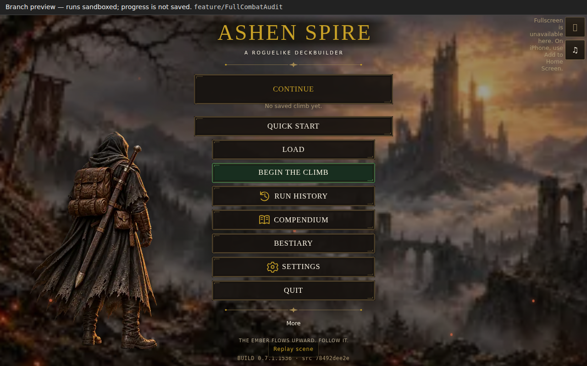
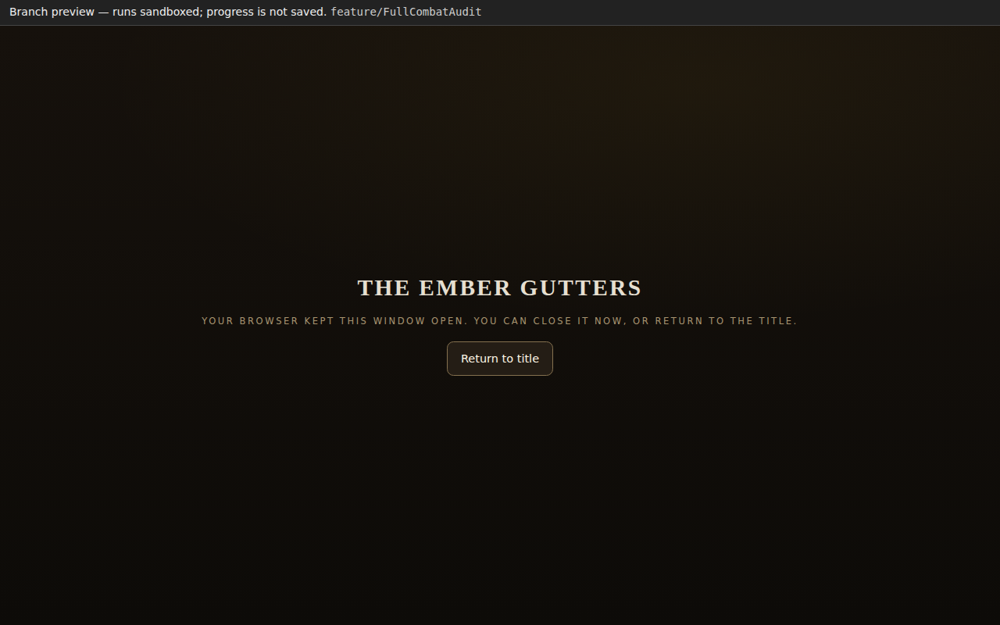

# Actual public hosted preview captures

[Play route](https://cehinds.github.io/AshenSpire/branches/feature/FullCombatAudit/latest/) · [Successful frozen replay](https://github.com/cehinds/AshenSpire/actions/runs/38705237731) · [Full proof artifact](https://github.com/cehinds/AshenSpire/actions/runs/38705237731/artifacts/11958675887)

These unedited screenshots were captured from the real public wrapper and its opaque game iframe at **1280 × 800**, with ordinary pointer clicks and no injected fixtures, on **2026-10-15 08:23:41–08:26:20 UTC**.

| Identity | Value |
| --- | --- |
| Production commit | `eccdfe210380b12b7b9ec380f83b59bada881690` |
| Build / source | **0.7.1.1536 / 78492dee2e** |
| Actual loaded HTML SHA-256 | `71036042f98bcf220a60146c3916666b3cce1388b30394ab6716394b38eb8b87` |
| Wrapper SHA-256 | `e24dd5b8908a4a1b46fa269f0e8cd017ba53fba7004f20b05fc00843245933ef` |
| Verification workflow commit | `6c9e283454f26986a8c4e974195f1297a42e6807` |
| Run / artifact | **38705237731 / 11958675887** |

The same buffered CDP session observed the wrapper's actual build request, waited for completion, and read those bytes for the SHA check. The executed title stamp matched the source and full version. Quit was last, paused co-op was hidden, a blocked window close displayed the fallback, and Return to title worked. All six checks passed with zero runtime page errors. This is title-menu delivery proof, not an additional combat matrix.

| Public menu | Browser-blocked Quit |
| --- | --- |
|  |  |

- Menu PNG SHA-256: `317c3832f91c72e4670061e93810903727bdf98d1f81d9d95e2ba8fe97771040`.
- Quit PNG SHA-256: `591d748da011e790b5ae9ddb3b50279443116b86e262521e57de501e38d4a503`.

The return-to-title screenshot stays in the artifact; it includes an ordinary Quick start hover tooltip. The [four original viewport images](../VIEWPORT-CAPTURES.md) retain build **1530 / 368140ce27**.

The earlier [normal eccd run](https://github.com/cehinds/AshenSpire/actions/runs/38699427242) failed on response-body cache eviction with 128 MiB resource / 256 MiB total buffers; [diagnostic artifact 11958190075](https://github.com/cehinds/AshenSpire/actions/runs/38699427242/artifacts/11958190075) is not a successful proof. The later frozen replay used bounded **256 MiB resource / 512 MiB total** buffers. The tooling-only parent correction `d2d02a91fdf59dcd2012aa38a9e86be18e03ac44` starts a fresh normal build/publication/proof. That normal pipeline is pending; the frozen replay is not a claim that it passed.
