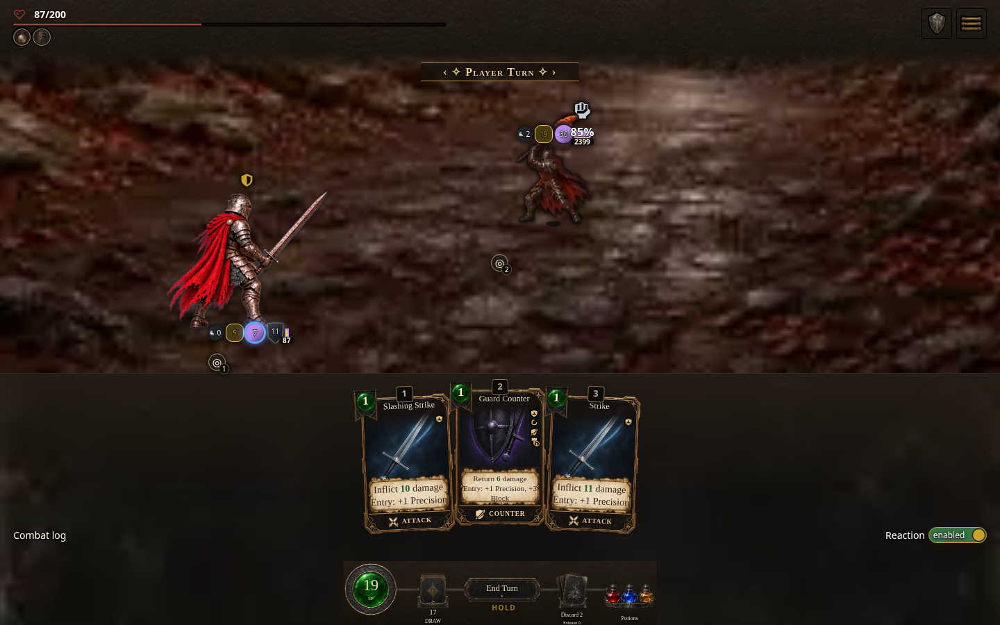
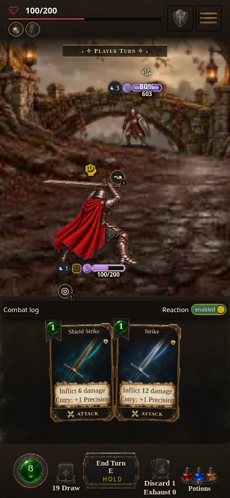

# Resumed compiled combat regression — 2026-10-15 UTC

The fresh bounded check passes **18/18 distinct compiled mouse/touch cases**, with zero runtime errors and zero unexpected resource failures. This evidence is separate from the historical 360-row report at source `368140ce27`; those older rows and screenshots retain their original identity.

## Artifact and input identity

- Build source commit: `7315352ee2d9d058d562548b4faa43f27a1166d7`.
- Official local build: `0.7.1.1534`, source digest `84651451fe`, **light** edition, `hd-assets-v23` light/common cache, standalone-file entrypoint. The committed parent ordinal remains unchanged; this build's stamp is a local artifact identity.
- Packed compiled HTML: 15,174,160 bytes; SHA-256 `f7b5990a8defe62e3e5a6eaafba30e0cbe7f81bdc65528fa2177cb884418259f`.
- Frozen snapshot: `/workspace/scratch/full-combat-audit/resume-source-84651451fe`; original server `http://127.0.0.1:4415/AshenSpire.html`. This is a local reproduction address, not a public preview claim.
- Each report checks all **794 JavaScript modules** against that immutable source snapshot and verifies the compiled source, ordinal, edition, run path and byte hash.
- Desktop: 1440×900 with real mouse clicks. Phone: 390×844 with touch enabled and real taps; viewport emulation, not a physical device.
- Reproduction harness: [worker commit 80b93fac5](https://github.com/cehinds/AshenSpire/commit/80b93fac5), including [97821610b](https://github.com/cehinds/AshenSpire/commit/97821610b). The tool changes remain on `worker/FullCombatAudit/resume-browser`; the parent receives documentation and screenshots only.

## Cases and measured outcomes

| Case | Mouse | Touch | Observed effect |
| --- | --- | --- | --- |
| Star Spark → canonical Gilded Knight, base/upgraded/upcast 1/2/3 | 5 passed | 5 passed | Real enemy-figure input pays once, deals positive spell HP damage, completes the enemy turn and pays for next-turn Defend. Compiled events, resources and state match the immutable source oracle. |
| Prepared canonical Gilded Knight Counter, fallback configured to 7 | 1 passed | 1 passed | Real paid Attack triggers the prepared return. Its base Poise payload is 7; the matchup produces **11 total player Poise** (`ceil(7×1.5)`). Player HP falls 100→90 across the return and real Gilded Guard reaction. |
| Canonical Fell Warden Held Blade resolution, fallback configured to 7 | 1 passed | 1 passed | Player HP falls 100→87. Listed fallback pressure is exactly 7; ordinary hit pressure adds 1, producing **8 total player Poise** before the next paid card. |
| Retained Evade outside Evade stance, Smash misses | 1 passed | 1 passed | Seeded actual d20=1 produces one `attackMissed` with `evadeAttempted=true`. Enemy HP stays 640; Poise stays 0. |
| Retained Evade outside Evade stance, Smash hits | 1 passed | 1 passed | Actual d20=20 produces one `attackHit`, labeled `Hit — Evade Failed`. Incoming HP damage is `ceil(19×1.5)=29` before the enemy's Blunt weakness; final HP falls 640→603. Authored listed Poise 7 becomes 11; ordinary/Blunt/Impact/relic contributions produce 29 total Poise. |

All eight stance cases run at normal animation pace. After playback settles, the player's visible `Evade N` badge equals canonical `effectiveEvasion` for the actor. This is a settled HUD assertion, not proof of every intermediate animation beat. The harness verifies the original compiled runtime functions are preserved, input remains available, pending state clears and complete resulting state matches the immutable source engine. Additional read-only checks on the raw reports verify the exact Counter and Held Blade pressure amounts and the failed-Evade ×1.5 HP/listed-Poise calculations independently of aggregate receipt sums.

These are isolated fixtures with enlarged HP/resource pools and enemy HP, not earned campaign encounters. The Counter preparation is fixture setup through the canonical source helper before measured input; the actual triggering Attack, payment, reaction and resulting damage are compiled UI behavior. Held Blade's `pendingMove` is **fixture-seeded** as already charging; subsequent end-turn input, canonical delayed resolution and next paid card are real compiled game behavior. This does not claim that its telegraph was prepared through normal UI play. Retained Evade and the target's Sweep stance are data fixtures; hit/miss outcomes use searched serialized RNG counters without replacing RNG functions. Fallback 7 is an explicit configuration fixture; the shipped default remains 3.

Canonical authored charging stages are support-only. Damaging charging-stage hit/miss grouping, intermediate paced-HUD snapshot behavior and configured Bestiary readouts remain covered by the separately recorded **107 native/production-loader tests**, not by these 18 compiled browser cases. Co-op remains outside this resumed browser run. Default class weapon art policy is unchanged.

## Fresh representative captures



The desktop image shows player HP 87/200 after fixture-seeded Held Blade resolves and the next-turn Defend pays. Pressure totals above come from measured state, not an inferred screenshot number.



The touch image shows the canonical target at 603 HP after the real paid Smash. The retained Evade attempt fails; the player's class-default artwork remains in use.

## Raw proof and diagnostic history

Raw proof is scratch evidence, not committed bulk JSON or an assertion that it was uploaded:

| Report | SHA-256 | Result |
| --- | --- | --- |
| `/workspace/scratch/full-combat-audit/resume-browser/star-spark/report-cards-both-starseer-all.json` | `67a282fb454eee598c7d744bdb5a659614380f3a4588b2b1ed62b68cacb28849` | 10/10 passed |
| `/workspace/scratch/full-combat-audit/resume-browser/stances-verified/report-resume-stances-both-reaver-all.json` | `b4513bf2d42cb15b8cde3a5c25756caac149c3357d6137d9de3867fbee45d0f4` | 8/8 passed |

`/workspace/scratch/full-combat-audit/resume-browser/verified-summary.json` records the read-only exact-value assertion result. Browser logs are `/workspace/scratch/full-combat-audit/resume-star-spark-browser.log` and `/workspace/scratch/full-combat-audit/resume-stances-verified-browser.log`. The two reports record 16 and 22 optional cue HTTP404 responses respectively, each classified only after observed audio synthesis; no unexpected resource failure is excluded.

The initial six-row stance diagnostic passed at `/workspace/scratch/full-combat-audit/resume-browser/stances/`. The following eight-row attempt at `/workspace/scratch/full-combat-audit/resume-browser/stances-final/` failed only a harness label assertion: it expected `Evasion N`, while the authored badge is `Evade N`. Its effects already matched, and the failed report is preserved. Worker `80b93fac5` corrects that assertion; the separate `stances-verified` report above is the authoritative clean rerun. Diagnostic attempts are not additional coverage cases.

The harness unit checks pass 8/8. Another agent independently reviewed worker `97821610b` and `80b93fac5` and found no blocking semantic issue; the report explicitly identifies fixture-seeded delayed state. All owned browser processes closed after their runs.

## Reproduction

Use the preserved original server tool and matching cache from the frozen snapshot; a plain file server omits required source transforms. Set:

```sh
export QA_REFERENCE_SOURCE=/workspace/scratch/full-combat-audit/resume-source-84651451fe/src
export QA_BUILD_URL=http://127.0.0.1:4415/AshenSpire.html
export QA_SOURCE_URL=http://127.0.0.1:4415/src/
export QA_EXPECT_SOURCE=84651451fe
export QA_EXPECT_ORDINAL=1534
export QA_EXPECT_HTML_SHA256=f7b5990a8defe62e3e5a6eaafba30e0cbe7f81bdc65528fa2177cb884418259f
export QA_EXPECT_EDITION=light
export QA_EXPECT_RUN_PATH='standalone file'
export QA_EXPECT_VERSION=0.7.1.1534
```

At the linked worker harness commit, run each separately with a fresh scratch output path:

```sh
QA_OUTPUT=/workspace/scratch/full-combat-audit/reproduce-star-spark node tools/combat-audit/browser-combat.mjs --mode=cards --class=starseer --card=starSpark --enemy=gildedKnight --category=spell-target-regression --end-turn=true --figure-target=true --pace=fast
QA_OUTPUT=/workspace/scratch/full-combat-audit/reproduce-stances node tools/combat-audit/browser-combat.mjs --mode=resume-stances --class=reaver --pace=normal
```
