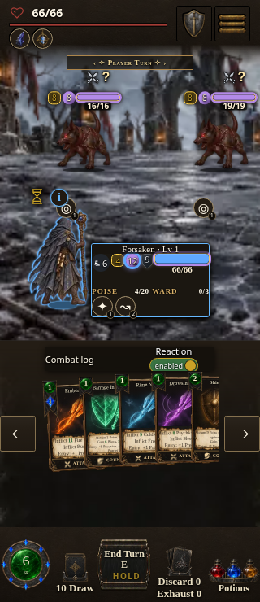
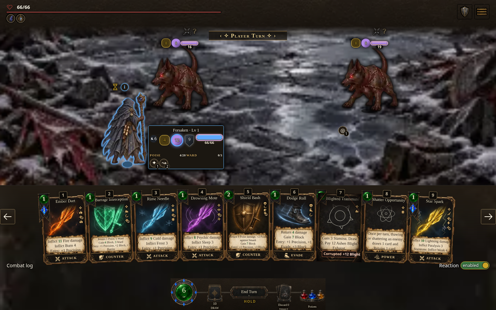

# Fresh compiled HUD spacing follow-up — 2026-10-15 UTC

The build containing upstream PR2010's selected-player HUD CSS passes **13/13 focused browser cases**: ten Star Spark targeting/recovery cases and three selected-panel geometry/input cases. The earlier 18-case source `84651451fe` report remains separate and unchanged in [the resumed record](README.md).

## Exact compiled artifact

- Source commit `eccdfe210380b12b7b9ec380f83b59bada881690`.
- Official local light build **0.7.1.1536**, source digest **78492dee2e**, `hd-assets-v23` light/common art.
- Packed HTML: **15,175,519 bytes**; SHA-256 `44902694c6843737ceba804c88ce40eb6a80c194d44aeaa8089763e11a08ef19`.
- Frozen snapshot `/workspace/scratch/full-combat-audit/resume-source-78492dee2e`; original server `http://127.0.0.1:4416/AshenSpire.html`. This is a local reproduction URL, not a public preview claim.
- The compiled source, ordinal and HTML byte hash are checked before input. The spell report additionally checks edition, run path, full version and all 794 JavaScript modules against that immutable source. The HUD report verifies the compiled CSS includes the new `--hp-value-line` reservation and that its selected-panel padding takes effect.
- The committed parent's ordinal remains unchanged. No browser result or older screenshot was relabeled as this artifact.

## Focused outcomes

| Check | Coverage | Result |
| --- | --- | --- |
| Star Spark → Gilded Knight | Base, upgraded and upcast 1/2/3, each on mouse and touch | **10/10 passed**. Real enemy-figure input pays once and damages the selected canonical enemy; enemy turn completes and next-turn Defend pays. Full events/state/resources match immutable source. Zero runtime errors or unexpected resource failures; 16 optional cue HTTP404 responses have observed synthesis classifications. |
| Selected-player panel | 320×740 touch, 390×844 touch, 1440×900 mouse | **3/3 passed**. Actual player-sprite input opens the panel. HP clears visible Poise/Ward text, fits the panel, and the panel fits the viewport. Labels, defense order and Barrier-on-Ward are retained. Actual subsequent card/figure input pays for one Star Spark, with no pending reaction or queued action left. Zero captured page runtime exceptions. |

The same upstream `tools/player-hud-clearance-qa.mjs` geometry rules are applied to the compiled artifact, with the official browser launcher. The measured vertical clearance from HP's bottom to the nearest resource text is **16.25 px** at 320 and 390 widths, and **27.47 px** at desktop. The selected panels are respectively 146, 176 and 220 px wide and fully inside their viewports. The pointer/touch check finds a visible point on the actual enemy figure after opening the selected-player panel, then uses real input to commit the paid spell. It does not force an input through an overlay.

These are screenshot-route data fixtures: deterministic protection values and an existing canonical Star Spark instance moved from the draw/discard pile into hand if needed. They are not earned campaign states. Game functions/listeners are not replaced. The geometry check records page exceptions and waits for decoded visible images; it does not claim an independent complete console/network audit. No pressure-case rerun, full matrix, co-op, or exhaustive viewport cross-product is claimed for this CSS follow-up. The previous pressure cases retain their `84651451fe` identity.

## Fresh inspected captures





The 390 px image was also inspected and remains in the raw scratch output. These are viewport emulations, device scale 1. Default class artwork is retained.

## Raw proof and reproduction

| Raw report | SHA-256 | Result |
| --- | --- | --- |
| `/workspace/scratch/full-combat-audit/resume-css-browser/star-spark/report-cards-both-starseer-all.json` | `ef2dd6412530f7dce810f941fc4778c4cb644282165e727760f7f2ac148a5dd0` | 10/10 passed |
| `/workspace/scratch/full-combat-audit/resume-css-browser/hud-verified/report.json` | `ab912d5090407dccfff95ad294d711ac3be217c5f6b0f1239a17ecc1b0286ff7` | 3/3 passed |

Raw logs are `/workspace/scratch/full-combat-audit/resume-css-star-spark-browser.log` and `/workspace/scratch/full-combat-audit/resume-css-hud-verified-browser.log`. Raw JSON remains outside the repository. An initial 320 px attempt passed geometry but stopped because the fixture assumed Star Spark was already in hand; its report is preserved at `/workspace/scratch/full-combat-audit/resume-css-browser/hud/report.json`. Worker `cc3f63e90` corrects the fixture by moving the existing canonical instance into hand and explicitly discloses that setup. The authoritative clean rerun is the separate `hud-verified` report above; the initial diagnostic is not additional coverage. Another agent reviewed the helper and correction without a blocking finding. All owned browser processes closed after the checks.

Reproduction uses [worker harness `cc3f63e90`](https://github.com/cehinds/AshenSpire/commit/cc3f63e90) on `worker/FullCombatAudit/resume-browser`; tool changes are preserved there and not integrated into the parent. Set the previous record's `QA_*` variables to this frozen source directory, URL, source `78492dee2e`, ordinal `1536`, version `0.7.1.1536` and HTML hash above. Then run separately with fresh scratch output paths:

```sh
QA_OUTPUT=/workspace/scratch/full-combat-audit/reproduce-css-spell node tools/combat-audit/browser-combat.mjs --mode=cards --class=starseer --card=starSpark --enemy=gildedKnight --category=spell-target-regression --end-turn=true --figure-target=true --pace=fast
QA_OUTPUT=/workspace/scratch/full-combat-audit/reproduce-css-hud node tools/combat-audit/compiled-hud-clearance.mjs
```
