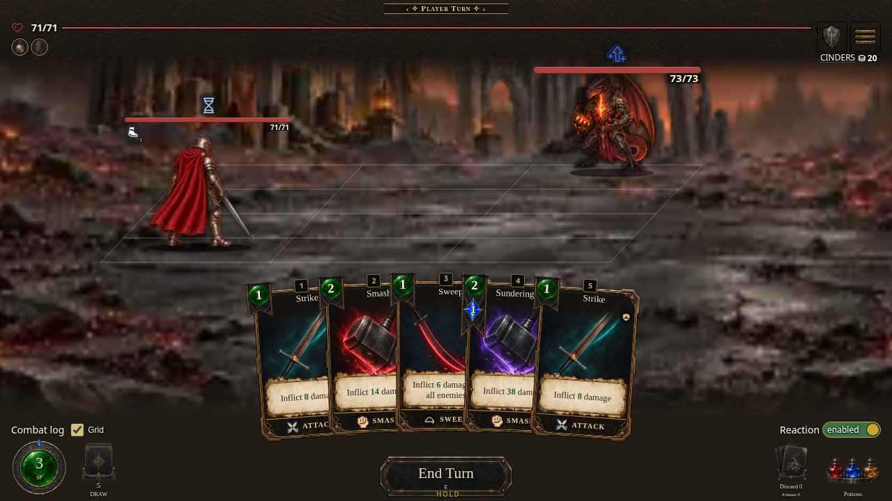
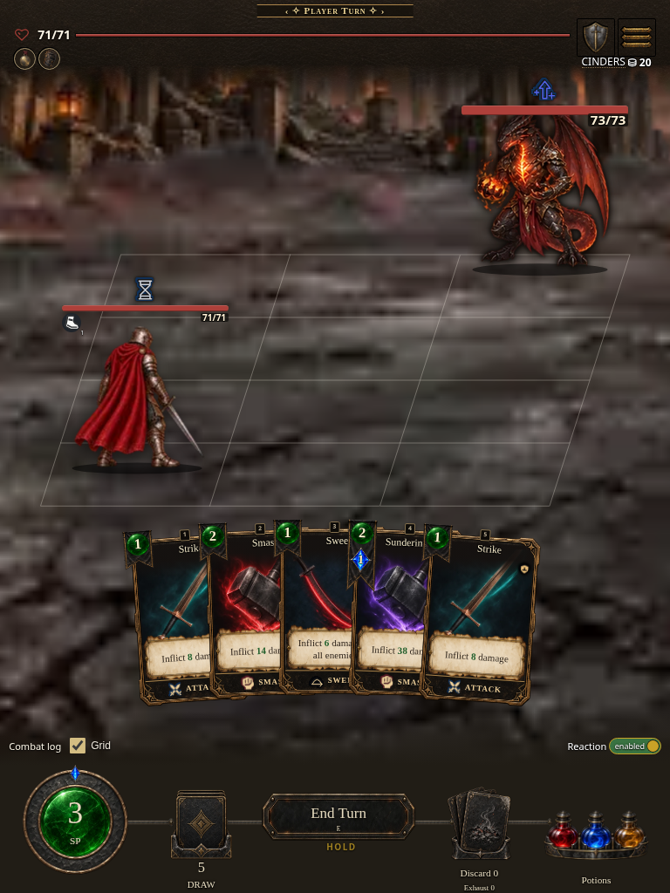
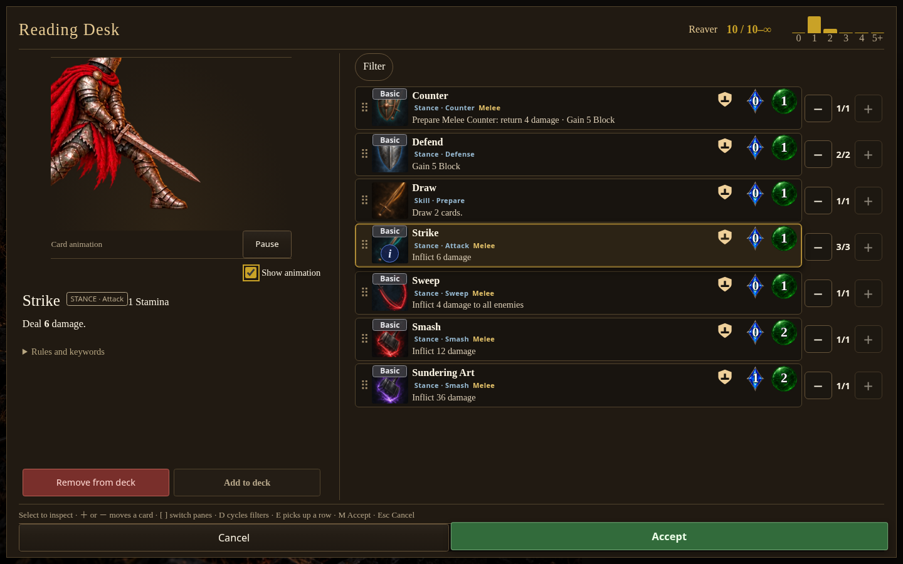
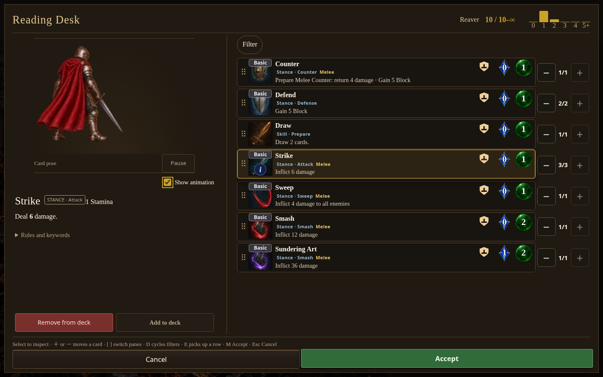

# Animation module browser preview

Captured 2026-10-17 from the local source server (`index.html`), source commit `a7e4d21abff5cdc817d79cbfc6f5f305570934fe`. With the module disabled, authored figure clips and pose-based hit reactions stop while figures stay at their static pose. Damage-triggered CSS hit flashes and recoil, plus heavy-hit screen shake, remain active; combat geometry and outcomes remain intact.

The matching standalone CI artifact is build **0.7.1.1550**, ordinal **1550** (artifact `12111476110`, archive SHA-256 `78313b852a1ec7ae823b2930e94fee4d9502b879e8126c30c200084886588174`). Its runtime source is `a7e4d21abff5cdc817d79cbfc6f5f305570934fe`; source digest `1779e6f1ff` is the value reported by the hosted build metadata. See workflow run [39060894016](https://github.com/cehinds/AshenSpire/actions/runs/39060894016). The public [Stance Animation Module preview](https://cehinds.github.io/AshenSpire/branches/feature/StanceAnimationModule/latest/) was verified on 2026-10-17 by read-only workflow [39063856405](https://github.com/cehinds/AshenSpire/actions/runs/39063856405): normal and cache-busted index checks matched the runtime source, and `build.txt` returned HTTP 200 as `text/plain` with source digest `1779e6f1ff`, ordinal 1550, and release `0.7.1`. This proves published route identity, not hosted browser execution; the 14 browser scenes above were captured locally from the source server.

The later consolidated compatibility follow-up includes a four-viewport co-op HUD gallery and the verified 0.7.1.1554 artifact identity; its local screenshot provenance and pending public-route check are documented in [browser-followup/CAPTURE.md](browser-followup/CAPTURE.md).

Browser evidence covered 14 scenes: eight Core cases across four viewports with animation enabled and disabled, four Current cases across normal and Classic profiles with both settings, and two Reading Desk playback cases. The recorded evidence has zero page errors, art failures, and disabled-state body transitions. Core geometry and outcomes matched across setting states. Current checks included a range miss, one resource payment, three optional reaction passes and turn progression. Reading Desk autoplay played when enabled and remained static when disabled. This does not establish behavior for every class or card, or every hardware configuration.

The settings shape used for the override is:

```json
{
  "formatVersion": 1,
  "core": "ashen.core@1.0.0",
  "modules": { "animation": { "enabled": false } }
}
```

| Phone · 390 × 844 | Desktop · 1440 × 900 | Wide · 1280 × 720 | Tablet · 768 × 1024 |
| --- | --- | --- | --- |
|  |  |  |  |

| Reading Desk · enabled | Reading Desk · disabled |
| --- | --- |
|  |  |

The compact evidence digest is in [evidence-summary.json](evidence-summary.json). It records the SHA-256 of the full browser evidence file retained with the capture output; raw QA output is not copied into this gallery.
