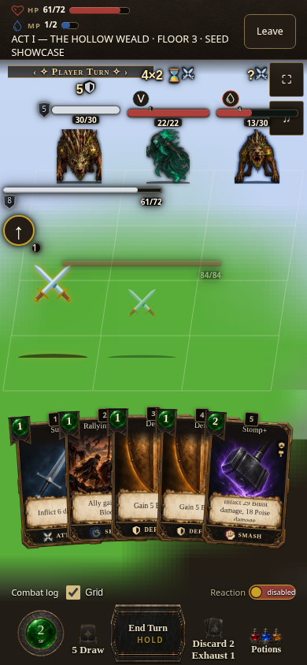
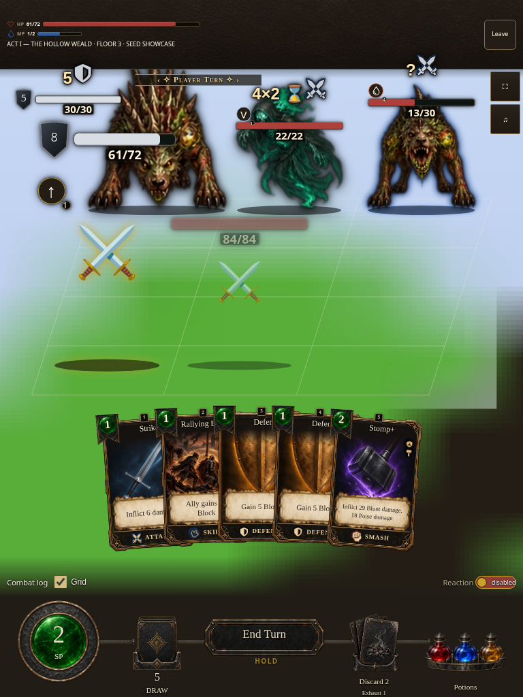

# Co-op HUD browser follow-up

Captured 2026-10-17 UTC from the production `mountCoop` renderer through the
explicit source `?shot=coop&shotSettings={"manaRing":false}` screenshot fixture.
The transport and host snapshot are canned. These captures do not demonstrate
a live co-op connection. The canned seats have no player appearance; their
crossed-swords placeholders and the fixture backdrop are expected.

Source base: `61b1eeaa8885342a734fd3e28bc55d741b99a1ef` (Dev).
Inherited build identity: `0.7.1.1551`, digest `fb5dff3704`.
This is local source-preview evidence of the CSS correction as captured, not a
newly published build. Captured fixed `styles/combat.css` SHA-256:
`4c2540e842cbbf4dab3db16806c5f70d89d30b3bc12dfbd38f462fb215521a3d`.
These screenshots are local source-preview evidence from this capture base and working CSS; they are not captures from the final consolidated runtime artifact or the public feature route. The consolidated feature preview records runtime source and artifact identity separately from these original local captures.

Both baseline and fixed captures await `document.fonts.ready` and all image
`decode()` promises; the capture records report fonts loaded and zero failed
image elements. Art uses the pinned `hd-assets-v23` cache and source display
copies. No capture-only layout CSS is applied. Baseline comparison swaps in
the exact base commit's combat stylesheet; fixed views use the working source.

- Phone: `after-390x844-bars.png` (390 × 844).
- Desktop: `after-1440x900-bars.png` (1440 × 900).
- Wide: `after-1280x720-bars.png` (1280 × 720).
- Tablet: `after-768x1024-bars.png` (768 × 1024).
- Baseline/fixed comparison: `before-390x844-bars.png`,
  `before-1280x800-bars.png`, `after-1280x800-bars.png`.

## Fixed co-op HUD at four viewports

These images show the local canned `mountCoop` screenshot fixture, not a live connection. The seats intentionally use placeholders because the snapshot has no player appearance.

| Phone · 390 × 844 | Desktop · 1440 × 900 | Wide · 1280 × 720 | Tablet · 768 × 1024 |
| --- | --- | --- | --- |
|  |  |  |  |

## Consolidated feature identity

Runtime source commit: `c9eecc45d8641ccfaa132777715b0ba4ef7c3aa1`. The matching standalone feature artifact is build **0.7.1.1554**, ordinal **1554**, release `0.7.1`, artifact `12115253921`, archive SHA-256 `3d6dd2ecdc8ff2f2b390e4286686f08b6138090f9973d7826fad3502ed7ab2a8`, source digest `cf58726889` (workflow run [39071922844](https://github.com/cehinds/AshenSpire/actions/runs/39071922844), build log job 117511131255). The uploaded artifact is [available here](https://github.com/cehinds/AshenSpire/actions/runs/39071922844/artifacts/12115253921). These screenshots remain local captures from source base `61b1eeaa8885342a734fd3e28bc55d741b99a1ef` plus the recorded CSS correction; they are not screenshots of the final artifact or public route. The stylesheet digest is unchanged and gameplay values remained equal across 49 files after compaction; updated provenance hashes were verified against file bytes, so these captures are retained with their original provenance. The public [Module Browser Compatibility preview](https://cehinds.github.io/AshenSpire/branches/fix/ModuleBrowserCompatibility/latest/) was verified read-only at 2026-10-17T22:05:47.145Z by [workflow 39073305472, attempt 2](https://github.com/cehinds/AshenSpire/actions/runs/39073305472/attempts/2) (job 117516200345). Normal and cache-busted index requests returned HTTP 200 and identified runtime source `c9eecc45d8641ccfaa132777715b0ba4ef7c3aa1`; both `build.txt` requests returned HTTP 200 as `text/plain`, digest `cf58726889`, ordinal 1554 and release `0.7.1`. The trusted checker also confirmed the wrapper, loader and payload HEAD request (80,777,943 characters). This proves publication and payload identity; it does not demonstrate hosted browser execution or a live co-op connection.

The existing Release 0.7.1.1517 root README gallery was separately verified unchanged by read-only workflow [38698554816, attempt 4](https://github.com/cehinds/AshenSpire/actions/runs/38698554816) at 2026-10-17T20:21:11Z (job 117494404258, source `d310c277fffaaec6ec7a58a87de846577f12312d`, digest `a5b5079cb1`). This check is independent of the feature publication proof.

Before the correction, phone Leave reaches y=101.77 beyond the 76px HUD band;
desktop resource bars start at y=-3.23 and Leave reaches y=82.27 beyond 80px.
Afterward, phone Leave ends at y=62.08 and its label at y=74.77; desktop
resource bars start at y=8.77 and Leave ends at y=61.52.

Validation: `node --test tests/coop-hud-top.test.mjs
 tests/ui-component-catalogs.test.mjs` passes 69/69. The unmodified full
`tools/coop-hud-top.mjs` browser probe passes GREEN 6/6, including ring on/off,
390×844, 844×390 and 1280×800, all subsidiary orb/seat/privacy/Counter/flask/vow
checks, and comparisons with the solo action bar. Screenshot evidence concerns
the topbar correction only.
